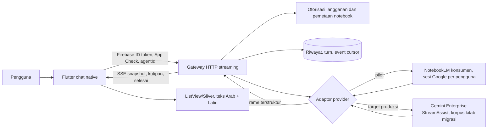

# Kajian arsitektur chat native OpenTurath AI

Tanggal: 24 September 2026  
Ruang lingkup: keputusan arsitektur dan kontrak data; belum mengubah aplikasi atau layanan produksi.

## Putusan

**Jika kitab harus tetap berada di NotebookLM konsumen, pendekatan paling masuk akal adalah Flutter native → gateway milik OpenTurath → adaptor NotebookLM tidak resmi, dengan penyimpanan riwayat milik OpenTurath.** Namun, ini hanya layak sebagai *pilot terbatas*, bukan janji layanan produksi yang tahan perubahan Google. `notebooklm-py` sendiri menyatakan protokolnya tidak terdokumentasi dan dapat berubah sewaktu-waktu. API publik Gemini Notebook Enterprise yang saya temukan mengelola notebook dan sumber, tetapi belum mendokumentasikan operasi chat dan riwayat NotebookLM untuk integrasi aplikasi. Catatan audit Google menyebut metode chat internal; keberadaan metode di log audit **bukan** kontrak API publik. [NotebookLM Enterprise API](https://docs.cloud.google.com/gemini/enterprise/notebooklm-enterprise/docs/api-notebooks), [audit log metode internal](https://docs.cloud.google.com/gemini/enterprise/notebooklm-enterprise/docs/set-up-usage-audit-logs-for-nblme), [pernyataan pengembang `notebooklm-py`](https://github.com/teng-lin/notebooklm-py).

**Jika “100% native, riwayat lengkap, streaming, dan SLA yang dapat dijanjikan” adalah syarat mutlak produksi, pindahkan korpus kitab ke layanan RAG dengan API chat resmi**, misalnya Gemini Enterprise `streamAssist`, setelah uji mutu jawaban Arab, kutipan, hak akses, harga, dan wilayah data. Ini **mengganti mesin jawab**, sehingga hasilnya tidak boleh diklaim identik dengan NotebookLM. `streamAssist` mendokumentasikan streaming dan sesi percakapan. Jangan memilih `streamAnswer` lama untuk kasus Arab/Indonesia tanpa verifikasi: dokumentasinya menyebut batas dukungan streaming hanya bahasa Inggris dan menyarankan `streamAssist`. [StreamAssist](https://docs.cloud.google.com/gemini/enterprise/docs/get-answers-from-streamassist), [referensi API](https://docs.cloud.google.com/gemini/enterprise/docs/reference/rest/v1/projects.locations.collections.engines.assistants/streamAssist), [batas streamAnswer lama](https://docs.cloud.google.com/gemini/enterprise/docs/stream-answer).

Keputusan produk yang diperlukan sebelum membangun: pilih **mempertahankan NotebookLM dengan risiko operasional** atau **memigrasikan mesin jawab ke API resmi**. Gateway dan kontrak UI di bawah dibuat netral terhadap pilihan itu.

## Bukti pada aplikasi saat ini

- `agent_multi_tab_room.dart` memakai `InAppWebView`, pemeriksaan kesiapan JavaScript, lalu menyalin riwayat dari `window.otGetConversationList`. Kegagalan baca ditelan; pesan riwayat diberi ID berdasarkan urutan dan timestamp sintetis `DateTime.now() - ...`. Ini bukan bukti waktu/ID asli dari server, dan riwayat dapat terhapus saat sinkronisasi ulang. Lihat `openturath_ai/lib/widgets/agent_multi_tab_room.dart:991`.
- `notebook_ui_script.dart` menyediakan `otGetConversationList` dari DOM, sehingga perubahan struktur halaman Google dapat merusak ekstraksi. Lihat `openturath_ai/lib/core/notebook_ui_script.dart:408`.
- `chatGate` yang ada adalah gerbang akses tampilan web, bukan API chat terstruktur. Lihat `openturath_ai/functions/src/index.ts:1691`.
- Integrasi `notebooklm-py` yang ada saat ini dipakai untuk berbagi/mencabut akses notebook. Ia memuat sesi Google dari penyimpanan lokal; belum merupakan layanan tanya-jawab multi-pengguna. Lihat `ecosystem/openturath_subscription/notebooklm_manager.py:1`.

## Perbandingan opsi

| Opsi | Implementasi | Stabilitas perubahan Google | Kecepatan tampilan jawaban | Riwayat dan pemisahan pengguna | Putusan |
|---|---|---|---|---|---|
| Gateway Python + `notebooklm-py`/RPC internal | Sedang; pustaka sudah ada, tetapi perlu adaptor, sesi per identitas, serta penanganan stream | Rendah; endpoint dan skema privat | Potensial cepat hanya jika parser meneruskan frame saat datang; API `ask()` publik saat ini menunggu jawaban selesai | Hanya percakapan terbaru yang dapat dicari langsung; riwayat lama belum terjamin; sesi harus per pengguna | **Pilot NotebookLM** |
| Mesin browser CDP/headless di server | Tinggi; browser, antrean, login, challenge, DOM, skalabilitas | Rendah; bergantung HTML, posisi elemen, dan timing | Tambahan overhead browser; hasil parsial rawan terpotong | Cookie dan profil browser per pengguna mahal dan rawan bercampur | Tidak dipilih |
| Flutter langsung memanggil RPC internal | Tampak singkat, tetapi kompleks untuk auth/versi platform | Rendah; pembaruan app diperlukan saat protokol berubah | Satu hop lebih sedikit, namun keuntungannya tidak mengatasi risiko | Cookie/token Google terekspos di perangkat; sulit audit dan cabut akses | Tidak dipilih |
| Gateway + API `streamAssist` resmi, korpus dimigrasi | Tinggi pada migrasi awal kitab, metadata, dan pengujian ilmiah | Lebih tinggi; API terdokumentasi | Mendukung respons streaming resmi | Sesi resmi + arsip aplikasi; riwayat NotebookLM lama tetap perlu migrasi terpisah | **Target produksi** |

Penilaian latensi adalah inferensi arsitektur, **bukan** hasil benchmark. Uji pada korpus nyata 21 asisten diperlukan untuk waktu ke byte pertama, waktu ke teks pertama, waktu jawaban selesai, ketepatan kutipan, dan mutu bahasa Arab.

## Apa yang tersedia dari protokol NotebookLM konsumen

Dokumentasi pengembang `notebooklm-py` mencatat endpoint `GenerateFreeFormStreamed` terpisah dari `batchexecute`. Frame memuat jawaban **kumulatif** dan tanda final pada frame terakhir. Karena itu gateway harus mengganti teks snapshot berdasarkan `revision`, bukan menambahkan setiap frame ke teks lama. `AskResult.conversation_id` didapat lewat pencarian ID percakapan terbaru; slot `sessionId` pada stream pernah berbeda dari ID riwayat yang otoritatif. Jangan memakai nomor posisi array mentah atau `server_conversation_id` yang ambigu sebagai ID aplikasi. [RPC dan format stream](https://github.com/teng-lin/notebooklm-py/blob/main/docs/rpc-reference.md).

API publik pustaka `client.chat.ask()` mengembalikan jawaban **setelah lengkap**; streaming memang terjadi di dalam pustaka, tetapi tidak diekspos sebagai iterator publik. Maka klaim “tinggal pasang `notebooklm-py` lalu token langsung muncul di Flutter” tidak benar. Pilot butuh adaptor/fork terawat yang mengekspos frame secara inkremental; jangan menggantungkan server produksi pada API privat pustaka tanpa tes kompatibilitas dan pin versi. [Dokumentasi Python API, bagian streaming](https://raw.githubusercontent.com/teng-lin/notebooklm-py/main/docs/python-api.md).

`get_history(notebook_id, limit, conversation_id)` menghasilkan pasangan tanya-jawab dari percakapan terbaru atau ID yang sudah diketahui. RPC penemuan percakapan mengembalikan **satu ID terbaru** walaupun limit lebih besar; pengambilan turn untuk ID itu berurutan dari terbaru. Artinya pustaka ini tidak membuktikan bahwa **seluruh percakapan lama** bisa ditemukan. Kutipan/referensi tersedia pada jawaban baru, tetapi tidak boleh diasumsikan seluruh metadata kutipan, timestamp, dan referensi historis tersedia kembali dari API riwayat typed tersebut. [Dokumentasi API riwayat](https://raw.githubusercontent.com/teng-lin/notebooklm-py/main/docs/python-api.md), [RPC riwayat](https://github.com/teng-lin/notebooklm-py/blob/main/docs/rpc-reference.md).

Konsekuensi: lakukan **impor sekali** riwayat yang benar-benar dapat dibaca untuk **identitas Google yang benar**, beri `provenance=notebooklm_import`, `timestamp=null` bila waktu asli tidak tersedia, dan tampilkan status “riwayat lama yang tersedia”. Mulai saat itu, OpenTurath menyimpan setiap pesan, status, referensi, dan waktu server sendiri. Jangan menjanjikan rekonstruksi penuh seluruh chat lama tanpa bukti ekspor resmi dan uji terhadap akun riil. Jangan menghapus percakapan untuk membuat chat baru: metode `delete_conversation` memang destruktif. [Semantik riwayat dan hapus](https://raw.githubusercontent.com/teng-lin/notebooklm-py/main/docs/python-api.md).

## Arsitektur pilihan



1. Flutter membuka `GET /v1/conversations?agentId=...` dan `GET /v1/conversations/{id}/messages?cursor=...`. Gateway memverifikasi identitas dan hak atas agen pada **setiap** permintaan, lalu mengirim halaman riwayat terbaru lebih dulu; halaman lama dimuat ketika pengguna menggulir.
2. Saat kirim, Flutter membuat `clientTurnId` UUID, langsung menampilkan pertanyaan serta satu gelembung asisten berstatus `queued/thinking`. Gateway memvalidasi identitas, kuota, agen, notebook yang boleh diakses, dan `clientTurnId` untuk idempotensi sebelum mengirim ke provider. Simpan pesan pengguna dan turn yang diterima secara atomik. Lock per `(userId, agentId, conversationId)` agar dua pertanyaan tidak saling silang.
3. Gateway memanggil adaptor yang dipilih. Adaptor mengubah respons provider menjadi event netral, menyimpan setiap snapshot/final dan referensi. Untuk NotebookLM, gunakan identitas Google **milik pengguna yang sesuai**; Firebase ID token saja tidak memberi hak memakai sesi Google mereka. Jangan memakai satu cookie akun admin untuk seluruh pelanggan: riwayat server dapat bercampur dan pencabutan hak menjadi tidak setara dengan sesi Google.
4. Flutter menerima streaming melalui satu permintaan `POST /v1/conversations/{id}/turns:stream` berisi respons `text/event-stream` yang dibaca sebagai byte stream. Alternatif dua langkah `POST` lalu `GET /events` memudahkan resume. Untuk ponsel, SSE satu arah sudah cukup; WebSocket baru diperlukan bila ada kebutuhan dua arah berkelanjutan. Jangan memakai callable Firebase biasa sebagai asumsi bahwa semua potongan jawaban otomatis diteruskan real-time.
5. Gateway mengirim `answer.snapshot` dengan seluruh teks yang diketahui dan nomor revisi meningkat. Flutter mengganti isi gelembung asisten yang **sama**, tidak menambah bubble atau mengosongkan daftar. Pada `turn.completed`, simpan final, pustaka sumber, dan status. Cek koneksi ulang dengan cursor/event ID; jangan otomatis mengirim pertanyaan sama lagi jika hasil panggilan provider ambigu.

**Batas penting identitas:** Pada NotebookLM konsumen, operasi interaktif menggunakan sesi Google. Sesi backend per pengguna membutuhkan jalur autentikasi yang benar-benar bisa dipertahankan, persetujuan pengguna, dan kontrol penyimpanan kredensial. Jika ini tidak dapat dibuktikan aman dan sah, pilot gateway tidak boleh menggantikan WebView bagi pelanggan. Klien `notebooklm-py` juga terikat ke satu event loop dan tidak boleh dibagi lintas tenant; cache chat per instansnya tidak memasukkan email akun sebagai dimensi kunci. [Arsitektur pustaka](https://github.com/teng-lin/notebooklm-py/blob/main/docs/architecture.md).

## Kontrak data yang disarankan (OpenTurath, bukan format Google)

Semua `id` di bawah adalah ID OpenTurath. Simpan `providerConversationId` dan `providerTurnId` hanya di server sebagai nilai opak. Contoh respons riwayat:

```json
{
  "schemaVersion": 1,
  "conversationId": "conv_01JX...",
  "agentId": "fikih-syafii",
  "messages": [
    {
      "messageId": "msg_01JX...",
      "turnId": "turn_01JX...",
      "role": "assistant",
      "status": "completed",
      "createdAt": "2026-09-24T10:32:04Z",
      "provenance": "openturath_gateway",
      "text": "...النص العربي... Penjelasan... [1]",
      "citations": [
        {
          "citationId": "cite_1",
          "marker": "[1]",
          "sourceId": "src_kitab_123",
          "title": "Nama kitab dari metadata sumber",
          "quotedText": "Teks yang benar-benar dikirim provider",
          "location": {"page": null, "startChar": null, "endChar": null},
          "verification": "provider_reference"
        }
      ]
    }
  ],
  "nextCursor": null,
  "historyCoverage": "gateway_recorded_plus_available_import"
}
```

`createdAt` boleh `null` untuk impor lama yang tidak memiliki waktu asli. `location` juga boleh `null`; jangan menebak nomor halaman PDF dari potongan teks. `citationId` mengacu pada referensi provider yang valid, sedangkan `sourceId` dipetakan server ke katalog kitab; kutipan tanpa rujukan terverifikasi boleh tampil sebagai teks biasa tanpa tautan sumber.

Contoh permintaan:

```http
POST /v1/conversations/conv_01JX.../turns:stream
Authorization: Bearer <Firebase ID token>
X-Firebase-AppCheck: <token>
Idempotency-Key: turn_01JX...
Accept: text/event-stream
Content-Type: application/json

{"schemaVersion":1,"agentId":"fikih-syafii","clientTurnId":"turn_01JX...","text":"Apa syarat ...?"}
```

Contoh respons SSE; `data:` selalu satu JSON lengkap per event. Event ID dapat dipakai untuk resume; server harus menyimpan buffer/jurnal event sebelum mengiklankan kemampuan replay.

```text
id: evt_101
event: turn.accepted
data: {"schemaVersion":1,"conversationId":"conv_01JX...","turnId":"turn_01JX...","userMessageId":"msg_user_1","assistantMessageId":"msg_ai_1","createdAt":"2026-09-24T10:32:00Z"}

id: evt_102
event: turn.thinking
data: {"turnId":"turn_01JX...","stage":"reading_sources"}

id: evt_103
event: answer.snapshot
data: {"turnId":"turn_01JX...","messageId":"msg_ai_1","revision":1,"text":"قال الإمام..."}

id: evt_104
event: answer.snapshot
data: {"turnId":"turn_01JX...","messageId":"msg_ai_1","revision":2,"text":"قال الإمام... Menurut ... [1]"}

id: evt_105
event: citation.upsert
data: {"turnId":"turn_01JX...","citationId":"cite_1","marker":"[1]","sourceId":"src_kitab_123","title":"Nama kitab","quotedText":"...","location":null,"verification":"provider_reference"}

id: evt_106
event: turn.completed
data: {"turnId":"turn_01JX...","messageId":"msg_ai_1","revision":2,"status":"completed","completedAt":"2026-09-24T10:32:06Z"}
```

Event kesalahan berbentuk `turn.failed` dengan `code`, `retryable`, `message`, dan `supportId`; jangan terus menampilkan animasi saat autentikasi gagal atau layanan sedang membatasi permintaan. Jika sambungan terputus setelah `turn.accepted`, Flutter meminta `GET /v1/turns/{id}` untuk mengetahui apakah jawaban selesai sebelum menawarkan kirim ulang. Idempotensi aplikasi hanya mencegah duplikasi pada gateway; ia **tidak** menjamin provider internal tidak menjalankan pertanyaan dua kali setelah kegagalan yang statusnya ambigu.

## Desain UI native yang mengikuti kontrak

- Timeline menggunakan ID pesan stabil, `ListView`/sliver, dan pembaruan hanya untuk satu `assistantMessageId`. Pertanyaan langsung muncul dari state lokal; `thinking` berganti menjadi teks pada bubble yang sama. Batasi frekuensi render snapshot (misalnya sekitar satu kali per frame tampilan) agar teks Arab panjang tidak membuat daftar meloncat.
- Saat streaming, tampilkan teks biasa dengan arah per paragraf (`RTL` untuk blok Arab, `LTR` untuk Latin) dan font yang sesuai bila aset dan lisensi font tersedia. Setelah final, render markdown/rujukan dengan parser dan elemen sumber yang terpisah; jangan memotong string per code unit karena harakat Arab dan emoji bisa terpecah.
- Pertahankan posisi baca saat tinggi jawaban bertambah; gulir otomatis hanya bila pengguna berada dekat bagian bawah. Bubble lama tidak dibuat ulang ketika frame baru datang. Pengukuran ulang layout dapat terjadi, jadi “tanpa jeda/kedipan sama sekali” adalah sasaran uji UI, bukan jaminan dari protokol jaringan.
- Sumber ilmiah harus menampilkan judul kitab, petikan yang benar-benar diterima, serta lokasi hanya jika terverifikasi. Bedakan kutipan provider dari penalaran model, dan sediakan keadaan “rujukan belum tersedia” bila metadata belum datang.

## Ketahanan dan syarat kelulusan pilot

1. **Sesi:** kredensial provider hanya di server, terenkripsi dan terisolasi per akun; tidak di Flutter, tidak di Firestore yang bisa dibaca klien, tidak dalam log. Lakukan pemeriksaan kesehatan sesi sebelum chat; jika challenge/login diperlukan, minta autentikasi ulang secara jelas. Jangan mencoba melewati challenge otomatis.
2. **Akses:** periksa Firebase Auth, App Check, hak langganan, kepemilikan percakapan, dan pemetaan agen ke notebook pada setiap baca/kirim/resume. Pencabutan langganan harus segera memutus akses gateway; pisahkan sesi setiap pengguna agar riwayat tidak bercampur.
3. **Protokol:** pin versi adaptor, gunakan tes cassette yang disanitasi untuk bentuk frame dan kutipan, deteksi perubahan skema, circuit breaker, metrik gagal auth/parser/rate limit, serta rollback ke tampilan web yang ada jika pilot gagal. Jangan mengandalkan retry otomatis untuk operasi kirim yang ambigu.
4. **Riwayat:** uji dua akun nyata pada notebook yang sama. Pastikan pesan dan sumber tidak saling muncul. Uji impor terbaru, percakapan lama yang ID-nya diketahui, pergantian perangkat, reload, dan pesan yang tidak memiliki timestamp. Nyatakan cakupan impor secara eksplisit.
5. **Kualitas:** uji corpus pertanyaan Arab berharakat, Indonesia, kombinasi Arab-Latin, dan rujukan PDF. Catat waktu ke event diterima, waktu ke teks pertama, penyelesaian, dan konsistensi referensi. Bandingkan jawaban pada NotebookLM WebView dengan jalur baru tanpa menganggap model lain identik.

### Tahapan implementasi yang aman

1. Bangun model pesan, riwayat, dan widget Flutter native dengan adaptor mock; ini dapat diuji tanpa menyentuh sesi Google.
2. Bangun gateway, otorisasi, jurnal turn/event, dan kontrak streaming; uji reconnect serta dua identitas terpisah.
3. Uji kelayakan adaptor NotebookLM pada lingkungan terbatas dengan akun uji dan notebook uji, termasuk streaming **sebelum** jawaban final, kutipan, riwayat, pembaruan sesi, dan batas akses. Hentikan pilot bila isolasi pengguna atau riwayat tidak dapat dibuktikan.
4. Paralel, uji migrasi sebagian kitab ke `streamAssist` untuk melihat kesetaraan cakupan sumber, mutu ilmiah, sitasi, bahasa Arab, serta biaya. Baru setelah bukti ini tersedia pilih jalur produksi.

**Kesimpulan praktis:** penggantian WebView oleh Flutter native adalah proyek UI dan backend yang mungkin dibuat, tetapi tidak ada dasar untuk menjanjikan *seluruh* riwayat NotebookLM lama atau streaming token langsung dari API publik NotebookLM saat ini. Gateway netral provider memberi jalur pilot dengan korpus yang ada sekaligus jalan migrasi ke API chat resmi apabila syarat keandalan produksi tidak dapat dipenuhi oleh RPC tidak resmi.
