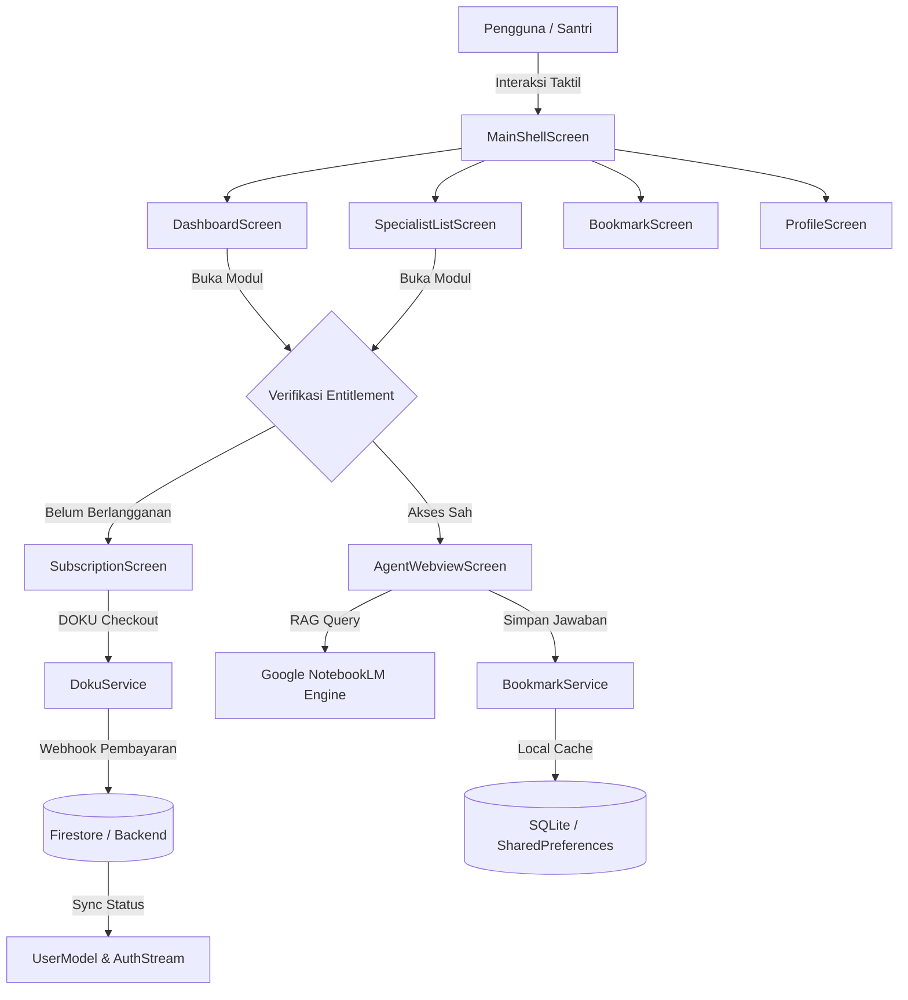

# BLUEPRINT KOMPREHENSIF UI/UX & ARSITEKTUR DESAIN — OPENTURATH AI

> **Dokumen Spesifikasi Teknis & Panduan Analisis Desain Komprehensif**
> **Versi Target:** `1.0.16+17` (Rilis Hardened Apple HIG & Pesantren Scholarship Standard)
> **Platform Target:** Android & iOS (Flutter Native Canvas)
> **Tujuan Dokumen:** Diserahkan kepada AI tingkat lanjut (LLM Expert UI/UX) untuk dianalisis, diaudit secara kritis, dan diberikan rekomendasi peningkatan menuju standar kelas dunia setara penerima *Apple Design Award*.

---

## DAFTAR ISI
1. [Visi Produk, Domain Ilmiah & Mental Model Pengguna](#1-visi-produk-domain-ilmiah--mental-model-pengguna)
2. [Filosofi Desain & Standar Desain Sistem](#2-filosofi-desain--standar-desain-sistem)
3. [Spesifikasi Fondasi Desain & Token Sistem (`AppTheme`)](#3-spesifikasi-fondasi-desain--token-sistem-apptheme)
4. [Anatomi & Alur Pengalaman Layar per Layar (Screen-by-Screen Deep Dive)](#4-anatomi--alur-pengalaman-layar-per-layar-screen-by-screen-deep-dive)
   - 4.1 Shell Navigasi Utama (`MainShellScreen`)
   - 4.2 Beranda / Dashboard Akademik (`DashboardScreen`)
   - 4.3 Direktori Spesialis Ilmiah (`SpecialistListScreen`)
   - 4.4 Ruang Riset & Telaah Naskah AI (`AgentWebviewScreen`)
   - 4.5 Buku Catatan Rujukan & Riset (`BookmarkScreen`)
   - 4.6 Profil Peneliti & Pengaturan Bergaya Apple Settings (`ProfileScreen`)
   - 4.7 Antarmuka Langganan & Gerbang Pembayaran (`SubscriptionScreen`)
5. [Arsitektur Rekayasa, Keamanan & Pengelolaan State](#5-arsitektur-rekayasa-keamanan--pengelolaan-state)
6. [Aksesibilitas (A11y), Tipografi Bilingual & Skalabilitas Tampilan](#6-aksesibilitas-a11y-tipografi-bilingual--skalabilitas-tampilan)
7. [Pertanyaan Kritis & Panduan Analisis untuk AI Pengkaji](#7-pertanyaan-kritis--panduan-analisis-untuk-ai-pengkaji)

---

## 1. Visi Produk, Domain Ilmiah & Mental Model Pengguna

### 1.1 Apa itu OpenTurath AI?
OpenTurath AI **bukan** aplikasi chatbot konvensional, bukan wrapper GPT biasa, dan bukan platform tanya jawab agama umum. OpenTurath AI adalah **stasiun kerja riset naskah primer keilmuan Islam klasik (*Kutub at-Turats*)** berbasis kecerdasan buatan (*Retrieval-Augmented Generation / RAG* tingkat tinggi). 

Aplikasi ini mendigitalkan, mengindeks, dan memproses korpus naskah ratusan kitab kuning rujukan otoritatif lintas disiplin:
- **Fikih 4 Mazhab**: Syafi'i, Hanafi, Maliki, Hanbali (dengan spesialisasi kitab *mu'tamad* seperti *Tuhfatul Muhtaj*, *Nihayatul Muhtaj*, *Al-Majmu'*, *Al-Hidayah*, *Mukhtashar Khalil*, *Kasyful Qina'*).
- **Fikih Kontemporer & Eskatologi Terapan**: Fikih Tahawwulat (*Fiqh at-Tahawwulat*) berbasis 1.500+ rekaman ceramah suara dan seluruh naskah karya Allamah Al-Habib Abu Bakar Al-Adni bin Ali Al-Masyhur.
- **Rumpun Keilmuan Komplementer**: Ushul Fiqh & Qawa'id Fiqhiyyah, Hadits & Takhrij Sanad, Tafsir & Ulumul Quran, Aqidah Ahlussunnah wal Jama'ah (Asy'ariyyah & Maturidiyyah), Nahwu & Sharaf (Balaghah), serta Tasawwuf & Akhlaq (*Ihya Ulumiddin*, *Al-Hikam*).

### 1.2 Persona Pengguna & Ekspektasi Emosional
1. **Santri Senior / Mahasantri Ma'had Aly**: Terbiasa membaca *ibarah* kitab gundul tanpa harakat, membutuhkan kecepatan mencari rujukan halaman (*maraji'*), nomor jilid, dan nama fasal/bab untuk keperluan musyawarah *bahtsul masa'il*.
2. **Asatidz & Kyai Pesantren**: Memerlukan kehati-hatian (*ihtiyath*), verifikasi fatwa yang ketat, tidak menyukai klaim instan tanpa landasan teks Arab orisinal, serta menuntut integritas sanad keilmuan.
3. **Akademisi Perguruan Tinggi Islam (UIN/IAIN/PTIQ)**: Menuntut perbandingan komparatif lintas mazhab (*al-fiqh al-muqaran*), catatan kaki akademis, serta kemampuan menyalin teks terjemahan dan kutipan Arab sekaligus.
4. **Masyarakat Umum / Penuntut Ilmu Pemula**: Membutuhkan kejelasan navigasi, bahasa yang santun, antarmuka yang bersih tanpa intimidasi teknis, serta jaminan bahwa fatwa yang disajikan berafiliasi dengan tradisi *Ahlussunnah wal Jama'ah*.

### 1.3 Nada Suara & Bahasa (*Tone of Voice*)
- **Dignified, Sober & Reverent**: Tidak ada bahasa pemasaran murahan (*hype-free*). Kata-kata seperti *"Fatwa pamungkas"*, *"AI paling sakti"*, atau penggunaan emoji mahkota `👑` diharamkan dari aplikasi.
- **Istilah Ilmiah Baku**: Menggunakan terminologi tradisi pesantren dan universitas Islam: *Tahqiq*, *Mu'tamad*, *Istidlal*, *Naskah Primer*, *Thalabul Ilmi*, *Ahlan wa Sahlan*.
- **Etika Keilmuan (*Adab al-Bahits*)**: Aplikasi selalu menyajikan dialog etika sebelum riset dibuka, mengingatkan peneliti bahwa AI adalah alat bantu telaah (*khadim al-bahits*), bukan mujtahid independen.

---

## 2. Filosofi Desain & Standar Desain Sistem

OpenTurath AI memadukan dua paradigma desain kelas atas dunia:

```
┌─────────────────────────────────────────────────────────────┐
│                   OpenTurath AI Design DNA                   │
├──────────────────────────────┬──────────────────────────────┤
│    Apple Cupertino (HIG)     │     Google NotebookLM        │
│   • Keheningan Visual        │   • Fokus Riset RAG          │
│   • Material Frosted Glass   │   • Tampilan Bebas Distraksi │
│   • Inset Grouped Canvas     │   • Sitasi Sumber Langsung   │
│   • Feedback Taktil Haptic   │   • Ekstraksi Kutipan Arab   │
└──────────────────────────────┴──────────────────────────────┘
```

1. **Apple Human Interface Guidelines (HIG)**:
   - *Clarity*: Tipografi hierarkis tajam, kontras tinggi yang ramah mata santri yang membaca di malam hari, dan ikonografi SF-style yang bermakna.
   - *Deference*: Antarmuka mengabdi pada konten teks kitab. Warna aksen digunakan secara hemat agar teks arab dan ibarah tetap menjadi titik fokus utama.
   - *Depth & Materials*: Memanfaatkan *translucent blur* (frosted glass) pada bilah navigasi bawah, memisahkan kanvas datar menjadi *grouped elevated surfaces* sehingga elemen mengambang secara alami.

2. **Google NotebookLM Studio Aesthetic**:
   - Antarmuka riset berdaulat di mana ruang percakapan RAG berada di tengah, bersih dari *clutter* tombol komersial, logo vendor yang mengganggu, atau iklan.

---

## 3. Spesifikasi Fondasi Desain & Token Sistem (`AppTheme`)

Implementasi kode sumber berpusat pada [lib/core/theme.dart](file:///Users/apple/Downloads/ramadhan/openturath_ai/lib/core/theme.dart).

### 3.1 Palet Warna & Kontras WCAG AA

| Token Desain | Mode Terang (*Light*) | Mode Gelap (*Dark Obsidian*) | Peran Semantik & Standar Aksesibilitas |
|---|---|---|---|
| `canvas` | `#FFFFFF` | `#0E0E10` | Latar belakang dasar kanvas utama aplikasi |
| `groupedCanvas` | `#F6F6F8` (iOS Grouped) | `#0E0E10` | Kanvas latar bertekstur untuk grouped cards |
| `surfaceCard` | `#FFFFFF` | `#18181B` (Zinc-900) | Permukaan kartu mengambang (*floating surfaces*) |
| `surfaceHeader` | `#FFFFFF` | `#0E0E10` | Bilah judul atas / status bar canvas |
| `border` | `#E5E7EB` (Gray-200) | `#27272A` (Zinc-800) | Hairline border 1px pemisah struktur |
| `borderSubtle` | `#F1F5F9` | `#1E1E22` | Garis batas sangat tipis untuk pemisah sekunder |
| `textPrimary` | `#18181B` (Zinc-900) | `#FAFAFA` (Zinc-50) | Teks judul utama & body naskah (Kontras $\ge 12:1$) |
| `textSecondary` | `#71717A` (Zinc-500) | `#A1A1AA` (Zinc-400) | Metadata, tanggal hijri, & rujukan |
| `textTertiary` | `#6B7280` (WCAG 4.8:1) | `#A1A1AA` (WCAG 7.3:1) | Placeholder pencarian & keterangan kaki legal |
| `accent` | `#18181B` (Monochrome) | `#22D3EE` (Neon Cyan) | Indikator fokus aktif & pemanis interaktif |
| `appleGreen` | `#34C759` | `#34C759` | Switch toggle aktif standar iOS resmi |
| `appleRed` | `#FF3B30` | `#FF3B30` | Aksi destruktif (Logout, Hapus Akun, Batal) |
| `navBarBg` | `0xD9FFFFFF` (85% Blur) | `0xCC0E0E10` (80% Blur) | Frosted glass material navigasi bawah |
| `navBarBorder` | `0x1F000000` (12% Black) | `0x26FFFFFF` (15% White) | Hairline 0.5px border atas bilah navigasi |

### 3.2 Triad Tipografi Akademik
Aplikasi menggunakan 3 keluarga font yang saling melengkapi peran masing-masing:

```
┌────────────────────────────────────────────────────────────────────────┐
│                        SISTEM TIPOGRAFI TRIAD                          │
├──────────────┬─────────────────────────────────────────────────────────┤
│ Google Fonts │ Peran: Sans-Serif Antarmuka Sistem Modern               │
│    Outfit    │ Karakter: Bersih, geometris, modern, legibilitas tinggi │
│              │ Penggunaan: Label tombol, navigasi, metadata, input     │
├──────────────┼─────────────────────────────────────────────────────────┤
│ Google Fonts │ Peran: Editorial Academic Serif                         │
│  Newsreader  │ Karakter: Anggun, klasik, bermartabat, sentuhan buku    │
│              │ Penggunaan: Header OpenTurath, Salam Peneliti, Judul    │
├──────────────┼─────────────────────────────────────────────────────────┤
│ Google Fonts │ Peran: Teks Arab Turats & Kaligrafi Mazhab              │
│    Amiri     │ Karakter: Naskh otentik, harakat proporsional, agung    │
│              │ Penggunaan: Kaligrafi فقه التحولات, kutipan ayat, ibarah│
└──────────────┴─────────────────────────────────────────────────────────┘
```

#### Skala Modular Tipografi (Modular Typographic Scale)
Menghindari ukuran font pecahan acak, seluruh UI mematuhi skala matematis Apple HIG:
- **Display Large**: `34pt` / Bold (w700) / Tracking `-0.6`
- **Display Medium**: `28pt` / SemiBold (w600) / Tracking `-0.4`
- **Headline Large**: `24pt` / SemiBold (w600) / Tracking `-0.3`
- **Headline Medium**: `20pt` / SemiBold (w600) / Tracking `-0.2`
- **Title Large**: `17pt` (Ukuran Standar iOS Header) / SemiBold / Tracking `-0.1`
- **Title Medium**: `15pt` / SemiBold (w600)
- **Title Small**: `13pt` / SemiBold (w600)
- **Body Large**: `15pt` / Regular (w400) / Line-Height `1.55`
- **Body Medium**: `13pt` / Regular (w400) / Line-Height `1.45`
- **Body Small**: `12pt` / Regular (w400) / Line-Height `1.40`
- **Caption / Label Small**: `11pt` / Medium (w500) / Tracking `+0.2`

### 3.3 Sistem Geometri & Spasial
- **Radius Skala Expressive**:
  - `radiusXS`: `8.0pt` (Tag kecil, badge chip)
  - `radiusS`: `12.0pt` (Input field, dialog alert)
  - `radiusM`: `16.0pt` (Kartu spesialis, bottom sheet)
  - `radiusL`: `18.0pt - 20.0pt` (Kartu modul utama, Apple ID card)
  - `radiusXL`: `28.0pt` (Modal sheet besar)
  - `radiusPill`: `100.0pt` (Stadium pills, filter chips, tombol utama)
- **Target Sentuh Minimum (*Minimum Tap Target*)**:
  - Wajib $\ge 44 \times 44\text{ pt}$ sesuai *Cupertino / HIG Accessibility Standard* (ditegakkan pada tombol hapus bookmark, aksi AppBar, dan filter pills).
- **Elevasi & Kedalaman**:
  - Menghindari *drop shadows* hitam pekat bergaya Android lama. Kedalaman dibangun menggunakan *subtle border outlines* (`1px` border ber-opacity) dan diferensiasi warna kanvas (`#0E0E10` vs `#18181B`).

### 3.4 Komponen Interaksi Mikro: `AppleInteractiveWrapper`
Semua kartu, pill, dan item daftar yang dapat disentuh dibungkus dalam [lib/widgets/apple_interactive_wrapper.dart](file:///Users/apple/Downloads/ramadhan/openturath_ai/lib/widgets/apple_interactive_wrapper.dart):
- **Animasi Pegas (*Spring Feedback*)**: Saat ditekan (*tap down*), skala mengecil halus ke `0.97` (durasi 120ms, kurva `Curves.easeInOutCubic`). Saat dilepas, membal kembali ke `1.0`.
- **Haptic Taktil**: Memanggil `HapticFeedback.lightImpact()` atau `selectionClick()` secara presisi.
- **Aksesibilitas Reduced Motion**: Jika pengguna mengaktifkan *Reduce Motion* pada setelan sistem perangkat (`MediaQuery.of(context).disableAnimations == true`), efek scale otomatis dinonaktifkan tanpa merusak fungsi klik.
- **Semantics Screen Reader**: Secara eksplisit membungkus elemen ke dalam `Semantics(button: true, enabled: true, label: semanticLabel)`.

---

## 4. Anatomi & Alur Pengalaman Layar per Layar (Screen-by-Screen Deep Dive)

### 4.1 Shell Navigasi Utama (`MainShellScreen`)
Berkas: [lib/screens/main_shell_screen.dart](file:///Users/apple/Downloads/ramadhan/openturath_ai/lib/screens/main_shell_screen.dart)

#### Desain Responsif Adaptif:
- **Mobile (< 768pt)**: Menggunakan bilah navigasi bawah (*Bottom Navigation Bar*) berciri *frosted glass*.
  - `extendBody: true` memungkinkan konten layar mengalir anggun di balik bilah kaca translusen.
  - Efek blur: `BackdropFilter(filter: ImageFilter.blur(sigmaX: 20, sigmaY: 20))`.
  - Translusensi: `0xD9FFFFFF` (Light) / `0xCC0E0E10` (Dark).
  - Garis hairline atas: `0.5px` (`#26FFFFFF` / `#1F000000`).
- **Tablet / Desktop ($\ge 768\text{pt}$)**: Secara otomatis bertransformasi menjadi **Navigation Rail** di sisi kiri dengan tombol pengalih tema gelap/terang cepat di pojok bawah.

#### 4 Tab Utama:
1. **Beranda (`Icons.home_outlined` $\rightarrow$ `Icons.home_rounded`)**: Dashboard eksplorasi & search-first.
2. **Spesialis (`Icons.auto_awesome_outlined` $\rightarrow$ `Icons.auto_awesome_rounded`)**: Direktori modul per mazhab dan rumpun ilmu.
3. **Bookmark (`Icons.bookmark_border_rounded` $\rightarrow$ `Icons.bookmark_rounded`)**: Rujukan teks kitab & jawaban AI yang tersimpan.
4. **Profil (`Icons.person_outline_rounded` $\rightarrow$ `Icons.person_rounded`)**: Apple ID profile card & pengaturan aplikasi.

---

### 4.2 Beranda / Dashboard Akademik (`DashboardScreen`)
Berkas: [lib/screens/dashboard_screen.dart](file:///Users/apple/Downloads/ramadhan/openturath_ai/lib/screens/dashboard_screen.dart)

```
┌─────────────────────────────────────────────────────────────┐
│ OpenTurath                      [Avatar Peneliti (Circle)]   │
│ Rabu, 18 Shafar 1448 H • 10 September 2026                 │
├─────────────────────────────────────────────────────────────┤
│ [Banner Pembaruan Versi Baru Siap Pasang (Jika Ada)]        │
├─────────────────────────────────────────────────────────────┤
│ Ahlan, Ustadz Abdullah                                      │
│ Kaji naskah primer turats dengan asisten riset cerdas.     │
├─────────────────────────────────────────────────────────────┤
│ 🔍 [ Cari spesialis, bab fikih, atau kitab...            ]  │
├─────────────────────────────────────────────────────────────┤
│ ✨ OpenTurath Pro  [AKSES PENUH]                          > │
│    Akses korpus kitab primer tanpa batas telaah.            │
│    (Otomatis tersembunyi jika pengguna sudah berlangganan)  │
├─────────────────────────────────────────────────────────────┤
│ 📜 [Carousel Banner Pengumuman & Adab Thalabul Ilmi]       │
├─────────────────────────────────────────────────────────────┤
│ Eksplorasi Keilmuan                              Lihat Semua >
│ [Semua] [Fikih] [Hadits] [Tafsir] [Tasawuf] [Nahwu]         │
├─────────────────────────────────────────────────────────────┤
│ [Daftar Kartu Modul Riset Terkurasi Sesuai Filter Rumpun]   │
│ • Judul Modul (Outfit 15 Bold)                              │
│ • Subtitle Ilmiah Kitab Primer (Outfit 12 Muted)            │
│ • Badge Kategori + Panah iOS Chevron (>)                   │
└─────────────────────────────────────────────────────────────┘
```

#### Komponen Kunci UX:
1. **Header Kalender Ganda**: Menghadirkan penanggalan Hijriyah berdampingan dengan Masehi menggunakan algoritma konversi presisi di [lib/core/hijri_date_utils.dart](file:///Users/apple/Downloads/ramadhan/openturath_ai/lib/core/hijri_date_utils.dart).
2. **Spotlight Search-First Bar**: Terletak ergonomis di sepertiga atas layar. Sekali ketuk langsung membuka mode pencarian interaktif instan.
3. **Gating Kartu Langganan Pintar**: Kartu penawaran upgrade Pro tidak ditampilkan secara agresif bagi pengguna yang sudah memiliki status `isSubscriptionActive` atau `isPremium`.
4. **Filter Rumpun Keilmuan Horizontal**: Chip horizontal bergaya pill M3/HIG yang dapat digeser secara halus (*bouncing scroll*) dengan *haptic click* saat memilih kategori.
5. **Daftar Modul Terkurasi**: Mengeliminasi grid 2x2 kaku yang sebelumnya redundan, menggantinya dengan daftar kartu horizontal yang rapi dan memuat status naskah (*Aktif* vs *Segera Hadir*).

---

### 4.3 Direktori Spesialis Ilmiah (`SpecialistListScreen`)
Berkas: [lib/screens/specialist_list_screen.dart](file:///Users/apple/Downloads/ramadhan/openturath_ai/lib/screens/specialist_list_screen.dart)

#### Fitur & Desain Unggulan:
1. **Kartu Berdaulat Fikih Tahawwulat (`_SovereignTahawwulatCard`)**:
   - Ditempatkan di baris teratas dengan visual mewah namun bersahaja.
   - Header kaligrafi Arab resmi: `فقه التحولات` menggunakan font *Amiri* dengan line-height `1.55`.
   - Badge keilmuan: `SPESIALIS UTAMA • RUKUN KEEMPAT`.
   - Tombol aksi: `Buka Ruang Riset` berbentuk pill solid hitam/putih kontras tinggi.
2. **Spesialis Mazhab Fikih Empat**:
   - Menghadirkan asisten khusus: Mazhab Syafi'i (*Al-Umm, Minhajuth Thalibin*), Mazhab Hanafi (*Raddul Muhtar, Al-Mabsut*), Mazhab Maliki (*Al-Mudawwanah, Mukhtashar Khalil*), Mazhab Hanbali (*Al-Mughni, Zadul Mustaqni'*).
   - Menampilkan `subtitleAcademic` spesifik pada setiap baris (misalnya: *"Kompilasi fatwa mu'tamad kutub Syafi'iyyah"*).
3. **Pencarian Dwibahasa dengan Normalisasi Aksara Arab**:
   - Menggunakan modul pencarian cerdas [lib/core/arabic_utils.dart](file:///Users/apple/Downloads/ramadhan/openturath_ai/lib/core/arabic_utils.dart).
   - Peneliti dapat mencari dalam huruf latin maupun Arab tanpa khawatir perbedaan harakat/tasykil (sistem menormalisasi alif washal, hamzah, ta' marbuthah, dan ya' mardudah).

---

### 4.4 Ruang Riset & Telaah Naskah AI (`AgentWebviewScreen`)
Berkas: [lib/screens/agent_webview_screen.dart](file:///Users/apple/Downloads/ramadhan/openturath_ai/lib/screens/agent_webview_screen.dart)

Layar ini adalah jantung operasional aplikasi. Menghubungkan peneliti dengan instans Google NotebookLM RAG yang telah diisi ribuan halaman kitab turats.

```
┌─────────────────────────────────────────────────────────────┐
│ [←] Fikih Syafi'i (Minhaj at-Thalibin)       [⚡5] [📋] [🔖] [A]│
├─────────────────────────────────────────────────────────────┤
│                                                             │
│                 CANVAS TELAAH RISET TURATS                  │
│                                                             │
│   Peneliti: "Bagaimana hukum shalat di atas perahu          │
│              yang sedang berlayar menurut Imam Nawawi?"    │
│                                                             │
│   OpenTurath AI:                                            │
│   "Menurut Imam An-Nawawi dalam Minhaj at-Thalibin:        │
│    'Wajib menyempurnakan ruku' dan sujud serta menghadap    │
│    kiblat jika mampu...'                                    │
│                                                             │
│    Ibarah Asli (Al-Majmu' Syarh Al-Muhadzdzab, Juz 3):      │
│    «تَصِحُّ الصَّلَاةُ فِي السَّفِينَةِ قَاعِدًا مَعَ الْقُدْرَةِ عَلَى     │
│    الْقِيَامِ فِي قَوْلٍ ضَعِيفٍ، وَالصَّحِيحُ اشْتِرَاطُ الْقِيَامِ»       │
│                                                             │
│    Rujukan: Al-Minhaj Bab Shalat Safinah hal. 42            │
│                                                             │
├─────────────────────────────────────────────────────────────┤
│ [ Pesan Anda untuk Asisten Naskah...                   ] [↑]│
└─────────────────────────────────────────────────────────────┘
```

#### Arsitektur Injeksi & Kepatuhan:
1. **Bilah Navigasi Atas Asli (*Native Top Bar*)**:
   - Ditempatkan tepat di bawah status bar/notch kamera, memberikan rasa kendali penuh.
   - Tombol aksi dengan touch target $\ge 44\text{pt}$:
     - **Tersisa Kuota (`⚡`)**: Menampilkan sisa pertanyaan untuk akun trial.
     - **Salin Cepat (`📋`)**: Menyalin respons AI terbaru ke clipboard dengan feedback ikon centang hijau selama 2 detik.
     - **Simpan Rujukan (`🔖`)**: Menyimpan kutipan langsung ke database Bookmark lokal.
     - **Skala Font (`A`)**: Membuka modal slider untuk mengubah ukuran huruf teks kitab dari 80% hingga 150%.
2. **Mesin Cloaking & Purifikasi Antarmuka (`_turatsMasterScript`)**:
   - Menyuntikkan CSS & JavaScript ke dalam WebView untuk menyembunyikan header Google, tombol akun consumer, logo NotebookLM, dan tombol-tombol yang membingungkan santri.
   - **Kepatuhan Regulasi Vendor**: Tetap mempertahankan catatan kaki kepatuhan hukum (*compliance notices*) tanpa merusak estetika visual.
3. **Penyelarasan Tema Gelap/Terang Real-time**:
   - Menghindari *white flash* saat beralih tema dengan menyuntikkan token warna `#0E0E10` dan `#FAFAFA` langsung ke DOM WebView.
4. **Dialog Adab Peneliti (*Adab al-Bahits*)**:
   - Ditampilkan sekali saat pertama kali memasuki ruang riset, menanamkan nilai luhur adab mencari ilmu sebelum teknologi digunakan.

---

### 4.5 Buku Catatan Rujukan & Riset (`BookmarkScreen`)
Berkas: [lib/screens/bookmark_screen.dart](file:///Users/apple/Downloads/ramadhan/openturath_ai/lib/screens/bookmark_screen.dart)

#### Fitur & Desain:
1. **Penyimpanan Berstruktur (*Structured Citations*)**:
   - Menyimpan judul masalah, nama spesialis, naskah kitab rujukan, kutipan teks Arab (*ibarah*), serta jawaban utuh.
2. **Kategori Filter Chip**:
   - Memfilter rujukan berdasarkan disiplin ilmu: *Fikih, Hadits, Tafsir, Aqidah, Ushul Fiqh, Bahasa Arab, Sejarah, Tasawuf*.
3. **Lembar Bacaan Bukti (*Evidence Bottom Sheet*)**:
   - Mengetuk bookmark akan memunculkan [lib/widgets/evidence_bottom_sheet.dart](file:///Users/apple/Downloads/ramadhan/openturath_ai/lib/widgets/evidence_bottom_sheet.dart) yang menyajikan teks Arab dengan font *Amiri* ukuran besar, terjemahan, dan rincian sanad kitab.
4. **Pencegahan Salah Sentuh (*Fat-Finger Prevention*)**:
   - Tombol hapus memiliki area sentuh `44x44pt` dengan konfirmasi dialog modal yang jelas sebelum data dihapus.

---

### 4.6 Profil Peneliti & Pengaturan Bergaya Apple Settings (`ProfileScreen`)
Berkas: [lib/screens/profile_screen.dart](file:///Users/apple/Downloads/ramadhan/openturath_ai/lib/screens/profile_screen.dart)

```
┌─────────────────────────────────────────────────────────────┐
│ Profil                                                      │
├─────────────────────────────────────────────────────────────┤
│ ┌─────────────────────────────────────────────────────────┐ │
│ │ (Avatar)  Ahmad Fauzi                      [  PRO  ]    │ │
│ │           fauzi@santri.id                               │ │
│ └─────────────────────────────────────────────────────────┘ │
│                                                             │
│ AKUN & LANGGANAN                                            │
│ ┌─────────────────────────────────────────────────────────┐ │
│ │ 💳 Paket & Langganan                 Paket Semua AI >   │ │
│ └─────────────────────────────────────────────────────────┘ │
│                                                             │
│ TAMPILAN & BAHASA                                           │
│ ┌─────────────────────────────────────────────────────────┐ │
│ │ 🌙 Tema Tampilan                     [  (🍏 Toggle) ]   │ │
│ │ ─────────────────────────────────────────────────────── │ │
│ │ 🌐 Bahasa Aplikasi                   Bahasa Indonesia > │ │
│ └─────────────────────────────────────────────────────────┘ │
│                                                             │
│ INFORMASI & HUKUM                                           │
│ ┌─────────────────────────────────────────────────────────┐ │
│ │ 📄 Ketentuan Layanan                                  > │ │
│ │ ─────────────────────────────────────────────────────── │ │
│ │ 🔒 Kebijakan Privasi Riset                            > │ │
│ │ ─────────────────────────────────────────────────────── │ │
│ │ ℹ️ Tentang OpenTurath                 Versi 1.0.16+17 > │ │
│ └─────────────────────────────────────────────────────────┘ │
│                                                             │
│ ┌─────────────────────────────────────────────────────────┐ │
│ │ 🚪 Keluar dari Akun                       (Apple Red)   │ │
│ └─────────────────────────────────────────────────────────┘ │
│                                                             │
│                 Hapus Akun & Data Riset                     │
└─────────────────────────────────────────────────────────────┘
```

#### Ciri Khas Apple HIG:
1. **Apple ID Unified Profile Card**: Informasi nama, email, avatar, dan status langganan dipadukan dalam satu kartu rounded (`18pt`).
2. **Gaya Inset Grouped Table**:
   - Setiap grup setelan dibungkus dalam kontainer ber-radius `18pt` dengan latar `surfaceCard`.
   - Garis pemisah internal (*inner dividers*) menggunakan indentasi `54pt` (`AppTheme.dividerIndent`), persis seperti iOS Settings di mana garis tidak memotong ikon sebelah kiri.
3. **Apple Green Switch**: Menggunakan warna hijau iOS resmi (`#34C759`) untuk toggle mode gelap/terang.
4. **Kepatuhan Privasi Google Play & App Store**: Menghadirkan alur penghapusan akun mandiri (*Self-serve Account Deletion*) dengan konfirmasi ganda dan pembersihan data menyeluruh dari server.

---

### 4.7 Antarmuka Langganan & Gerbang Pembayaran (`SubscriptionScreen`)
Berkas: [lib/screens/subscription_screen.dart](file:///Users/apple/Downloads/ramadhan/openturath_ai/lib/screens/subscription_screen.dart)

#### Opsi Paket & *Price Anchoring*:
1. **Paket Unggulan — Akses Penuh (Semua AI)**:
   - Harga: **Rp 99.000 / bulan**.
   - Akses tak terbatas ke seluruh modul fikih 4 mazhab, tahawwulat, hadits, tafsir, dll.
   - Badge: `AKSES LENGKAP · REKOMENDASI` dengan visual kartu beraksen tegas.
2. **Paket Spesialis Satuan**:
   - Harga: **Rp 50.000 / bulan**.
   - Dilengkapi *dropdown* pemilihan cabang spesialis yang diinginkan.

#### Alur Transaksi Ramah Peneliti:
- **Pengumpulan WhatsApp untuk Bukti Aktivasi**: Menampilkan dialog nomor WA untuk pengiriman kwitansi resmi dan notifikasi masa aktif.
- **Gerbang Pembayaran DOKU (QRIS, Virtual Account, E-Wallet)**: Integrasi melalui [lib/widgets/doku_checkout_sheet.dart](file:///Users/apple/Downloads/ramadhan/openturath_ai/lib/widgets/doku_checkout_sheet.dart) dengan penanganan pesan error yang manusiawi tanpa menampilkan kode galat teknis mentah.

---

## 5. Arsitektur Rekayasa, Keamanan & Pengelolaan State

### 5.1 Diagram Alur Komponen & State



### 5.2 Pengerasan Keamanan (Security Hardening Terverifikasi)
1. **Isolasi Sesi Pengguna Tamu (*Guest Session Isolation*)**:
   - Menghapus kerentanan UID `'guest'` statis. Setiap sesi anonim baru di-generate dengan `guest_${timestamp}_${random}` di [lib/services/auth_service.dart](file:///Users/apple/Downloads/ramadhan/openturath_ai/lib/services/auth_service.dart), mencegah tabrakan data antar-perangkat.
2. **Pencegahan Kebocoran Socket Pembaruan (*Socket Leak Prevention*)**:
   - Di [lib/services/update_service.dart](file:///Users/apple/Downloads/ramadhan/openturath_ai/lib/services/update_service.dart), koneksi `HttpClient` dijamin tertutup di blok `finally`, dilengkapi auto-clean APK lama dan verifikasi ukuran payload $>10\text{MB}$.
3. **Validasi Kunci Modul Tanpa Pembobolan (*Strict Key Isolation*)**:
   - Modul `fiqh` murni dan `fiqh_tahawwulat` diisolasi dengan pembatas ketat (`_`) pada [lib/models/user_model.dart](file:///Users/apple/Downloads/ramadhan/openturath_ai/lib/models/user_model.dart), memastikan pengguna paket fikih standar tidak dapat membobol spesialis eskatologi tanpa hak lisensi.

---

## 6. Aksesibilitas (A11y), Tipografi Bilingual & Skalabilitas Tampilan

1. **Dukungan Pembaca Layar (VoiceOver & TalkBack)**:
   - Setiap elemen ikonik dilengkapi `tooltip` dan dibungkus atribut `Semantics`.
2. **Kepatuhan Teks Bilingual LTR / RTL**:
   - Naskah bahasa Indonesia dan Latin disajikan dengan `TextDirection.ltr`.
   - Kaligrafi dan kutipan ayat/hadits/ibarah secara eksplisit menggunakan `TextDirection.rtl` dengan line-height minimal `1.55` untuk mencegah harakat atas (*fathah/dhammah*) bertabrakan dengan garis teks di atasnya.
3. **Skalabilitas Teks Dinamis (*Dynamic Type Support*)**:
   - Ruang riset dilengkapi *Font Scale Picker* independen (80% - 150%) yang tersimpan persisten di memori lokal, sangat ramah bagi kyai sepuh dan santri berkacamata tebal.

---

## 7. Pertanyaan Kritis & Panduan Analisis untuk AI Pengkaji

> **PANDUAN UNTUK AI PENGKAJI (LLM REVIEWER):**
> Anda diminta mengaudit seluruh rancangan antarmuka dan pengalaman pengguna (UI/UX) di atas dengan menggunakan standar tertinggi industri desain aplikasi modern (**Apple Design Awards, Human Interface Guidelines 2026, dan Pola Ergonomi Riset Akademik**).

Mohon berikan analisis, kritik tajam, dan rekomendasi konkrit untuk 6 aspek berikut:

1. **Evaluasi Keheningan Visual & Hierarki Informasi**:
   - Apakah susunan Dashboard (Greeting $\rightarrow$ Search $\rightarrow$ Pro Card $\rightarrow$ Carousel $\rightarrow$ Chips $\rightarrow$ Module List) sudah optimal, ataukah masih terdapat potensi *cognitive overload* bagi santri yang terburu-buru mencari ibarah fatwa?
2. **Interaksi Antara Latin dan Aksara Arab (Bilingual Typography)**:
   - Bagaimana menilai kombinasi Google Fonts *Outfit*, *Newsreader*, dan *Amiri*? Apakah ada potensi benturan ritme visual (*typographic rhythm*) ketika teks Latin dan kutipan teks Arab berdampingan dalam satu kartu? Bagaimana solusi penataan margin dan baseline-nya?
3. **Peningkatan Taraf "Apple Design Award"**:
   - Apa saja 3 micro-interaction atau transisi gerak (*shared element transition / fluid gesture*) yang dapat ditambahkan agar transisi dari Beranda ke Ruang Riset WebView terasa mulus (*seamless*), alih-alih terasa seperti membuka browser?
4. **Ergonomi Riset Jangka Panjang (Research Ergonomics)**:
   - Mengingat santri dan peneliti dapat membaca teks kuning selama 2–4 jam berturut-turut, apakah kontras dark mode `#0E0E10` dengan teks `#FAFAFA` terlalu kontras (*harsh eye strain*), ataukah perlu opsi *Sepia / Warm Paper Parchment Mode*?
5. **Optimasi Pengalaman Luar Jaringan (Offline Resilience & PWA Caching)**:
   - Karena pesantren di daerah terpencil kerap mengalami kendala sinyal internet, bagaimana arsitektur UX terbaik untuk menampilkan naskah kutipan yang pernah dibuka saat perangkat berada dalam kondisi offline?
6. **Strategi Konversi & Etika Paywall**:
   - Bagaimana menilai cara OpenTurath AI mengkomunikasikan nilai langganan Pro (Rp 99.000)? Apakah transisi dari free trial (5 pertanyaan) ke paywall terasa elegan dan bermartabat, atau masih ada kesan menghalangi penuntut ilmu (*barrier to knowledge*)? Bagaimana rekayasa copywriting-nya agar lebih beradab?

---
*Dokumen ini disusun sebagai cetak biru resmi arsitektur antarmuka OpenTurath AI versi 1.0.16+17.*
