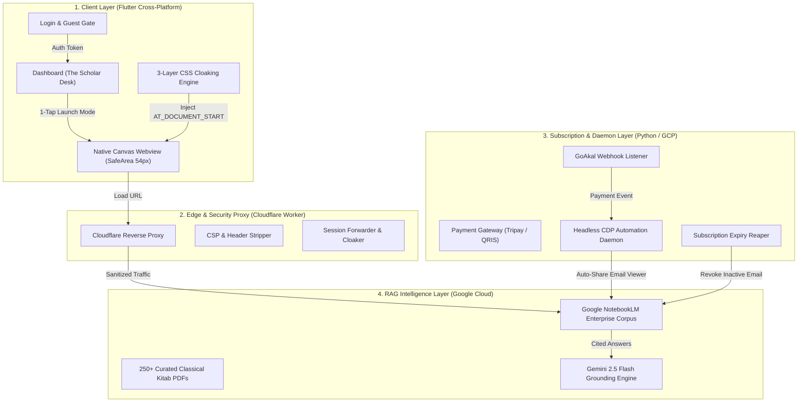

# CETAK BIRU MASTER & PRD LENGKAP: OPENTURATH AI (EDISI DEFINITIF)
## Panduan Prinsip, Spesifikasi Produk, Arsitektur Sistem, dan Desain UI/UX Ideal dari Awal Hingga Akhir

**Versi Dokumen:** 3.0.0 (The Ultimate Blueprint Edition)  
**Status:** Canonical & Production-Ready  
**Sasaran Pembaca:** Lead Software Architect, AI Agent Autonomous Developer, CPO, dan Product Engineer  
**Lingkup Proyek:** Flutter Mobile Client, Google NotebookLM RAG Engine, Cloudflare Edge Proxy, Python Automation Daemon, dan GoAkal Billing Gateway  

---

## DAFTAR ISI
1. [Filosofi & Prinsip Dasar Produk (Core Tenets)](#1-filosofi--prinsip-dasar-produk-core-tenets)
2. [Profil Pengguna & Kasus Penggunaan Kritis (Personas & Jobs to Be Done)](#2-profil-pengguna--kasus-penggunaan-kritis-personas--jobs-to-be-done)
3. [Arsitektur Sistem Holistik (End-to-End System Architecture)](#3-arsitektur-sistem-holistik-end-to-end-system-architecture)
4. [Spesifikasi Antarmuka & UX Klien Flutter (`openturath_ai`)](#4-spesifikasi-antarmuka--ux-klien-flutter-openturath_ai)
5. [Spesifikasi Cloaking & Injeksi Webview (The Invisible Plumbing)](#5-spesifikasi-cloaking--injeksi-webview-the-invisible-plumbing)
6. [Arsitektur Edge Proxy & Keamanan (`openturath_proxy`)](#6-arsitektur-edge-proxy--keamanan-openturath_proxy)
7. [Mesin Automasi Langganan & CDP Daemon (`openturath_subscription`)](#7-mesin-automasi-langganan--cdp-daemon-openturath_subscription)
8. [Skema Data Firestore & Model Relasional](#8-skema-data-firestore--model-relasional)
9. [Daftar Cacat Masa Lalu & Solusi Baku (The Lessons Learned)](#9-daftar-cacat-masa-lalu--solusi-baku-the-lessons-learned)
10. [Panduan Eksekusi Langkah-demi-Langkah untuk AI Canggih (Prompting & Execution Directive)](#10-panduan-eksekusi-langkah-demi-langkah-untuk-ai-canggih-prompting--execution-directive)

---

# 1. FILOSOFI & PRINSIP DASAR PRODUK (CORE TENETS)

OpenTurath AI bukan sekadar chatbot Islami biasa. OpenTurath AI adalah **Meja Kerja Riset Keilmuan Islam Klasik (*Scholarly Research Workbench*)** yang menyatukan ribuan jilid kitab kuning (*Kutubut Turats*) dan rekaman kajian ulama otoritatif dengan ketajaman kecerdasan buatan mutakhir.

Agar aplikasi ini berhasil secara global dan bernilai tinggi di mata pengguna, terdapat **5 Prinsip Sakral (*Non-Negotiable Tenets*)** yang tidak boleh dilanggar:

### 1.1. Prinsip "As-Sanad Al-Ilmi" (Zero-Hallucination & Hard Citation)
* Jawaban AI **wajib berakar 100% pada sumber kitab rujukan yang terverifikasi**.
* AI dilarang berspekulasi fatwa tanpa rujukan ibarah teks asli (*nash*), nama kitab, bab, dan nomor halaman.
* Teks ibarah Arab asli harus disajikan secara bermartabat menggunakan tipografi Arab klasik yang terbaca jelas (*Amiri/Scheherazade*), bukan font standar browser yang kaku.

### 1.2. Prinsip "Invisible Plumbing" (Whitelabel Murni)
* Pengguna membayar untuk pengalaman **OpenTurath AI**, bukan untuk melihat antarmuka Google.
* Seluruh elemen bawaan Google NotebookLM (header Google, tombol `+ Create notebook`, tombol `Settings`, tombol titik sembilan `Google Apps`, akun profil Google, watermark disclaimer Google, serta tombol `Copy notebook`) **wajib dieliminasi 100% dari pandangan pengguna**.
* Pengguna tidak boleh merasa sedang membuka browser atau website yang dibungkus; pengguna harus merasakan pengalaman aplikasi native yang kokoh.

### 1.3. Prinsip "1-Tap Direct Launch" (Anti-Fatigue UX)
* Hilangkan layar perantara yang tidak bernilai tambah.
* Jangan pernah memaksa pengguna berpindah ke halaman baru hanya untuk melihat daftar kitab yang sudah mereka ketahui.
* Pemilihan mode riset (**Al-Muhaqqiq** untuk telaah mendalam/ibarah Arab vs **Al-Bayan** untuk konseptual/bahasa Indonesia) harus dapat dieksekusi **dalam satu kali ketukan langsung dari kartu Dashboard**.

### 1.4. Prinsip "Google Gemini Obsidian Dignity" (Estetika visual)
* Gunakan palet resmi Google Gemini NotebookLM:
  * **Dark Mode (Default):** Canvas `#131314`, Card Surface `#1E1F20`, Border `#2A2B2D`, Accent Blue `#A8C7FA`.
  * **Light Mode:** Canvas `#F0F4F9`, Card Surface `#FFFFFF`, Border `#E1E3E1`, Accent Blue `#0B57D0`.
* Jangan mencampuradukkan palet emas, ungu, atau warna mencolok yang tidak harmonis.
* Terapkan rasio kontras visual tinggi (*WCAG AAA*) dengan tipografi `GoogleFonts.outfit` dan `GoogleFonts.amiri`.

### 1.5. Prinsip "Zero Screen Redundancy"
* Jangan pernah mengulang nama aplikasi atau logo lebih dari satu kali dalam satu layar visual.
* Satu identitas, satu hierarki, satu fokus tindakan.

---

# 2. PROFIL PENGGUNA & KASUS PENGGUNAAN KRITIS (PERSONAS & JOBS TO BE DONE)

### 2.1. Target Personas
1. **Santri Tingkat Tinggi / Bahtsul Masail:**
   * *Kebutuhan:* Mencari ibarah kitab kuning secara cepat untuk komparasi madzhab (Syafi'iyah vs Hanafiyah/Malikiyah/Hanabilah).
   * *Frustrasi:* Mengetik di ChatGPT sering mendapat hadits palsu atau ibarah karangan (halusinasi).
   * *Nilai Jual OpenTurath:* Jawaban disertai kutipan kitab dan nomor halaman asli dari korpus terverifikasi.
2. **Ustadz / Da'i / Peneliti Syariah:**
   * *Kebutuhan:* Menyiapkan materi fatwa kontemporer (zakat profesi, kripto, paylater, fintech) berbasis qawa'id fikhiyyah.
   * *Kebutuhan UX:* Membutuhkan mode *Al-Bayan* untuk bahasa praktis dan mode *Al-Muhaqqiq* untuk takhrij nash.
3. **Mahasiswa UIN / Peminat Studi Islam:**
   * *Kebutuhan:* Bertanya dalam bahasa Indonesia santun dan mendapatkan penjelasan terstruktur tanpa harus menguasai bahasa Arab gundul secara aktif.

---

# 3. ARSITEKTUR SISTEM HOLISTIK (END-TO-END SYSTEM ARCHITECTURE)

Ekosistem OpenTurath dirancang dalam model **Hybrid 4-Tier Enterprise Architecture**:



---

# 4. SPESIFIKASI ANTARMUKA & UX KLIEN FLUTTER (`openturath_ai`)

### 4.1. Halaman Masuk (Login Screen)
* **Tata Letak:** Minimalis, terpusat (*Centered Hero Layout*), tanpa kartu bertingkat atau border ganda.
* **Elemen Visual Wajib (Hanya 1 Set):**
  1. Ikon bundar resmi Google Gemini Notebook (`notebooklm_round.svg`, diameter 80px) dengan ambient radial glow halus di belakangnya.
  2. Judul: `OpenTurath AI` (Outfit, 28px, Bold, letterSpacing: -0.8).
  3. Subjudul: `Khazanah Turats Ilmiah. Ditopang Nalar AI.` (Outfit, 14.5px, Regular, Text Secondary).
  4. 3 Chips Nilai Tambah: `[ 📜 Puluhan Ribu Ibarah ]`, `[ ⚡ Sitasi Presisi ]`, `[ 🤖 Gemini 2.5 Flash ]`.
  5. 2 Tombol Aksi Kapsul Penuh (*Stadium Shape*, tinggi 52px):
     * Tombol Utama: `[ G  Lanjutkan dengan Google ]` (Warna `#FFFFFF` pada Dark, `#1F1F1F` pada Light).
     * Tombol Sekunder: `[ Masuk sebagai Peneliti Tamu ]` (Outlined capsule dengan border halus).
  6. Catatan Kaki: Ketentuan Layanan & Kebijakan Privasi (Outfit 12px).
* **Aturan Terlarang:**
  * DILARANG meletakkan logo atau teks *OpenTurathBrand* di pojok kiri atas jika di tengah sudah ada judul.
  * DILARANG menampilkan kartu promosi berjejer.

### 4.2. Halaman Beranda (The Scholar Workbench / Dashboard)
* **Header Atas (TopBar):**
  * Logo teks ramping kiri: `Gemini Notebook [TURATS]` (tinggi 20px).
  * Kanan: Tombol Pengaturan (`Icons.settings_outlined`) dan Keluar (`Icons.logout_rounded`).
* **Fitur Pencarian Pintar (Smart Search Bar):**
  * Normalisasi teks Arab otomatis: Menghapus harakat/tasykik secara instan, menyatukan bentuk alif (`أ`, `إ`, `آ` $\rightarrow$ `ا`), ya (`ي` / `ى`), ta marbuthah (`ة` / `ه`).
  * Mendukung pencarian bilingual: Pengguna mengetik *"bukhari"* atau *"بخاري"* memunculkan hasil yang sama.
* **Kategori Pills Horizontal:**
  * Pilihan: `[ Semua ]`, `[ Fikih & Ushul ]`, `[ Hadits & Sanad ]`, `[ Lughah & Sastra ]`, `[ Akidah & Akhlak ]`.
* **Kartu Korpus Riset (The Integrated Research Card):**
  Setiap kartu mewakili 1 cabang ilmu/notebook, dengan anatomi:
  1. **Baris Atas:** Badge Kategori (kiri) + Judul Kitab Bahasa Arab (`GoogleFonts.amiri`, 16px, Bold, kanan).
  2. **Judul & Deskripsi:** Judul Latin jelas (17px Bold) + ringkasan korpus 2 baris (12.5px).
  3. **Lencana Kitab Rujukan Interaktif:**
     * Tombol pil: `[ 📖 4 Kitab Rujukan (i) ]`.
     * Jika disentuh: Menampilkan **Modal Bottom Sheet** dari bawah berisi daftar kitab, pengarang, dan deskripsi singkat. Tidak berpindah halaman!
  4. **Pemisah Garis Halus (Divider):** 1px border.
  5. **Tombol Peluncur Mode Langsung (1-Tap Direct Launchers):**
     * Terdiri dari 2 tombol bersebelahan:
       * Tombol 1: `[ 🔍 Al-Muhaqqiq (Riset) ]` $\rightarrow$ Sekali klik langsung meluncurkan AI mode teks Arab/takhrij.
       * Tombol 2: `[ 💡 Al-Bayan (Konsep) ]` $\rightarrow$ Sekali klik langsung meluncurkan AI mode konseptual/bahasa Indonesia.

---

# 5. SPESIFIKASI CLOAKING & INJEKSI WEBVIEW (THE INVISIBLE PLUMBING)

Inilah komponen paling kritis yang menentukan apakah aplikasi terasa seperti $100M SaaS profesional atau sekadar webview mentah.

### 5.1. Proteksi Fisik Notch & Status Bar HP
* Scaffold webview **WAJIB** dibungkus oleh `SafeArea(bottom: false)`.
* Gunakan **Native Slim Top Bar** berketinggian tepat **54px**:
  * Tombol Kembali (`Icons.arrow_back_rounded`, size 22).
  * Judul Mode Aktif (misal: *"Fiqh Tahawwulat — Al-Muhaqqiq"*).
  * Indikator Status Hijau Denyut Halus (6px circle `#10B981`) menandakan AI terhubung.
  * Subjudul Arab (`المحقق`, Amiri 12.5px).
  * Tombol Muat Ulang (`Icons.refresh_rounded`, size 20).
* **Hasil:** Halaman webview dimulai **di bawah native bar**, sehingga 100% mustahil menabrak notch kamera, punch-hole, jam, atau ikon baterai HP!

### 5.2. Injeksi CSS 3-Lapis (Total Google Cloaking)
CSS wajib diinjeksikan melalui `initialUserScripts` pada event `UserScriptInjectionTime.AT_DOCUMENT_START` sebelum browser merender DOM pertama, dengan fallback eksekusi kedua pada `onLoadStop`.

```css
/* Selektor Standar Emas untuk Menghilangkan Seluruh Jejak Google & Subheader */
header,
.header,
.header-container,
mat-toolbar,
[role="banner"],
a.logo-link,
labs-tailwind-logo,
a[aria-label="Gemini Notebook Homepage"],
.title-input,
input.title-input,
.title-container,
button[aria-label="Copy notebook"],
button[aria-label*="Copy"],
button[aria-label="Create notebook"],
button.mat-tonal-button[aria-label="Create notebook"],
button[aria-label="Settings"],
a[aria-label="Google apps"],
a[aria-label^="Google Account"],
.gb_C,
#gb,
#gbwa,
.pro-badge,
.disclaimer,
.disclaimer-text,
.footer-disclaimer,
[class*="disclaimer"],
.compliance-notice {
  display: none !important;
  visibility: hidden !important;
  height: 0 !important;
  max-height: 0 !important;
  overflow: hidden !important;
  pointer-events: none !important;
}

/* Memaksa Area Chat Memenuhi 100% Layar Bersih */
main, .main-content, .chat-container {
  padding-top: 0 !important;
  margin-top: 0 !important;
  height: 100vh !important;
}
```

---

# 6. ARSITEKTUR EDGE PROXY & KEAMANAN (`openturath_proxy`)

Untuk lingkungan web dan pengamanan URL langsung NotebookLM, Cloudflare Worker bertindak sebagai reverse proxy:
1. **Header Sanitization:** Menghapus header `x-frame-options`, `content-security-policy` (CSP), dan `set-cookie` yang melarang iframe/webview.
2. **URL Obfuscation:** Mengubah URL asli `notebook.google.com/notebook/<id>` menjadi domain privat kustom: `gateway.openturath.com/research/<agent_id>`.
3. **Session Injection:** Meneruskan sesi autentikasi secara transparan.

---

# 7. MESIN AUTOMASI LANGGANAN & CDP DAEMON (`openturath_subscription`)

### 7.1. Alur Transaksi GoAkal & Tripay
1. Pengguna memilih durasi langganan (1 Bulan, 6 Bulan, 1 Tahun).
2. Aplikasi mengarahkan pengguna ke payment gateway GoAkal via QRIS/VA.
3. Webhook server menerima payload:
   ```json
   {
     "event": "payment.success",
     "user_email": "peneliti@openturath.com",
     "service_id": "cmln2i27k0000jx047oabzw8p",
     "duration_days": 30,
     "signature": "SHA256_VERIFIED_SIGNATURE"
   }
   ```

### 7.2. Headless CDP Automation Daemon (Chrome DevTools Protocol)
* Ketika pembayaran sukses, daemon Python di Cloud Run mengeksekusi worker berbasis Playwright:
  1. Menghubungkan ke session browser admin Google NotebookLM.
  2. Membuka dialog pembagian notebook (*Share Dialog*).
  3. Memasukkan email pembeli sebagai **Viewer (Read Only)**.
  4. Mencentang *Don't notify* agar inbox pengguna tidak dibanjiri email Google.
  5. Menekan *Save / Share*.
* **Reaper Daemon:** Setiap 24 jam memeriksa database Firestore; email yang masa langganannya habis otomatis dicabut hak aksesnya dari notebook Google.

---

# 8. SKEMA DATA FIRESTORE & MODEL RELASIONAL

### 8.1. Koleksi: `users`
```json
{
  "uid": "USER_GOOGLE_UID_OR_GUEST",
  "email": "santri@openturath.com",
  "displayName": "Ahmad Sanusi",
  "isGuest": false,
  "role": "user",
  "createdAt": "2026-09-01T00:00:00Z",
  "questionCount": 42,
  "trialExhausted": false
}
```

### 8.2. Koleksi: `entitlements`
```json
{
  "id": "ENT_USERID_MODULEID",
  "userId": "USER_GOOGLE_UID",
  "moduleId": "fikih_tahawwulat",
  "status": "active",
  "plan": "6_months",
  "startDate": "2026-09-01T00:00:00Z",
  "expiryDate": "2027-03-01T00:00:00Z",
  "akalCuid": "cmln2i27k0000jx047oabzw8p",
  "notebookId": "dc7ee7e4-f4ad-4db6-9cd0-0013727abbe4"
}
```

### 8.3. Koleksi: `agents` (Katalog Notebook)
```json
{
  "id": "fikih_tahawwulat",
  "title": "Fikih Tahawwulat",
  "titleArabic": "فقه التحولات والمنهج التليد",
  "description": "Kajian fikih pergeseran zaman dan eskatologi Islam bersanad.",
  "category": "Fikih",
  "emoji": "⚖️",
  "sortOrder": 1,
  "referenceBooks": [
    {
      "title": "Al-Usus wal Munthalaqat",
      "titleArabic": "الأسس والمنطلقات في فقه التحولات",
      "author": "Al-Habib Abu Bakar Al-Adni Al-Masyhur",
      "era": "Kontemporer"
    }
  ],
  "subAgents": [
    {
      "id": "fikih_tahawwulat_muhaqqiq",
      "name": "Al-Muhaqqiq",
      "nameArabic": "المحقق",
      "description": "Riset takhrij nash Arab dan dalil komparasi madzhab.",
      "emoji": "🔍"
    },
    {
      "id": "fikih_tahawwulat_bayan",
      "name": "Al-Bayan",
      "nameArabic": "البيان",
      "description": "Uraian konseptual dan solusi praktis berbahasa Indonesia.",
      "emoji": "💡"
    }
  ]
}
```

---

# 9. DAFTAR CACAT MASA LALU & SOLUSI BAKU (THE LESSONS LEARNED)

Berikut adalah ringkasan kegagalan yang pernah terjadi beserta rumus anti-gagalnya:

| No | Gejala Cacat Masa Lalu | Akar Penyebab | Solusi Baku Wajib |
|---|---|---|---|
| 1 | Layar menabrak kamera notch HP & jam digital | Menggunakan layout fullscreen tanpa `SafeArea` atau AppBar custom yang kurang tinggi | Wajib membungkus webview dengan `SafeArea(bottom: false)` dan AppBar native setinggi 54px. Webview selalu mulai di bawah AppBar. |
| 2 | Logo biru Google, judul notebook, dan tombol Copy masih muncul di webview | Selektor CSS hanya menargetkan `header` luar, bukan sub-header dalam (`.header-container`, `.title-input`, `button[aria-label="Copy notebook"]`) | Tambahkan `.header-container`, `.logo-link`, `.title-input`, `button[aria-label="Copy notebook"]`, dan `[class*="disclaimer"]` ke dalam `_hideElementsCss`. |
| 3 | Redundansi teks di halaman login (3x Gemini Notebook) | Header atas memanggil `OpenTurathBrand` sementara bagian tengah memanggil SVG teks dan Text widget | Hapus header pojok kiri atas dan SVG teks sekunder. Hanya gunakan: Hero Round Icon $\rightarrow$ Single Title $\rightarrow$ Subtitle $\rightarrow$ Action Buttons. |
| 4 | Alur berbelit (SubAgentSelectionScreen redundan) | Pengguna dikirim ke halaman baru yang hanya mengulang 4 kotak kitab yang sama | Terapkan **1-Tap Direct Launch**: Tombol `[Al-Muhaqqiq]` dan `[Al-Bayan]` ditaruh langsung di kartu Beranda. Daftar kitab dibuka via Bottom Sheet. |
| 5 | Palet warna menyimpang (Obsidian Gold yang asing) | Menciptakan palet warna sendiri di luar identitas asli Gemini Notebook | Kunci token warna 100% pada palet resmi Google Gemini Notebook: `#131314` (Dark Canvas), `#1E1F20` (Surface), `#A8C7FA` (Accent Blue). |

---

# 10. PANDUAN EKSEKUSI LANGKAH-DEMI-LANGKAH UNTUK AI CANGGIH (PROMPTING & EXECUTION DIRECTIVE)

Jika dokumen ini diberikan kepada AI canggih di masa mendatang, **berikan prompt berikut sebagai instruksi eksekusi utama**:

```markdown
Peran Anda adalah Lead Mobile Architect dan Principal Engineer.
Tugas Anda adalah mengaudit dan mengimplementasikan aplikasi OpenTurath AI berdasarkan dokumen PRD Master Edisi 3.0.0 (CETAK BIRU MASTER & PRD LENGKAP).

ATURAN EKSEKUSI MUTLAK:
1. JANGAN PERNAH mengubah palet warna dari standar resmi Google Gemini NotebookLM:
   - Dark Canvas: #131314 | Dark Surface Card: #1E1F20 | Dark Border: #2A2B2D | Accent Blue: #A8C7FA
   - Light Canvas: #F0F4F9 | Light Surface Card: #FFFFFF | Light Border: #E1E3E1 | Accent Blue: #0B57D0
2. Pertahankan pola '1-Tap Direct Launch' pada Dashboard (tombol Al-Muhaqqiq dan Al-Bayan langsung dapat diklik dari kartu).
3. Pastikan Safe Area pada layar Webview selalu aktif di bagian atas (tinggi AppBar 54px) sehingga mustahil menabrak kamera notch HP.
4. Terapkan CSS cloaking lengkap yang menyembunyikan:
   header, .header, .header-container, mat-toolbar, [role="banner"], a.logo-link, labs-tailwind-logo, .title-input, button[aria-label="Copy notebook"], button[aria-label="Create notebook"], button[aria-label="Settings"], a[aria-label="Google apps"], a[aria-label^="Google Account"], .gb_C, #gb, #gbwa, .pro-badge, .disclaimer, [class*="disclaimer"].
5. Validasi seluruh kode sebelum build dengan 'flutter analyze' (harus 0 issues) dan 'flutter test' (23/23 tests pass).
```

---
*Dokumen ini merupakan standar kebenaran tertinggi (*Single Source of Truth*) untuk pengembangan seluruh lini produk OpenTurath AI.*
