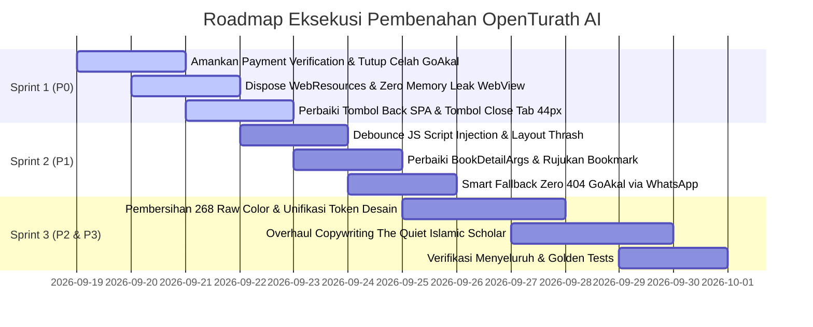

# MASTER REGISTER AUDIT FORENSIK & RENCANA KERJA PENYEMPURNAAN OPENTURATH AI

> **Status Dokumen:** Living Master Plan & Defect Register  
> **Versi:** 1.0.0 (Comprehensive Multi-Auditor Consolidation)  
> **Tanggal Pembuatan:** 18 September 2026  
> **Tujuan:** Dokumentasi sentral seluruh temuan audit independen, defect register (P0–P3), restrukturisasi harga, standarisasi desain token, pembersihan copywriting (The Quiet Islamic Scholar), dan pelacakan audit lanjutan yang akan dimasukkan oleh tim.

---

## 1. RINGKASAN EKSEKUTIF KONSOLIDASI AUDIT

Berdasarkan audit Dewan Auditor Independen dan pakar produk eksternal, OpenTurath AI memiliki fondasi riset dan korpus turats yang sangat bernilai dan ambisius, namun mengalami degradasi mutu pada 5 pilar utama:

| Pilar Evaluasi | Status Saat Ini | Masalah Inti yang Teridentifikasi |
| :--- | :---: | :--- |
| **1. Keamanan Transaksi & Entitlement** | 🔴 **KRITIS (D+)** | 4 celah P0: verify fallback Firestore tanpa verifikasi server, GoAkal invoice kosong tanpa binding, harga dikirim dari client (raw amount), dan verifikasi entitlement bertumpu pada cache lokal + jam lokal HP. |
| **2. Integrasi GoAkal & Pricing** | 🔴 **KRITIS (D)** | Seluruh 6 link paket bundle menghasilkan 404 (belum dibuat di GoAkal). Harga Paket Sultan Rp 249.000 menganibalisasi produk satuan Rp 49.000 dan berisiko defisit biaya operasional LLM. |
| **3. Stabilitas Memory & Lifecycle WebView** | 🟠 **TINGGI (C)** | Tab ditutup hanya memanggil `stopLoading()`, controller dan handler JS bocor di memori. Injeksi script berulang 10–20x per load pada `onProgressChanged >= 35`. Back button terjebak loop SPA. |
| **4. Konsistensi Desain (Purism)** | 🔴 **BURUK (D)** | Token desain di-bypass masif: 268 `Color(0xFF...)` liar, 119 `Colors.white/black`, 245 `GoogleFonts.*` inline, 164 `BorderRadius.circular` liar. Dua desain sistem paralel bertarung (`core/design/*` vs `core/theme.dart`). |
| **5. Copywriting & Adab Turats** | 🔴 **BURUK (D)** | AI-slop dan gaya promosi bazaar murah (`🔥 HARGA KHUSUS LAUNCHING`, `Diskon 50%`, `GPS Navigasi Akhir Zaman`, `Super AI`). Istilah keilmuan (*Ibarah, Marja', Muallif, Muhaqqiq, Tahqiq*) belum konsisten. |

---

## 2. DEFECT REGISTER TERPADU (P0 — P3)

### A. Kategori P0 — Kritis (Keamanan, Transaksi, Kebocoran Memori, Blocker Rilis)

| ID Defect | File & Baris | Deskripsi Masalah | Solusi Rencana Eksekusi | Status |
| :--- | :--- | :--- | :--- | :---: |
| **P0-SEC-1** | `subscription_service.dart:135-154`<br>`doku_checkout_sheet.dart:93-166` | Fallback `verifyPaymentStatus` percaya Firestore `status=='success'` + shape `{success:true}` tanpa cek entitlement server. | Hapus fallback Firestore. Sukses hanya jika `res['verified'] == true && res['status'] == 'SUCCESS'` dari server Cloud Function + refresh model user `hasAccessToAgent()`. | `PENDING` |
| **P0-SEC-2** | `subscription_screen.dart:311-362`<br>`doku_checkout_sheet.dart:85,150` | GoAkal membuka `DokuCheckoutSheet` dengan `invoiceNumber: ''` → saat ditutup langsung memicu `_syncAkalPurchases()` buta tanpa bukti bayar. | Hapus penggunaan `DokuCheckoutSheet` ber-invoice kosong untuk GoAkal. Alihkan ke alur WhatsApp Admin resmi atau verifikasi S2S GoAkal dengan signature order valid. | `PENDING` |
| **P0-SEC-3** | `subscription_service.dart:108-132`<br>`doku_service.dart:27-36` | `amount`, `plan`, `planTitle` dikirim mentah dari client Flutter ke backend `createCheckout`. | Backend Cloud Function wajib mengabaikan `amount` dari client dan hanya mencocokkan `planId` ke tabel harga baku server. | `PENDING` |
| **P0-SEC-4** | `models/user_model.dart:135-142`<br>`core/membership_pass_state.dart:49-56` | Gate paywall membaca cache lokal + jam lokal `DateTime.now()`. Rollback jam HP atau edit SharedPreferences memberi akses pro offline. | Validasi entitlement selalu menggunakan `serverTimestamp` atau header waktu jaringan. Cache lokal hanya untuk display UI offline non-kritis. Enkripsi/amankan phone di storage. | `PENDING` |
| **P0-MEM-1** | `agent_session_manager.dart:79-97`<br>`agent_multi_tab_room.dart:557-563` | `closeTab` hanya memanggil `stopLoading()`. `webController`, `keepAlive`, dan handler `otCopiedAnswer` tidak dibebaskan. Buka-tutup tab menguras RAM. | Buat fungsi `disposeWebResources()` di `AgentSessionTab` yang melepas JS handler, menghentikan web view, membuang controller, dan melepaskan keep-alive sebelum tab dihapus dari list. | `PENDING` |
| **P0-UX-1** | `agent_multi_tab_room.dart:296-351` | Tombol `InkWell(close)` disarangkan di dalam `InkWell(selectTab)` dengan ukuran sentuh hanya ~18px. Memicu race condition index tab saat ditutup. | Pisahkan event listener. Buat tombol close menggunakan `GestureDetector(behavior: HitTestBehavior.opaque)` dengan tap target minimum **44x44 px**. | `PENDING` |

---

### B. Kategori P1 — Tinggi (Ergonomi UI/UX, Performa, Logika Navigasi & Data)

| ID Defect | File & Baris | Deskripsi Masalah | Solusi Rencana Eksekusi | Status |
| :--- | :--- | :--- | :--- | :---: |
| **P1-UX-1** | `agent_multi_tab_room.dart:333`<br>`agent_webview_screen.dart:643,921` | Tap target tombol close tab (~18px), chip kuota (~20px), close adab (32px) di bawah standar aksesibilitas 44px. | Standardisasi seluruh elemen interaktif ke minimum `44x44 px` menggunakan `SizedBox` atau padding transparan. | `PENDING` |
| **P1-UX-2** | `main_shell_screen.dart:270-282` | Tombol back sistem memanggil `activeController.goBack()`. Karena NotebookLM adalah SPA, riwayat selalu true dan room AI tidak bisa ditutup. | Ubah logika `PopScope`: jika `sessionManager.isOpen`, panggil `sessionManager.closeRoom()` terlebih dahulu, jangan terjebak di `goBack()` SPA WebView. | `PENDING` |
| **P1-PERF-1** | `agent_multi_tab_room.dart:976-983`<br>`agent_webview_screen.dart:777-786` | Script raksasa `$_turatsMasterScript + $notebookUiScript` diinjeksi ulang pada setiap progress tick $\ge 35$ (10–20x per load). | Tambahkan boolean flag `_scriptInjected` per sesi WebView. Reset hanya pada `onLoadStart`, dan injeksi tepat SATU KALI saat progress mencapai ambang batas. | `PENDING` |
| **P1-PERF-2** | `notebook_ui_script.dart:163-254` | `MutationObserver(subtree, characterData)` + polling 500ms + querySelectorAll berlebihan memicu layout thrashing di browser engine. | Persempit target observasi hanya ke container chat `.chat-panel-content` / `.chat-view`, tambahkan debounce/throttle 800ms menggunakan `requestAnimationFrame`. | `PENDING` |
| **P1-DATA-1** | `book_detail_screen.dart:135-141` | `BookDetailScreen` kehilangan konteks agent/katalog saat dibuka langsung dari rute, menyebabkan bookmark tersimpan sebagai Fikih Syafi'i. | Buat class `BookDetailArgs { CanonicalBookPresentation book, AgentModel? agent, String? catalogId }` dan teruskan ke seluruh rantai bookmark. | `PENDING` |
| **P1-NAV-1** | `core/navigation_guard.dart:36-68` | Unlock navigasi memakai timer 450ms bukan selesainya push route, memicu dobel push atau blokir sunyi. | Ganti timer dengan tracking set in-flight future route yang selesai tepat waktu. | `PENDING` |
| **P1-SEC-5** | `redeem_code_sheet.dart:44-68` | Pesan error voucher membedakan not-found, used, quota, dan expired tanpa rate limit (voucher oracle). | Samakan pesan menjadi generik: *"Kode tidak valid atau sudah tidak dapat digunakan."* + batasi percobaan maksimal 5x per 10 menit. | `PENDING` |
| **P1-LIFE-1** | `screens/agent_webview_screen.dart:115` | `AppSnackBar.clear(context)` dipanggil di `dispose()` saat context sudah deactivated, memicu warning Flutter. | Hapus pemanggilan SnackBar dari siklus `dispose()`. | `PENDING` |

---

### C. Kategori P2 — Sedang (Purism Desain Token, Clutter, & Duplikasi Sistem)

| ID Defect | File / Komponen | Deskripsi Masalah | Solusi Rencana Eksekusi | Status |
| :--- | :--- | :--- | :--- | :---: |
| **P2-DES-1** | 268 titik di `lib/` | Penggunaan nilai warna heksadesimal mentah `Color(0xFF...)` di luar palet token `OTColors`. | Migrasi seluruh 268 titik ke token semantik di `OTColors` (`surface`, `border`, `textPrimary`, `accent`, dll.). | `PENDING` |
| **P2-DES-2** | 119 titik di `lib/` | Penggunaan `Colors.white` dan `Colors.black` mentah yang merusak adaptasi Dark/Light Mode. | Ganti dengan `OTColors.canvas`, `OTColors.surface`, dan `OTColors.textPrimary`. | `PENDING` |
| **P2-DES-3** | 245 titik di `lib/` | Pemanggilan `GoogleFonts.outfit(...)` langsung membypass sistem tipografi `OTTypography`. | Migrasi ke style resmi: `OTTypography.corpusTitle`, `OTTypography.cardTitle`, `OTTypography.bodyText`, dll. | `PENDING` |
| **P2-DES-4** | 164 titik di `lib/` | Penggunaan `BorderRadius.circular(...)` dengan nilai acak (4, 5, 6, 11 variasi per layar). | Standardisasi ke `OTRadius.cardBorder`, `OTRadius.chipBorder`, `OTRadius.buttonBorder`. | `PENDING` |
| **P2-DES-5** | 233 titik di `lib/` | Penggunaan `EdgeInsets` liar (all 22, fromLTRB 24,16,24,32) melanggar grid base-4. | Migrasi ke `OTSpacing.xs`, `OTSpacing.sm`, `OTSpacing.base`, `OTSpacing.lg`, `OTSpacing.xl`. | `PENDING` |
| **P2-DES-6** | `core/theme.dart:1-509` vs `core/design/*` | Dua sistem tema paralel saling tumpang tindih (`theme.dart` masih membawa gradient biru Google `0xFF0B57D0`). | Satukan menjadi SATU sumber kebenaran (Single Source of Truth) berbasis `OTColors` dan `OTTypography`. Hapus gradient Google lawas. | `PENDING` |
| **P2-DES-7** | `dashboard_screen.dart:557-592`<br>`subscription_screen.dart:645-717` | Clutter visual ekstrim: gradient + border 1.6 + shadow tebal + CustomPaint kubah + angka raksasa + emoji berderet. | Terapkan kaidah Apple/Linear Minimalist Purism: Flat surface tenang, hairline border 1.0px, tanpa shadow bertumpuk. | `PENDING` |

---

### D. Kategori P3 — Rendah (Konsistensi, Teks, & Mikro-interaksi)

| ID Defect | Lokasi | Deskripsi Masalah | Solusi Rencana Eksekusi | Status |
| :--- | :--- | :--- | :--- | :---: |
| **P3-UX-1** | `book_detail_screen.dart:170` | Tombol bertuliskan "Bagikan" ternyata hanya menyalin teks sitasi ke Clipboard. | Ganti label menjadi "Salin Sitasi / Kartu Kitab" atau panggil Share Sheet resmi OS jika ingin berbagi. | `PENDING` |
| **P3-UX-2** | `book_detail_screen.dart:65, 172` | SnackBar berbahasa Arab muncul di tengah aplikasi antarmuka bahasa Indonesia. | Selaraskan pesan feedback SnackBar ke Bahasa Indonesia yang beradab dan baku. | `PENDING` |
| **P3-COPY-1** | Multi-file | Campur aduk istilah singkatan waktu (`5m lalu`, `3j lalu`, `2h lalu`) vs standar baku. | Standarkan menjadi: `5 menit lalu`, `3 jam lalu`, `2 hari lalu`. | `PENDING` |
| **P3-COPY-2** | `book_catalog_screen.dart` | Campur aduk istilah `Filter`, `Filter aktif`, `Saring`, `Saring koleksi`. | Standarisasi seragam ke: `Saring`, `Saringan aktif`, `Hapus saringan`. | `PENDING` |

---

## 3. MASTER KAMUS COPYWRITING "THE QUIET ISLAMIC SCHOLAR"

Prinsip Utama: **Tanpa tanda seru (!), tanpa huruf kapital berteriak (CAPS LOCK), tanpa emoji berlebihan (🔥📦), tanpa istilah chatbot murahan.** Bahasa santun, jernih, mencerminkan ketenangan majlis ilmu turats.

### Matriks Transformasi Teks Aplikasi

| Area Antarmuka | Teks Lama (Marketing Bazaar / Calque Mesin) | Teks Baru (The Quiet Islamic Scholar) |
| :--- | :--- | :--- |
| **Pencarian Utama** | *Cari asisten atau topik kajian…* | **Cari kitab, ulama, atau bahasan…** |
| **Subtitle Telaah** | *Ajukan pertanyaan dan temukan pembahasannya langsung dari kitab-kitab turats.* | **Sodorkan masalah; baca pembahasannya pada Matan, Syarah, dan Hasyiyah.** |
| **Status Sesi** | *Sesi kajian siap dibuka kembali. / Buka kembali rujukan dan catatan sebelumnya.* | **Majlis terakhir tersimpan. Silakan lanjutkan. / Kembali pada Marja' dan catatan sebelumnya.** |
| **Daftar Modul** | *5 asisten tersedia* | **5 majlis tersedia** |
| **Navigasi Tab Sesi** | *Percakapan / Opsi percakapan* | **Ruang Telaah / Pengaturan telaah** |
| **Inisialisasi WebView** | *Membuka asisten… / Menyiapkan asisten…* | **Membuka majlis… / Menyiapkan Marja'…** |
| **Input Pertanyaan** | *Tulis pertanyaan seputar kitab ini…* | **Tuliskan masalah yang hendak ditakhrij dari kitab ini…** |
| **Ukuran Font** | *Sesuaikan ukuran huruf percakapan agar nyaman dibaca.* | **Sesuaikan ukuran huruf Ibarah agar nyaman dibaca.** |
| **Pencarian Kitab** | *Cari kitab, pengarang, atau penahkik…* | **Cari kitab, muallif, atau muhaqqiq…** |
| **Hasil Filter Kitab** | *Menampilkan 12 dari 2.226 kitab* | **12 dari 2.226 kitab** |
| **Empty State Kitab** | *Belum ada kitab yang cocok. Coba kata kunci lain.* | **Belum ada Marja' yang sesuai. Coba kata kunci atau nama muallif lain.** |
| **Banner Langganan** | *🔥 HARGA KHUSUS LAUNCHING / Diskon s/d 50%* | **Harga pengenalan masa peluncuran** |
| **Aksi Pembelian** | *Ambil Akses Sekarang* | **Aktifkan akses** |
| **Voucher** | *Punya voucher santri?* | **Punya kode akses? / Tukarkan kode akses** |
| **Error Voucher** | *Kode voucher tidak ditemukan…* | **Kode belum dikenali. Periksa kembali penulisannya.** |
| **Sinkronisasi GoAkal** | *Alhamdulillah! Akses aktif berhasil disinkronkan* | **Akses telah aktif.** |
| **Pembersihan Cache** | *Hapus data sementara untuk meringankan penyimpanan* | **Hapus berkas sementara untuk melapangkan penyimpanan** |
| **Dialog Keluar** | *Keluar dari akun / Anda perlu masuk kembali.* | **Keluar dari akun? / Setelah keluar, Anda perlu masuk kembali.** |
| **Salin Kutipan** | *Percakapan disalin dan tersimpan ke Catatan.* | **Ibarah telah tersimpan ke Catatan.** |

---

## 4. MASTER RESTRUKTURISASI MODEL HARGA & GOAKAL

### A. Evaluasi Rasio Eceran vs Bundle
- **Patokan Baku Satuan 1 AI:** **Rp 49.000 / bulan**.
- **Total Modul:** **24 AI** (Nilai akumulatif beli terpisah = **Rp 1.176.000 / bulan**).
- **Koreksi Paket Sultan:** Dari Rp 249.000 (tidak masuk akal, diskon ~79%) dinaikkan ke **Rp 499.000 / bulan** (diskon ~58%, setara bayar 10 AI gratis 14 AI).

### B. Tabel Resmi Paket & Skema Durasi

| Nama Paket | Isi Modul | Harga 1 Bulan | Harga 6 Bulan (Semester) | Harga 1 Tahun (Tahunan) |
| :--- | :--- | :---: | :---: | :---: |
| **👑 Paket Sultan All-Access** | **Seluruh 24 AI + VIP Priority Server** | **Rp 499.000** | **Rp 2.490.000** *(Rp 415rb/bln)* | **Rp 4.490.000** *(Rp 374rb/bln)* |
| **Paket Fikih Pesantren** | Fikih Syafii, Ushul Fiqh, Qawaid, Fatawa *(4 AI)* | **Rp 149.000** | **Rp 749.000** | **Rp 1.290.000** |
| **Paket Samudra Hadits** | Hadits, Syarah, Musthalah, Thabaqat, Tarikh *(5 AI)* | **Rp 179.000** | **Rp 890.000** | **Rp 1.490.000** |
| **Paket Tafsir & Bahasa Arab** | Tafsir, Tajwid, Balaghah/Kamus, Bibliografi *(4 AI)* | **Rp 149.000** | **Rp 749.000** | **Rp 1.290.000** |
| **Paket Mazhab Akbar** | Hanafi, Maliki, Hanbali, Muqaran, Aqidah, Fatawa *(6 AI)* | **Rp 199.000** | **Rp 990.000** | **Rp 1.790.000** |
| **Paket Fikih Tahawwulat** | 5 Persona Eksklusif Fikih Tahawwulat *(5 AI)* | **Rp 169.000** | **Rp 849.000** | **Rp 1.450.000** |

### C. Solusi Zero-404 GoAkal
- **Masalah:** 6 paket di atas belum dibuat di dashboard GoAkal sehingga applyUrl `cmu6rt...` error 404.
- **Solusi Sementara (Aplikasi):**
  - Mengosongkan URL fiktif di `goakal_catalog_registry.dart`.
  - Tombol pembelian paket di `subscription_screen.dart` menampilkan modal aktivasi langsung via **WhatsApp Admin Resmi (`081292979189`)** dengan pesan pre-filled terformat.
- **Solusi Permanen (Dashboard GoAkal):**
  - Buat 6 produk di GoAkal sesuai tabel di atas, ambil `shortId` aslinya, lalu masukkan ke registry aplikasi.

---

## 5. TAHAPAN EKSEKUSI (ROADMAP SPRINTS)



---

## 6. SPESIFIKASI BAKU: OPENTURATH MONOCHROME EDITORIAL (SISTEM VISUAL DEFINITIF)

> **Prinsip Karakter Visual:** Perpustakaan digital turath, ruang telaah akademik, dan katalog kitab modern.  
> **Bukan:** Aplikasi SaaS generik, fintech/kartu bank, dashboard subscription, AI futuristik neon/gradient, ataupun aplikasi anak warna-warni.  
> **Filosofi Monokrom:** Kedalaman dibangun melalui kontras, tipografi, ruang kosong (whitespace), garis pembatas (hairline border), hirarki ukuran, dan tekstur kertas halus (paper-like editorial structure).

---

### A. Token Warna Tunggal (Single Source of Truth)
Menggantikan seluruh warna di `OTColors` dan memusnahkan duplikasi di `core/theme.dart`.

#### 1. Light Mode (Warm Archival Paper)
| Token Semantik | Nilai Hex | Peran & Penggunaan |
| :--- | :---: | :--- |
| `OTColors.canvas` | `#F6F6F3` | Latar utama aplikasi (tekstur kertas arsip hangat) |
| `OTColors.surface` | `#FFFFFF` | Panel utama, bottom sheet, dialog, kartu, input field |
| `OTColors.surfaceSubtle` | `#EEEEEB` | Area sekunder, track selector, header list |
| `OTColors.ink` | `#171717` | Teks utama, heading, tombol primer (kontras tajam) |
| `OTColors.textSecondary` | `#656560` | Metadata, deskripsi kitab, label sekunder |
| `OTColors.textTertiary` | `#92928C` | Placeholder, informasi minor, divider halus |
| `OTColors.border` | `#DDDDD8` | Garis pembatas standar (1.0px hairline) |
| `OTColors.borderStrong` | `#B8B8B1` | Garis aktif, state fokus, pemisah antar-seksi penting |
| `OTColors.inverse` | `#171717` | Panel inverse, teks tombol utama |

#### 2. Dark Mode (Quiet Obsidian Scholar)
| Token Semantik | Nilai Hex | Peran & Penggunaan |
| :--- | :---: | :--- |
| `OTColors.canvas` | `#111110` | Latar utama aplikasi (obsidian hangat) |
| `OTColors.surface` | `#181817` | Panel utama, sheet, dialog, kartu |
| `OTColors.surfaceSubtle` | `#222220` | Area sekunder, background chip |
| `OTColors.ink` | `#F4F4F0` | Teks utama, heading, tombol inverse |
| `OTColors.textSecondary` | `#B2B2AA` | Metadata, deskripsi |
| `OTColors.textTertiary` | `#85857F` | Placeholder, label minor |
| `OTColors.border` | `#30302E` | Garis pembatas standar (1.0px) |
| `OTColors.borderStrong` | `#4B4B47` | Garis aktif, pemisah seksi |
| `OTColors.inverse` | `#F4F4F0` | Tombol atau teks kontras |

#### 3. Aturan Ketat Warna (Strict Color Invariants):
- **0 Gradient:** Dilarang menggunakan `LinearGradient`, `SweepGradient`, atau `RadialGradient` pada kartu, hero banner, ataupun background.
- **0 Warna Jenuh/Neon:** Tidak ada ungu, biru elektrik Google (`0xFF0B57D0`), cyan, oranye, atau hijau stabilo sebagai dekorasi.
- **Warna Status Fungsional Saja:** Merah (error) dan Hijau (sukses) HANYA boleh dipakai untuk status fungsional krusial (misal: verifikasi pembayaran atau indikator server mati), bukan sebagai dekorasi UI.
- **Status Akses Tenang:** Status akses ditampilkan dengan teks tenang + hairline border, bukan kartu hijau mencolok:
  ```text
  AKSES AKTIF
  Berlaku sampai 12 Oktober 2026
  ```

---

### B. Arsitektur Tipografi 3 Pilar

| Pilar Tipografi | Font Resmi | Peruntukan Khusus |
| :--- | :--- | :--- |
| **1. UI & Navigasi** | **Outfit** | Tombol, label navigasi, input field, chip, metadata, angka indeks |
| **2. Editorial & Heading** | **Newsreader** | Judul besar aplikasi, nama kitab utama, heading seksi, judul telaah |
| **3. Teks Arab & Turats** | **Scheherazade New** | Teks Arab asli, kutipan matan, syarah, hasyiyah, ibarah rujukan |

> **Aturan Penghapusan:** Hapus total ketergantungan pada font `Amiri` dan `Tajawal` di seluruh komponen produksi.

#### Hierarki Ukuran Font:
- **Display:** 32–40 px (`Newsreader`, regular)
- **Page Title:** 24–28 px (`Newsreader`, medium)
- **Section Title:** 18–20 px (`Outfit`, medium)
- **Body Text:** 15–16 px (`Outfit`, regular)
- **Metadata:** 12–13 px (`Outfit`, medium)
- **Arabic Ibarah:** 22–30 px (`Scheherazade New`, regular / bold untuk matan)
- **Citation:** 13–14 px (`Outfit` atau `Newsreader` italic)
- **Uppercase Restriction:** Huruf kapital penuh (ALL CAPS) HANYA diizinkan untuk metadata kecil berukuran 9–11 px (seperti `BIDANG KAJIAN`, `STATUS AKSES`), dilarang untuk heading atau kartu promo.

---

### C. Geometri Bentuk, Radius & Bayangan (Anti-Clutter)

| Elemen Antarmuka | Nilai Radius Baku | Penjelasan |
| :--- | :---: | :--- |
| **Tombol (Button)** | **8 px** | Tegas, profesional, tidak terlalu melengkung |
| **Input Field** | **8 px** | Selaras dengan tombol |
| **Kartu (Card)** | **10–12 px** | Tenang, proporsional (larang radius 24px) |
| **Bottom Sheet** | **16 px** | Lengkungan halus pada sudut atas |
| **Dialog Modal** | **12 px** | Kompak dan fokus |
| **Chip / Filter Tag** | **999 px** | Khusus pil status atau saringan |
| **List Row Editorial** | **0–4 px** | Hampir flat, dipisahkan oleh hairline border |

> **Aturan Shadow:** Bayangan (`BoxShadow`) hampir tidak digunakan. Efek kedalaman (*elevation*) murni diciptakan melalui garis pembatas (`border: 1.0px`) dan kontras lembut antar tingkat `surface`.

---

### D. Skala Spacing Baku (Base-4/8)

```text
space4   = 4.0 px
space8   = 8.0 px
space12  = 12.0 px
space16  = 16.0 px
space24  = 24.0 px
space32  = 32.0 px
space48  = 48.0 px
space64  = 64.0 px
```

- **Padding Layar HP:** `20.0 px`
- **Padding Layar Desktop/Tablet:** `32.0 – 48.0 px`
- **Jarak Antar-Seksi:** `32.0 – 48.0 px`
- **Jarak Antar-Baris List:** `12.0 – 16.0 px`
- **Jarak Judul ke Deskripsi:** `6.0 – 8.0 px`

---

### E. Cetak Biru Redesain Per Halaman

#### 1. Dashboard Baru (The Editorial Library Desk)
- Hapus kartu hero gelap bergaya fintech (`28282D→141417`), kubah CustomPaint, dan deretan kartu kecil berwarna.
- **Struktur Baru:**
  ```text
  OpenTurath

  Mulai telaah
  [ Cari kitab, ulama, atau bahasan...                   ]

  Lanjutkan telaah
  Fikih Tahawwulat
  Majlis terakhir 2 jam yang lalu                    Buka →

  Bidang kajian
  01  Fikih
  02  Hadits
  03  Tafsir
  04  Ushul Fikih
  05  Bahasa & Balaghah

  ADAB TELAAH
  Cocokkan rujukan dengan ibarah kitab asal sebelum menyimpulkan.
  ```
- Ganti carousel 5 kartu iklan dengan **satu strip pengingat adab telaah** yang tenang.

#### 2. Halaman Asisten Kajian (Katalog Akademik, Bukan Marketplace)
- Judul: *"Asisten kajian — Pilih bidang telaah yang sesuai dengan kebutuhan Anda."*
- Search: *"Cari bidang atau asisten..."* (bukan *"Cari ulama"*).
- Kartu berbentuk list editorial dengan nomor indeks `01`, `02`, status akses tenang, dan tombol `[Mulai telaah]`. Tahawwulat tetap menggunakan bahasa visual yang sama tanpa dekorasi berlebihan.

#### 3. Ruang Telaah / WebView (Layar Paling Tenang)
- Header minimalis: `← [Nama Bidang] · Majlis aktif`.
- Kontainer WebView jernih.
- Baris aksi bawah yang jelas dan terpisah:
  - `[Salin Ibarah]`
  - `[Simpan ke Catatan]`
  - `[Tutup Majlis]`
- Jangan menyembunyikan pesan akses gagal (`access-denied`); tampilkan pesan bantuan yang santun dan jelas jika koneksi/sesi terputus.

#### 4. Katalog Kitab & Detail Kitab
- Nomor indeks editorial (`01 Al-Umm`, `02 Shahih al-Bukhari`).
- **Detail Kitab:** Shell aplikasi tetap LTR (Bahasa Indonesia). Teks Arab murni pada judul kitab dan nama muallif/muhaqqiq.
- Ganti tombol "Bagikan" yang manipulatif dengan tombol jujur: `[Salin Kartu Kitab]` atau buka Share Sheet asli sistem operasi.
- SnackBar feedback dalam Bahasa Indonesia yang santun (bukan bahasa Arab di tengah aplikasi Indonesia).

#### 5. Halaman Langganan (Akses Transparan & Bebas Hype)
- Judul: *"Akses OpenTurath"*
- Deskripsi: *"Gunakan OpenTurath untuk menelaah kitab dan materi kajian dengan asisten yang sesuai bidangnya."*
- Tampilkan tabel paket akses monokrom dengan harga jujur (Rp 499.000 untuk Sultan All-Access).
- Status pembayaran eksplisit: *Menunggu pembayaran $\rightarrow$ Pembayaran sedang diverifikasi $\rightarrow$ Mengaktifkan akses $\rightarrow$ Akses telah aktif*.

#### 6. Profil & Pengaturan
- Ganti kartu membership berhias warna dengan **Panel Status Bersih**:
  ```text
  Akses OpenTurath
  Akses aktif · Berlaku sampai 12 Oktober 2026
  [Kelola akses]
  ```
- Seluruh row menu pengaturan memiliki tinggi tap sentuh minimal `44–48 px`.

---

### F. Aturan Implementasi Teknis & Standardisasi Komponen
1. **Button:**
   - Primary: Background `OTColors.ink`, teks `OTColors.inverse`, tinggi 44–48px, radius 8px.
   - Secondary: Background `surface`, border `borderStrong` (1.0px), teks `ink`.
2. **Search Field:**
   - Background `surface`, border `border`, aktif `borderStrong`, tinggi 48px, tombol clear 44px.
3. **Target Sentuh Mutlak:**
   - Semua elemen interaktif (tombol, chip, close tab, switch tema) **wajib $\ge 44 \times 44\text{ px}$**.
4. **Enforcement Code Hygiene:**
   - Larang `Color(0xFF...)` di widget UI.
   - Larang `Colors.white` dan `Colors.black`.
   - Larang `GoogleFonts.*` inline.
   - Hapus `core/theme.dart` (satukan ke token semantik).

---

## 7. LOG PENAMPUNGAN AUDIT TAMBAHAN DARI USER
*(Dokumentasi akan terus ditambahkan secara kumulatif setiap kali pengguna menempelkan audit baru)*

- **Audit Tambahan #1 (Monochrome Editorial):** ✅ *Telah dikaji relevansinya dan diintegrasikan 100% pada Seksi 6 di atas.*

- **Audit Tambahan #2: Kajian & Rencana Integrasi `open_turath_library_metadata_page.dart`:**
  - **Status Relevansi:** ✅ **SANGAT RELEVAN & MERUPAKAN ARTEFAK KUNCI.**
  - **Fungsi Komponen:** File ini menyediakan halaman gerbang *Metadata Pustaka AI* (`AiLibraryOverviewPage`) yang menjembatani data statistik korpus turats asli dari `assets/data/metadata_modul_lengkap.json` (seperti *103 kitab Fikih Syafi'i, 1.141 kitab Hadits, 866 kitab Bahasa Arab, 148 juta kata terindeks*) ke antarmuka visual sebelum pengguna masuk ke Ruang Telaah.
  - **Kelebihan Eksisting:**
    1. Menggunakan 3 font baku yang selaras dengan arahan audit: `Newsreader` (nama modul), `Scheherazade New` (nama Arab), dan `Outfit` (UI & angka).
    2. Menghadirkan micro-animation bernuansa akademik: `_StaggeredReveal`, `_RevealText` (efek tinta berjalan), dan `_AnimatedCounter` (angka counter halus).
    3. Mengubah persepsi aplikasi dari "chatbot instan" menjadi "Pustaka Riset Ilmiah Berbasis Korpus Mu'tamad".
  - **Daftar Refactoring Wajib untuk Standarisasi Desain Purism:**
    1. **Migrasi Lokasi Berkas:** Pindahkan file dari root `/Users/apple/Downloads/ramadhan/open_turath_library_metadata_page.dart` ke dalam arsitektur aplikasi: `openturath_ai/lib/screens/library_metadata_overview_screen.dart`.
    2. **Unifikasi Token Warna:** Ganti palet lokal `_Mono` (`Color(0xFF080808)`, dll.) dengan token semantik resmi `OTColors` agar otomatis mendukung **Light Mode (`#F6F6F3`)** dan **Dark Mode (`#111110`)**.
    3. **Pembersihan Gradient & Shadow:** Hapus `LinearGradient` di `_MonoPanel` (baris 812–819) dan hilangkan `BoxShadow` tebal (baris 820–826) agar murni mengikuti aturan *Flat Surface + 1.0px Hairline Border*.
    4. **Koreksi Radius:** Sesuaikan `BorderRadius.circular(25)` menjadi `12.0 px` (`OTRadius.cardBorder`).
    5. **Integrasi Rute Navigasi:** Hubungkan rute `AiLibraryOverviewPage.route(...)` ketika pengguna memilih salah satu bidang kajian di Dashboard atau Asisten Kajian sebelum meluncurkan WebView sesi telaah.

- **Audit Tambahan #3: Kajian & Rencana Integrasi `open_turath_book_library_redesign.dart`:**
  - **Status Relevansi:** ✅ **SANGAT RELEVAN & MERUPAKAN SOLUSI DEFINITIF KATALOG KITAB.**
  - **Fungsi Komponen:** File ini memuat perombakan arsitektural total untuk **Katalog Kitab Pustaka (`OpenTurathBookLibraryPage`)** dan **Detail Kartu Kitab (`OpenTurathBookDetailPage`)**, sekaligus menyediakan data parser `OpenTurathBook` yang 100% cocok dengan skema JSON katalog kitab turats riil (seperti `01_KATALOG_FIKIH_SYAFII.json`).
  - **Kelebihan Eksisting yang Menyelesaikan Masalah Audit:**
    1. **Eliminasi Clutter Kartu Besar:** Menggantikan tampilan kartu bertumpuk dengan *Editorial Row* (`_BookEditorialRow`) bernomor urut dua digit (`01`, `02`, ...), dipisahkan oleh garis pembatas tipis (`palette.line`).
    2. **Fokus Teks Arab Elegan:** Judul kitab Arab ditampilkan dalam `Scheherazade New` (27px / 50px) dengan `Directionality(TextDirection.rtl)` yang rata kanan sempurna, sementara informasi metadata (jilid, tahun wafat `W. 204 H`, penerbit) dalam font `Outfit`.
    3. **Solusi Cacat Detail Kitab (P1-DATA-1):** Shell aplikasi tetap dalam Bahasa Indonesia (LTR), teks Arab hanya digunakan untuk data kitab. Tidak lagi memaksa seluruh layar menjadi RTL.
    4. **Saringan (Filter) Lembut & Reaktif:** Filter `Semua kitab`, `Satu jilid`, `Multi-jilid` yang muncul secara halus tanpa memakan ruang permanen.
    5. **Pencarian Komprehensif:** Menelusuri judul, nama ringkas, muallif, muhaqqiq, dan penerbit secara instan.
  - **Daftar Refactoring Wajib untuk Standarisasi:**
    1. **Migrasi Berkas:** Pindahkan kode ini ke dalam arsitektur aplikasi:
       - `openturath_ai/lib/models/open_turath_book.dart` (Model)
       - `openturath_ai/lib/screens/book_library_editorial_screen.dart` (Katalog)
       - `openturath_ai/lib/screens/book_detail_editorial_screen.dart` (Detail Kitab)
    2. **Unifikasi Token Warna ke `OTColors`:** Ganti class lokal `_LibraryPalette` ke token semantik resmi `OTColors` (menggunakan `#F6F6F3` / `#111110`).
    3. **Penyambungan Fitur Berbagi & Simpan:**
       - Tombol `onShare` dihubungkan ke Share Sheet resmi OS atau salin sitasi baku.
       - Tombol `onBookmark` dihubungkan ke `BookmarkService` dengan membawa konteks koleksi/bidang kajian lengkap agar tidak default ke Fiqh Syafi'i.

- **Audit Tambahan #4:** *(Menunggu input pengguna...)*
- **Audit Tambahan #5:** *(Menunggu input pengguna...)*

---
*Dokumen ini diperbarui secara otomatis setiap kali ada temuan audit baru dan setiap langkah perbaikan selesai dieksekusi.*
