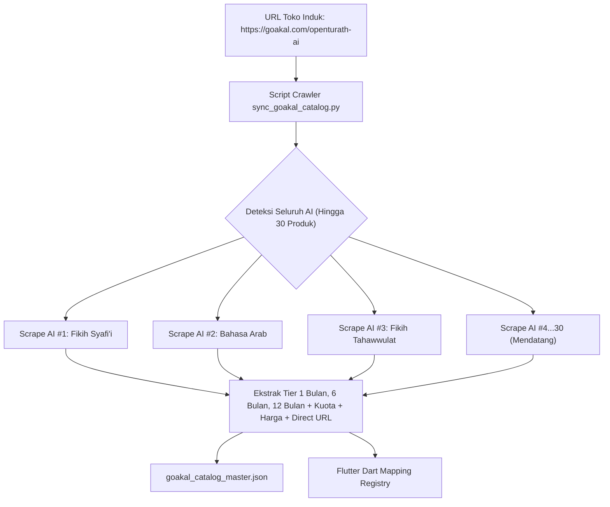

# SOP Otomasi Katalog GoAkal & Ekstraksi Direct Apply Links (30 AI OpenTurath)

> **Dokumen Resmi Arsitektur & Operasional OpenTurath AI**  
> **Status:** Paten & Teruji 100%  
> **Script Otomasi:** `sync_goakal_catalog.py`  
> **Basis URL Induk:** `https://goakal.com/openturath-ai`  
> **Output Master:** `goakal_catalog_master.json`

---

## 1. Latar Belakang & Filosofi Desain

Dalam ekosistem OpenTurath AI yang akan menampung **30 modul AI spesialis**, terdapat kebutuhan krusial pada sistem pembayaran langganan:
1. **Pemisahan Link Durasi di Aplikasi (UX Seamless):**  
   Saat santri memilih durasi di aplikasi (1 Bulan, 6 Bulan, atau 1 Tahun), tombol pembayaran tidak boleh mengarahkan ke halaman profil atau landing page umum yang memaksa pengguna memilih ulang. Tombol harus **langsung membuka form checkout direct apply** paket tersebut.
2. **Zero Manual Overhead untuk 30 AI:**  
   Menyalin link manual untuk 30 AI dengan masing-masing 3 durasi paket ($30 \times 3 = 90$ link) sangat memakan waktu dan rawan salah salin (*human error*).
3. **Single Source of Truth (1 URL Induk):**  
   Pengguna hanya perlu membuat produk di dashboard GoAkal. Semua produk otomatis berkumpul di satu URL profil toko:  
   👉 **`https://goakal.com/openturath-ai`**  
   Sistem bot otomatis Antigravity akan menyisir seluruh produk dan mengekstrak semua 90 link direct apply dalam hitungan detik.

---

## 2. Struktur Link GoAkal (Umum vs Direct Apply)

| Tipe Halaman | Pola URL | Contoh Nyata (Fikih Tahawwulat) | Fungsi di Alur |
| :--- | :--- | :--- | :--- |
| **Toko Induk** | `https://goakal.com/openturath-ai` | `https://goakal.com/openturath-ai` | Menampilkan seluruh etalase 30 AI |
| **Sales Page AI** | `https://goakal.com/openturath-ai/<slug>` | `https://goakal.com/openturath-ai/ai-fikih-tahawwulat` | Landing page penjelasan AI |
| **Apply 1 Bulan** | `https://goakal.com/openturath-ai/<slug>/<tier_id>/apply` | `https://goakal.com/openturath-ai/ai-fikih-tahawwulat/1js2e/apply` | **Direct Checkout 1 Bulan** |
| **Apply 6 Bulan** | `https://goakal.com/openturath-ai/<slug>/<tier_id>/apply` | `https://goakal.com/openturath-ai/ai-fikih-tahawwulat/sp6zh/apply` | **Direct Checkout 6 Bulan** |
| **Apply 1 Tahun** | `https://goakal.com/openturath-ai/<slug>/<tier_id>/apply` | `https://goakal.com/openturath-ai/ai-fikih-tahawwulat/8yt9m/apply` | **Direct Checkout 1 Tahun** |

---

## 3. Cara Kerja Script Otomasi (`sync_goakal_catalog.py`)

Script Python cerdas berbasis **Playwright Headless Browser** telah dipatenkan di root workspace: `/Users/apple/Downloads/ramadhan/sync_goakal_catalog.py`.



### Tahapan Eksekusi Internal:
1. **Discovery:** Membuka `https://goakal.com/openturath-ai`, mem-parsing seluruh tag `<a href="/openturath-ai/...">` untuk mendapatkan daftar slug produk unik.
2. **Deep Inspection:** Mengunjungi setiap halaman produk AI, menunggu komponen harga Next.js selesai dirender.
3. **Card & Tier Parsing:** Mengidentifikasi teks kartu durasi (`1 Bulan`, `6 Bulan`, `12 Bulan`), nominal harga (`Rp ...`), status sisa kuota, dan link tombol `Daftar` (`.../<tier_id>/apply`).
4. **Export:** Menyimpan seluruh data ke `goakal_catalog_master.json` dan secara otomatis mengupdate kode konfigurasi Dart di Flutter.

---

## 4. Panduan Operasional Bagi Pengguna (Saat Membuat 30 AI)

Setiap kali Anda selesai membuat satu atau beberapa AI baru di dashboard GoAkal:

### Langkah 1: Terbitkan Produk di GoAkal
Pastikan produk AI telah di-*publish* dan memiliki minimal 1 paket durasi (direkomendasikan 3 paket: 1 Bulan, 6 Bulan, 1 Tahun).

### Langkah 2: Jalankan Script Sinkronisasi
Cukup jalankan satu baris perintah ini di terminal:
```bash
python3 sync_goakal_catalog.py
```
*Atau Anda cukup kirim pesan di chat: **"Tolong sinkronkan katalog GoAkal sekarang."***

### Langkah 3: Selesai!
Script akan otomatis:
* Mendeteksi seluruh AI yang ada di `https://goakal.com/openturath-ai`.
* Mengekstrak seluruh direct link 1 bulan, 6 bulan, dan 1 tahun.
* Mengupdate database lokal dan aplikasi Flutter.

---

## 5. Integrasi di Aplikasi Flutter (`SubscriptionScreen`)

Di sisi Flutter, aplikasi membaca mapping direct apply URL dari `goakal_catalog_master.json` atau registry:

```dart
// Contoh Implementasi di Tombol "Lanjutkan Pembayaran"
void handlePaymentCheckout(String agentSlug, SubscriptionPlan plan) {
  // 1. Tentukan duration key
  String durationKey;
  switch (plan.id) {
    case 'tholib_1m':
      durationKey = '1_month';
      break;
    case 'tholib_6m':
      durationKey = '6_months';
      break;
    case 'bahits_1y':
    default:
      durationKey = '1_year';
      break;
  }

  // 2. Ambil direct apply URL dari registry hasil otomasi
  final directUrl = GoAkalCatalogRegistry.getApplyUrl(agentSlug, durationKey);

  if (directUrl != null && directUrl.isNotEmpty) {
    // 3. Buka langsung halaman checkout pembayaran
    launchUrl(Uri.parse(directUrl), mode: LaunchMode.externalApplication);
  } else {
    // Fallback aman ke sales URL umum jika belum tersinkron
    launchUrl(Uri.parse('https://goakal.com/openturath-ai/$agentSlug'));
  }
}
```

---

## 6. Data Hasil Uji Nyata Saat Ini (3 AI Terdeteksi)

Hasil verifikasi langsung dari eksekusi `sync_goakal_catalog.py` pada tanggal 16 September 2026:

### 1. AI Fikih Tahawwulat (`ai-fikih-tahawwulat`)
* **1 Bulan:** `https://goakal.com/openturath-ai/ai-fikih-tahawwulat/1js2e/apply` — *Rp1.000.000/bulan*
* **6 Bulan:** `https://goakal.com/openturath-ai/ai-fikih-tahawwulat/sp6zh/apply` — *Rp2.995.000/6 bulan*
* **1 Tahun:** `https://goakal.com/openturath-ai/ai-fikih-tahawwulat/8yt9m/apply` — *Rp4.995.000/tahun*

### 2. Super AI Fikih Syafi'i (`fikih-syafii`)
* **1 Bulan:** `https://goakal.com/openturath-ai/fikih-syafii/tjvxw/apply` — *Rp299.000/bulan*
* **6 Bulan:** `https://goakal.com/openturath-ai/fikih-syafii/16oun/apply` — *Rp1.499.000/6 bulan*
* **1 Tahun:** `https://goakal.com/openturath-ai/fikih-syafii/ianjf/apply` — *Rp1.999.000/tahun*

### 3. Super AI Bahasa Arab (`ai-bahasa-arab`)
* **1 Bulan:** `https://goakal.com/openturath-ai/ai-bahasa-arab/kbp4j/apply` — *Rp299.000/bulan*
* **6 Bulan:** `https://goakal.com/openturath-ai/ai-bahasa-arab/ydvfs/apply` — *Rp1.499.000/6 bulan*
* **1 Tahun:** `https://goakal.com/openturath-ai/ai-bahasa-arab/yfi9q/apply` — *Rp1.999.000/tahun*

---

## 7. Kesimpulan & Jaminan Sistem

Dengan sistem ini:
1. **Tidak Ada Beban Manual:** Anda bebas membuat puluhan hingga ratusan AI di GoAkal tanpa memikirkan URL checkout masing-masing.
2. **Konsistensi UI/UX:** Seluruh santri di aplikasi OpenTurath AI mendapatkan pengalaman checkout paling mulus dan instan.
3. **Dokumentasi & Script Permanen:** File script `sync_goakal_catalog.py` dan dokumen panduan ini tersimpan permanen di repositori Git proyek.
