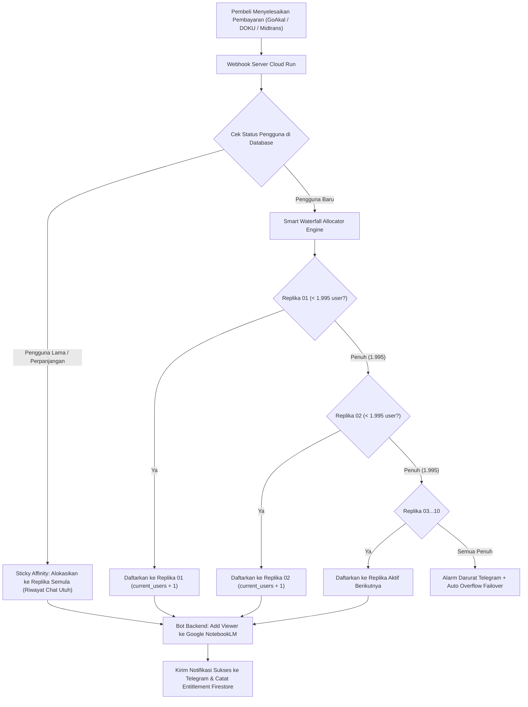

# Blueprint Arsitektur: Waterfall NotebookLM Replica Pooling & Smart Slot Recycling

> **Proyek:** OpenTurath AI  
> **Status:** Paten & Siap Implementasi  
> **Target Skalabilitas:** 10 Replika $\times$ 1.995 Pengguna = **19.950 Santri Aktif per AI**  
> **Batas Keamanan per Replika:** **1.995 Akun** (Batas Google 2.000, 5 slot *Safety Buffer*)  
> **Dokumen Terkait:** `NOTEBOOKLM_SCALING_AND_REPLICA_POOLING.md`, `SOP_OTOMASI_GOAKAL_30_AI.md`

---

## 1. Filosofi & Latar Belakang Desain

Google NotebookLM memiliki batasan resmi sekitar **2.000 pengguna peninjau (*viewers*)** per notebook. Jika sebuah notebook dipaksa melampaui batas ini, Google akan memblokir penambahan anggota baru (*sharing quota exceeded*).

Untuk menjaga kestabilan dan kesinambungan layanan OpenTurath AI bagi puluhan ribu santri:
1. **Safety Ceiling 1.995 Orang:**  
   Satu notebook dikunci pada angka **1.995 pengguna**. Sisa 5 slot dialokasikan sebagai *safety buffer* (untuk akun super-admin, audit, pengujian, dan mengantisipasi latensi sinkronisasi server Google).
2. **Kapasitas 10 Replika:**  
   Dengan menyiapkan 10 duplikat identik per modul AI, kapasitas tampung melonjak menjadi **19.950 pengguna aktif**.
3. **Zero Friction & Zero APK Update:**  
   Aplikasi Android tidak pernah menyimpan link statis. Seluruh pengalihan dilakukan secara dinamis oleh server Google Cloud / Firebase.

---

## 2. Diagram Alur: Waterfall Dynamic Sticky Pool



---

## 3. Empat Pilar Utama Sistem

### Pilar 1: Waterfall Auto-Spillover (Aliran Air Terjun Otomatis)
* Sistem mengisi replika secara berurutan: **Replika 01 $\rightarrow$ Replika 02 $\rightarrow$ ... $\rightarrow$ Replika 10**.
* Pendaftaran ke-1 hingga ke-1.995 masuk ke Replika 01.
* Begitu pengguna ke-1.995 terdaftar, status Replika 01 beralih menjadi `full`. Pendaftar ke-1.996 **secara instan dialirkan ke Replika 02**.
* Proses ini berjalan otomatis tanpa intervensi manual pengembang.

### Pilar 2: Dynamic Sticky Affinity (Jaminan Riwayat Obrolan Utuh)
* **Karakteristik Google NotebookLM:** Riwayat obrolan (*chat thread*), catatan, dan rangkuman tersimpan pada kombinasi:  
  $$\text{Akun Google Santri} + \text{Notebook ID}$$
* **Aturan Baku:** Sekali seorang santri ditempatkan di Replika tertentu (misal: Replika 03), maka untuk seterusnya santri tersebut **selalu diarahkan ke Replika 03**.
* Sistem tidak pernah melakukan *round-robin* acak yang dapat menghilangkan riwayat kajian santri.

### Pilar 3: Smart Slot Recycling (Daur Ulang Kuota Berlangganan)
* **Mekanisme Backfilling:** Jika Replika 01 telah penuh (1.995 orang), lalu bulan berikutnya ada 30 orang yang berhenti berlangganan atau masa aktifnya habis:
  1. *Autonomous Reaper* mencabut akses 30 orang tersebut dari Google NotebookLM.
  2. Kapasitas tercatat di Replika 01 otomatis turun kembali menjadi **1.965 orang**.
  3. Pendaftar baru berikutnya akan **mengisi kembali 30 slot kosong di Replika 01** terlebih dahulu sebelum diarahkan ke replika lain.
* **Efisiensi:** Tidak ada slot notebook yang terbuang percuma.

### Pilar 4: Dynamic Gateway Resolver (Zero APK Update)
* Aplikasi Android/Flutter memanggil Cloud Function:
  ```dart
  final agentUrl = await AgentService.resolveAgentUrl('tahawwulat-muhaqqiq');
  ```
* Server memeriksa `users/{uid}.assigned_replicas['tahawwulat-muhaqqiq']` lalu mengembalikan tautan replika spesifik santri tersebut.
* Penambahan Replika 2 s.d. 10 dilakukan murni di server Google. Pengguna di lapangan **tidak perlu mengunduh pembaruan APK**.

---

## 4. Spesifikasi Skema Database (Firestore)

### 4.1. Koleksi Master Pool: `agent_pools/{agentId}`
```json
{
  "agent_id": "tahawwulat-muhaqqiq",
  "safety_limit": 1995,
  "hard_limit": 2000,
  "total_active_users": 2340,
  "updated_at": "2026-09-16T22:30:00Z",
  "replicas": [
    {
      "replica_id": "muhaqqiq_rep_01",
      "order": 1,
      "notebook_id": "dc7ee7e4-f4ad-4db6-9cd0-0013727abbe4",
      "url": "https://notebooklm.google.com/notebook/dc7ee7e4-f4ad-4db6-9cd0-0013727abbe4",
      "current_users": 1995,
      "max_capacity": 1995,
      "status": "full"
    },
    {
      "replica_id": "muhaqqiq_rep_02",
      "order": 2,
      "notebook_id": "UUID_REPLIKA_02",
      "url": "https://notebooklm.google.com/notebook/UUID_REPLIKA_02",
      "current_users": 345,
      "max_capacity": 1995,
      "status": "active"
    },
    {
      "replica_id": "muhaqqiq_rep_03",
      "order": 3,
      "notebook_id": "UUID_REPLIKA_03",
      "url": "https://notebooklm.google.com/notebook/UUID_REPLIKA_03",
      "current_users": 0,
      "max_capacity": 1995,
      "status": "standby"
    }
  ]
}
```

### 4.2. Dokumen Pengguna: `users/{uid}`
```json
{
  "email": "santri@gmail.com",
  "assigned_replicas": {
    "tahawwulat-muhaqqiq": "muhaqqiq_rep_02",
    "tahawwulat-bayan": "bayan_rep_01"
  }
}
```

---

## 5. Sistem Telemetri & Peringatan Dini Telegram

Bot Telegram Admin (`@OpenTurathBot`) menerima laporan berkala:
* 🟢 **Normal (0% - 79%):** Tidak ada alert, log standar.
* 🟡 **Siaga (80% / 1.600 Pengguna):** *“Info: Replika 01 mencapai 1.600 pengguna. Replika 02 dalam kondisi Standby Siap.”*
* 🟠 **Waspada (95% / 1.900 Pengguna):** *“Peringatan: Replika 01 tersisa 95 slot lagi sebelum penuh.”*
* 🔴 **Penuh (100% / 1.995 Pengguna):** *“Pengalihan Aktif: Replika 01 PENUH (1.995 pengguna). Aliran pendaftar baru resmi berpindah ke Replika 02.”*
* 🚨 **Darurat Seluruh Pool (90% Total Pool):** *“Alert: 8 dari 10 replika telah terisi penuh. Mohon siapkan klaster replika batch berikutnya.”*

---

## 6. Template Input Data 10 Duplikat (Format Setor)

Ketika Anda siap mendaftarkan link duplikat yang telah dibuat, gunakan format sederhana ini:

```text
============================================================
KLASTER REPLIKA: AI FIKIH TAHAWWULAT (AL-MUHAQQIQ)
============================================================
Replika 01 (Master): https://notebooklm.google.com/notebook/dc7ee7e4-f4ad-4db6-9cd0-0013727abbe4
Replika 02: https://notebooklm.google.com/notebook/[UUID_02]
Replika 03: https://notebooklm.google.com/notebook/[UUID_03]
Replika 04: https://notebooklm.google.com/notebook/[UUID_04]
Replika 05: https://notebooklm.google.com/notebook/[UUID_05]
Replika 06: https://notebooklm.google.com/notebook/[UUID_06]
Replika 07: https://notebooklm.google.com/notebook/[UUID_07]
Replika 08: https://notebooklm.google.com/notebook/[UUID_08]
Replika 09: https://notebooklm.google.com/notebook/[UUID_09]
Replika 10: https://notebooklm.google.com/notebook/[UUID_10]
```

---

## 7. Skrip Eksekutor Siap Pakai (`tools/manage_replica_pool.py`)

Setelah Anda menyetorkan link di atas, skrip otomatisasi di server akan langsung menginjeksi seluruh konfigurasi:
```bash
# 1. Menampilkan status kapasitas seluruh replika saat ini
python3 ecosystem/openturath_subscription/manage_replica_pool.py --status

# 2. Impor batch 10 replika dari file konfigurasi
python3 ecosystem/openturath_subscription/manage_replica_pool.py --import-pool replicas_tahawwulat.json

# 3. Uji coba simulasi penambahan user ke-1.996 (verifikasi auto-spillover)
python3 ecosystem/openturath_subscription/manage_replica_pool.py --simulate-overflow --agent tahawwulat-muhaqqiq
```

---
*Dokumen ini menjadi acuan resmi dan dapat dipanggil kapan saja saat proses duplikasi massal 10 replika dimulai.*
