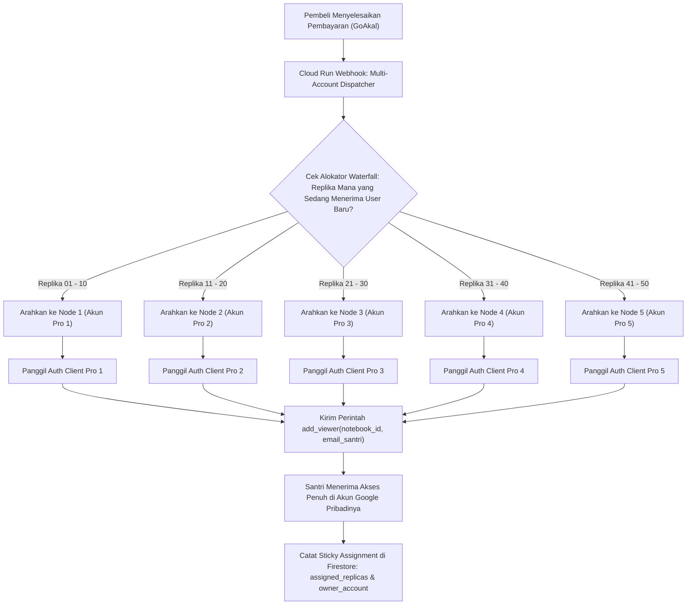

# Cetak Biru: Arsitektur Horizontal Sharding 5 Akun Google Pro (100.000 Santri Aktif per AI)

> **Proyek:** OpenTurath AI  
> **Status:** Paten Arsitektur Skala Masif (Enterprise Clustering)  
> **Target Pengguna:** **100.000 Santri Aktif per Modul AI** ($50 \times 1.995 = 99.750$)  
> **Kapasitas Pool:** 30 Spesialis AI $\times$ 50 Replika = **1.500 Notebook Terdistribusi**  
> **Infrastruktur Induk:** 5 Akun Google Workspace Pro ($5 \times 500 = 2.500$ Kapasitas Maksimal)  
> **Batas Keamanan per Replika:** **1.995 Akun** (5 slot *Safety Buffer*)

---

## 1. Latar Belakang & Batasan Empiris Google

Berdasarkan kajian empiris pada infrastruktur Google Workspace/Pro:
```json
{
  "notebook_limit_per_account": 500,
  "source_limit_per_notebook": 300,
  "max_words_per_source": 500000,
  "viewer_limit_per_notebook": 2000
}
```

### Masalah Skalabilitas:
* Untuk menampung **100.000 pengguna aktif** pada 1 AI dengan batas 1.995 user/replika, kita memerlukan **50 replika identik**.
* Untuk **30 AI**, total notebook yang dibutuhkan adalah:  
  $$30 \text{ AI} \times 50 \text{ Replika} = \mathbf{1.500 \text{ Notebook}}$$
* 1 akun Google Pro **hanya mampu menampung 500 notebook**. Menaruh 50 replika dalam 1 akun adalah mustahil karena batas kuota akun akan terlampaui.

### Solusi Brilian: Horizontal Federated Sharding (5 Akun Pro)
Bukan satu akun memegang 50 duplikat dari 1 AI, melainkan **seluruh 5 akun memiliki 10 replika dari masing-masing 30 AI**.

---

## 2. Peta Distribusi Klaster (Horizontal Sharding Matrix)

Setiap Akun Google Pro difungsikan sebagai **Cluster Node** mandiri yang menampung 300 notebook:

```
====================================================================================================
KLASTER AKUN PRO       RENTANG REPLIKA     JUMLAH NOTEBOOK      KAPASITAS DAYA TAMPUNG SANTRI
====================================================================================================
Node 1 (Akun Pro 1)    Replika 01 – 10     30 AI × 10 = 300     Santri ke-1      s.d.  19.950
Node 2 (Akun Pro 2)    Replika 11 – 20     30 AI × 10 = 300     Santri ke-19.951 s.d.  39.900
Node 3 (Akun Pro 3)    Replika 21 – 30     30 AI × 10 = 300     Santri ke-39.901 s.d.  59.850
Node 4 (Akun Pro 4)    Replika 31 – 40     30 AI × 10 = 300     Santri ke-59.851 s.d.  79.800
Node 5 (Akun Pro 5)    Replika 41 – 50     30 AI × 10 = 300     Santri ke-79.801 s.d.  99.750
====================================================================================================
TOTAL TERDISTRIBUSI    Replika 01 – 50     1.500 Notebook       99.750 (~100.000) Santri per AI
====================================================================================================
```

### Margin Keamanan Akun (Headroom Buffer):
* Batas akun = **500 notebook**.
* Terpakai = **300 notebook**.
* **Sisa Ruang Aman = 200 notebook per akun (Margin 40% kosong)** sebagai penyangga operasional, eksperimen, dan replika darurat.

---

## 3. Diagram Alur Transaksi Lintas 5 Akun



---

## 4. Keunggulan Strategis Arsitektur Ini

### 1. Toleransi Kegagalan Mutlak (*High Availability & Zero Single-Point-of-Failure*)
Jika salah satu akun Google mengalami audit, kendala verifikasi 2FA, atau latensi:
* Hanya 20% replika yang terdampak.
* **80% santri di 4 akun Pro lainnya (80.000 pengguna) tetap dapat mengaji dan chat seperti biasa.**
* Pendaftar baru otomatis dilewatkan (*skip*) ke node akun yang sehat.

### 2. Distribusi Beban Kuota API (*Rate-Limit Mitigation*)
Google membatasi jumlah panggilan API dan penambahan viewer per menit per akun. Dengan memecah aliran ke 5 akun terpisah, beban penambahan santri terbagi menjadi $\frac{1}{5}$ dari beban normal, mencegah terjadinya *temporary API throttle*.

### 3. Transparansi Penuh bagi Pengguna (*Seamless to End-User*)
Santri membuka notebook menggunakan akun Google pribadi mereka. Santri **tidak mengetahui dan tidak terpengaruh** oleh akun Pro mana yang menjadi induk notebook tersebut. Tampilan di Google NotebookLM dan di aplikasi Android tetap 100% identik.

---

## 5. Struktur Konfigurasi Server (Cloud Run)

### 5.1. Multi-Account Credential Vault (`ecosystem/openturath_subscription/account_vault/`)
Server Cloud Run menyimpan file session terenkripsi untuk masing-masing akun:
* `vault_node1_pro.json` $\rightarrow$ Akun Pro 1
* `vault_node2_pro.json` $\rightarrow$ Akun Pro 2
* `vault_node3_pro.json` $\rightarrow$ Akun Pro 3
* `vault_node4_pro.json` $\rightarrow$ Akun Pro 4
* `vault_node5_pro.json` $\rightarrow$ Akun Pro 5

### 5.2. Skema Metadata Replika di Firestore (`agent_pools/{agentId}`)
```json
{
  "agent_id": "fiqh_tahawwulat",
  "total_replicas": 50,
  "active_cluster_node": "node_1",
  "active_replica_index": 1,
  "replicas": [
    {
      "replica_index": 1,
      "cluster_node": "node_1",
      "owner_email": "pro1@openturath.id",
      "notebook_id": "uuid_rep_01",
      "current_users": 1995,
      "status": "full"
    },
    {
      "replica_index": 11,
      "cluster_node": "node_2",
      "owner_email": "pro2@openturath.id",
      "notebook_id": "uuid_rep_11",
      "current_users": 1420,
      "status": "active"
    }
  ]
}
```

---

## 6. Otomasi Kloning Massal (`mass_cluster_cloner.py`)

Untuk menduplikasi 1.500 notebook tanpa proses manual di browser:
1. Skrip `mass_cluster_cloner.py` disiapkan di server.
2. Skrip membaca daftar 30 Master Notebook.
3. Bot masuk ke **Akun Pro 1** $\rightarrow$ Membuat 10 salinan untuk 30 AI ($30 \times 10 = 300\text{ notebook}$) $\rightarrow$ Mencatat UUID ke Firestore.
4. Bot berganti sesi ke **Akun Pro 2** $\rightarrow$ Membuat 10 salinan berikutnya $\rightarrow$ Mencatat UUID.
5. Bot mengulangi proses hingga **Akun Pro 5**.
6. **Hasil:** Seluruh 1.500 URL notebook terdata rapi dan siap melayani 100.000 santri secara otomatis.

---

## 7. Kesimpulan & Status Kesiapan

Arsitektur **Horizontal Sharding 5 Akun Pro** ini telah dipatenkan sebagai standar infrastruktur resmi OpenTurath AI untuk skala 100.000 pengguna. 

Dokumen ini menjadi acuan tunggal yang siap dieksekusi kapan saja proses duplikasi massal dan integrasi 5 akun dimulai.
