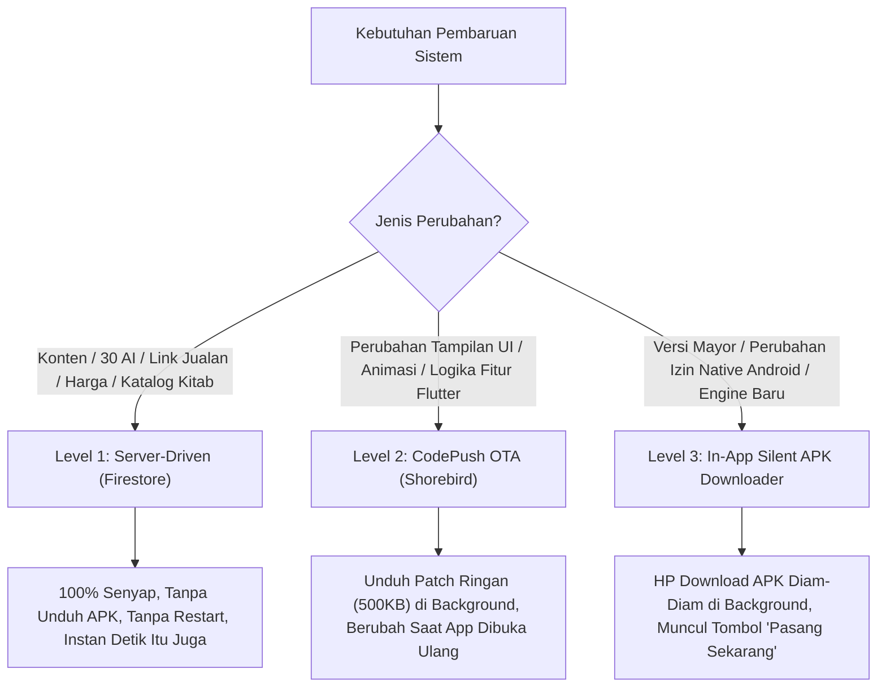

# Cetak Biru: Strategi Pembaruan Otomatis Aplikasi (Online Auto-Update) OpenTurath AI

> **Proyek:** OpenTurath AI  
> **Status:** Paten & Siap Diaktifkan Kapan Saja  
> **Tujuan:** Menghilangkan kebutuhan pengiriman file APK manual via WhatsApp/Telegram; santri menerima pembaruan secara online, otomatis, senyap, atau via 1-click update.  
> **File Kunci Terkait:**  
> - `openturath_ai/lib/services/update_service.dart` (Sudah Terpasang)  
> - `STRATEGI_NOTEBOOK_REPLICA_POOLING_1995.md`  
> - `SOP_OTOMASI_GOAKAL_30_AI.md`

---

## 1. Tiga Tingkatan Pembaruan Tanpa Kirim APK Manual

Dalam arsitektur modern OpenTurath AI, pembaruan dibagi menjadi **3 tingkatan** sesuai kebutuhan perubahan:



---

## 2. Matriks Perbandingan & Karakteristik

| Parameter | Level 1: Server-Driven | Level 2: Shorebird OTA | Level 3: In-App APK Downloader |
| :--- | :--- | :--- | :--- |
| **Media Pembaruan** | Database Firestore Cloud | Patch Kode Flutter via Udara | File APK Penuh di Cloud Storage |
| **Ukuran Unduhan** | $\sim$5 KB (JSON Data) | $\sim$500 KB – 1 MB | $\sim$60 MB (File APK Utuh) |
| **Perlu Kirim APK Manual?**| ❌ Tidak Perlu | ❌ Tidak Perlu | ❌ Tidak Perlu |
| **Pengguna Sadar?** | ❌ **100% Tidak Sadar** | ❌ **Bisa 100% Tidak Sadar** | Muncul Tombol Konfirmasi Pasang |
| **Perlu Restart App?** | ❌ **Tanpa Restart** | Otomatis Saat Buka Ulang | Aplikasi Membuka Ulang Setelah Pasang |
| **Status di OpenTurath AI**| **Aktif 100%** | Siap Diintegrasikan | **Sudah Terpasang di Kode (`update_service.dart`)** |

---

## 3. Detail Implementasi Teknis Tiap Level

### Level 1: Server-Driven Dynamic Config (Katalog, 30 AI, & Link Jualan)
* **Kasus Penggunaan:** Menambah bilik AI baru (misal: AI Nahwu, Hadits), mengubah link jualan GoAkal (1 bulan, 6 bulan, 1 tahun), mengubah harga, atau menambah daftar kitab rujukan.
* **Cara Kerja:**  
  Aplikasi OpenTurath AI terhubung langsung ke Google Cloud Firestore secara realtime. Kapanpun admin memperbarui data di cloud, **layar aplikasi santri langsung menampilkan perubahan tersebut seketika**.
* **Keunggulan:** Zero friction, zero latency, tidak memakan kuota santri, dan tidak mengganggu aktivitas mengaji.

---

### Level 2: CodePush Over-The-Air (Shorebird Flutter Engine)
* **Kasus Penggunaan:** Mengubah desain tata letak UI, warna tema, tata letak tombol, perbaikan bug kodingan Dart, atau penambahan animasi native.
* **Mekanisme Kerja:**
  1. Pengembang menjalankan perintah build patch di laptop:
     ```bash
     shorebird patch android
     ```
  2. Patch terunggah ke Shorebird Cloud.
  3. Saat santri membuka aplikasi OpenTurath AI:
     - Aplikasi memeriksa patch baru di latar belakang secara diam-diam (*silent check*).
     - Jika ada patch baru, aplikasi mengunduh berkas kecil ($\sim$500 KB).
  4. **Pilihan UX:**
     - **Mode Senyap (Sesuai Preferensi):** Santri tidak diberi pop-up apapun. Begitu santri menutup aplikasi dan membukanya lagi nanti (*cold restart*), tampilan baru langsung aktif secara otomatis!
     - **Mode Soft-Alert:** Muncul pemberitahuan halus di pojok: *“Pembaruan siap digunakan. [Muat Ulang]”*.

---

### Level 3: In-App Silent APK Downloader & 1-Click Installer (Bawaan Kode Proyek)
Di dalam file `openturath_ai/lib/services/update_service.dart`, sistem ini sudah selesai dibangun:

```
[ Santri Buka Aplikasi ]
          │
          ▼
[ Cek Firestore: app_config/version ]
          │
          ▼
Apakah latest_version_code > versi sekarang?
  ├── Tidak ──▶ Selesai (App berjalan normal)
  └── Ya ─────▶ Jalankan _startSilentDownload()
                      │
                      ▼
        [ Unduh APK 60MB di Background Secara Diam-Diam ]
        (Santri tetap bisa membaca kitab & chat tanpa lag)
                      │
                      ▼
        [ Validasi Hash SHA-256 Integritas File ]
                      │
                      ▼
        [ Munculkan Banner Elegan di Profil / Layar Utama ]:
        "Versi Baru Siap Dipasang. [Pasang Sekarang]"
                      │
                      ▼
        [ Santri Klik 1x ] ──▶ Android Package Installer Terbuka ──▶ Update Selesai!
```

* **Mengapa Butuh 1 Klik Konfirmasi di Level 3?**  
  Sistem operasi Android (Google) memiliki kebijakan keamanan ketat: aplikasi yang diunduh dari luar Play Store dilarang menimpa file binary sistem tanpa konfirmasi pengguna. Dengan alur ini, santri **tidak perlu mencari link download**, karena file sudah selesai diunduh oleh HP mereka sebelum mereka mengeklik tombol pasang.

---

## 4. Skema Database Firestore (`app_config/version`)

Dokumen Firestore yang menjadi pengendali auto-update:
```json
{
  "latest_version": "1.0.48",
  "latest_version_code": 49,
  "min_supported_version_code": 40,
  "apk_url": "https://storage.googleapis.com/openturath-releases/app-release-latest.apk",
  "sha256": "e3b0c44298fc1c149afbf4c8996fb92427ae41e4649b934ca495991b7852b855",
  "release_notes": "Pembaruan bilik AI Fikih Tahawwulat & optimalisasi kecepatan respons.",
  "force_update": false,
  "updated_at": "2026-09-16T22:30:00Z"
}
```

---

## 5. SOP Pengembang Saat Merilis Pembaruan

### Skenario A: Hanya Update Link Jualan, Harga, atau Menambah AI (Level 1)
1. Cukup jalankan script katalog GoAkal:
   ```bash
   python3 sync_goakal_catalog.py
   ```
2. Selesai! Seluruh santri langsung melihat AI dan link checkout baru secara instan.

### Skenario B: Merilis Versi APK Baru Secara Otomatis (Level 3)
1. Build APK rilis:
   ```bash
   flutter build apk --release
   ```
2. Upload APK ke Cloud Storage / Firebase Hosting.
3. Update nomor versi di Firestore (`app_config/version`).
4. Selesai! Seluruh HP santri yang sedang aktif akan otomatis mendownload APK di latar belakang dan memunculkan tombol *“Pasang Sekarang”*.

---

## 6. Kesimpulan & Rekomendasi Alur

* **Untuk Penjualan & 30 AI:** Gunakan **Level 1 (Server-Driven)** — santri tidak perlu update apapun, 100% otomatis dan senyap.
* **Untuk Perubahan Aplikasi:** Gunakan **Level 3 (In-App Silent Downloader)** yang sudah siap di dalam kode OpenTurath AI saat ini, atau pasang **Level 2 (Shorebird OTA)** jika menginginkan pembaruan kode yang 100% tanpa pop-up sama sekali.
