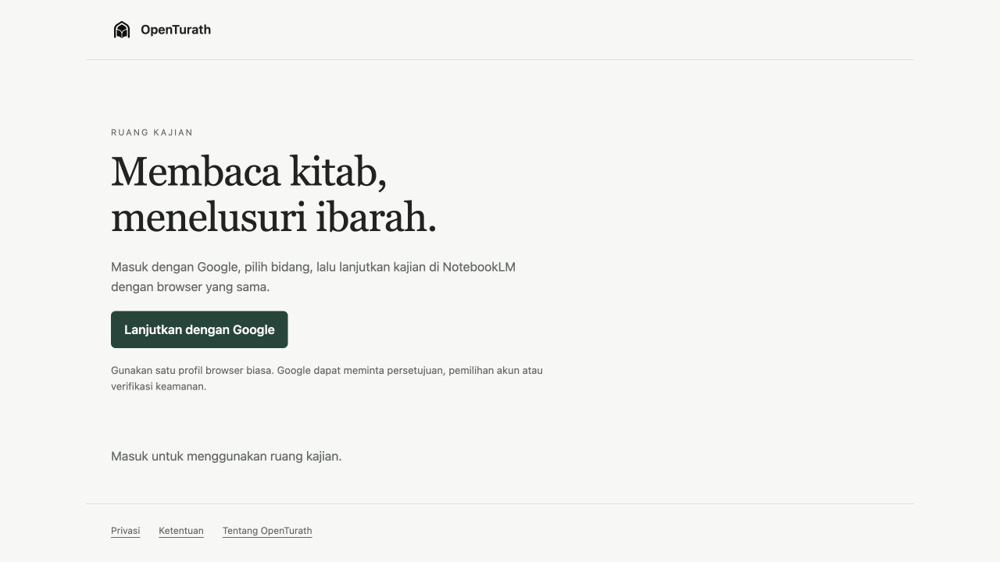

# Ruang browser OpenTurath — implementasi dan hasil pemeriksaan

Tanggal: 1 Oktober 2026. Cabang: `codex/browser-session-login-2026-10-01`.
Baseline sebelum implementasi: `5c188d8`. Setiap perubahan disimpan sebagai checkpoint Git.

## Keputusan dan alur yang dibuat

Pengguna memilih: **prioritaskan satu login melalui browser/PWA, NotebookLM tetap asli**.

1. Aplikasi native membuka `https://open-turath.firebaseapp.com/workspace/` di browser utama, tanpa meminta login Firebase native terlebih dahulu.
2. Ruang browser memakai Firebase Web SDK resmi, provider Google, scope identitas bawaan, dan penyimpanan sesi yang dikelola SDK.
3. Setelah observer Firebase mengonfirmasi pengguna dan profil tersedia, pengguna memilih salah satu dari 24 bidang kajian.
4. Callable produksi `getAgentUrl` memeriksa identitas dan hak akses di server. Hanya URL NotebookLM valid dari server yang dapat menjadi tautan.
5. Pengguna membuka NotebookLM asli pada profil browser yang sama. Sesi akun Google browser dapat dipakai kembali; token Firebase tidak diubah menjadi cookie Google.

Satu login di sini berarti satu pintu masuk pada **setiap perangkat dan profil browser**. Persetujuan pertama, pemilihan akun, MFA, pemeriksaan risiko, pencabutan sesi, dan izin notebook tetap dapat diminta Google. Ini bukan satu login global yang otomatis mengautentikasi perangkat lain.

Alamat `web.app` diarahkan ke `firebaseapp.com` sebelum OAuth dimulai agar redirect dan helper Firebase tetap satu origin. Manifest memakai `display: browser`; pintasan sengaja membuka browser biasa agar tidak bergantung pada penyimpanan sesi wadah standalone yang berbeda pada perangkat tertentu.

## Perbaikan keamanan yang diterapkan

- Jalur aktif tidak lagi memuat login Google/NotebookLM di WebView, menyuntikkan email, atau menekan tombol Google melalui skrip.
- Dialog desktop yang menerima token melalui fragment/bridge dihapus. Helper kompatibilitas lama hanya menerima browser biasa, mengikat callback loopback pada state acak, dan mengirim hasil melalui POST untuk verifikasi Firebase.
- Flag kesiapan dari keberhasilan membuka browser dan fallback pengguna saat Keychain gagal dihapus dari alur autentikasi.
- Pergantian akun dan logout membatalkan hasil permintaan lama; hasil popup saja tidak menandai sesi sebagai berhasil.
- URL notebook dibatasi pada HTTPS, host Google yang tepat, dan pola ID notebook. Query/fragment dari server dibuang sebelum tautan dibuat; `authuser` hanya petunjuk pemilihan akun.
- Katalog publik hanya memuat judul dan ID bidang, tanpa URL/ID notebook pribadi. Cache offline hanya memuat berkas publik ruang browser, bukan helper OAuth, API terautentikasi, atau halaman Google.
- Patch SDK macOS yang memindahkan data autentikasi ke preferensi biasa dihentikan. Empat sumber Pods dipulihkan dari tag resmi FirebaseAuth 11.15.0 dan GoogleUtilities 8.1.3; versi dan hash tercatat di `sdk-restoration.json`.
- Startup macOS baru hanya menghapus tiga nama preferensi plaintext yang diketahui ditulis patch lama, tanpa membaca nilainya atau menghapus Keychain. Pembersihan runtime ini belum dijalankan dalam pemeriksaan ini.

## Cakupan dan batasan nyata

Ruang browser saat ini menyediakan login, katalog asisten, pemeriksaan akses, penukaran kode reguler, dan pembukaan NotebookLM. Entry native sekarang menjadi pembuka ruang browser. **Pembaca kitab, catatan, dan alur pembayaran native lama belum dipindahkan ke browser**; sumbernya tetap tersimpan di repository. Ini belum merupakan migrasi seluruh fitur native.

Kode promo yang dibatasi satu perangkat fisik tetap mengikuti aturan backend. Browser tidak mengirim identitas perangkat palsu; kode tersebut dapat ditolak dan ditampilkan dengan pesan yang jelas. Hak akses aktif dan kode reguler tetap memakai backend yang sama. Backend, aturan akses, dan data langganan tidak diubah.

Firebase produksi telah diperiksa secara baca-saja: provider Google aktif pada proyek `255541559800`; client provider sesuai client server dalam source. Status audience/publishing consent OAuth belum diperiksa melalui Cloud Console. Screenshot merek “finance bot” saja tidak membuktikan konfigurasi itu milik client ini. Karena itu error 403 tersebut belum dinyatakan selesai.

NotebookLM tetap mengelola izin notebook, sesi Google, dan verifikasi akun. Logout ruang browser mengakhiri sesi OpenTurath; pengguna perlu keluar dari Google sendiri pada perangkat bersama. Firebase native lama tidak diinisialisasi oleh launcher; mengaktifkannya kembali di macOS memerlukan konfigurasi signing/Keychain yang benar.

## Bukti verifikasi

| Pemeriksaan | Hasil yang benar-benar diperoleh |
| --- | --- |
| Flutter analyze | Exit 0, `No issues found` |
| Seluruh tes Flutter | Exit 0, 260 tes lulus, termasuk 8 tes launcher baru |
| Regresi browser/controller | Exit 0, 21 tes lulus: cancel, permintaan ganda, logout gagal, pergantian akun, hasil lama, pembatasan URL dan cache |
| Syntax JS helper dan workspace | Exit 0 |
| Format Dart pada berkas yang berubah | Exit 0, tidak ada perubahan format |
| Build macOS debug | Exit 0; `build/macos/Build/Products/Debug/OpenTurath AI.app`, binary bertanggal 1 Oktober 2026 |
| SDK Firebase JS 12.19.0 | Empat modul resmi merespons HTTP 200 |
| Callable produksi tanpa autentikasi | HTTP 401 `UNAUTHENTICATED`, CORS mengizinkan origin workspace; bukan bukti akses akun berlangganan |
| Browser lokal desktop dan lebar 390px | SDK benar-benar dimuat, tombol login aktif, status belum login, tidak ada error/warning console; tidak ada overflow horizontal |
| Google login → akses server → pertanyaan NotebookLM → jawaban | **Belum diuji dengan akun nyata** |
| Android/iOS/Windows/Linux pada perangkat nyata | **Belum diuji** |

Tes unit dan build tidak membuktikan login Google atau jawaban NotebookLM berhasil. Build macOS ini merupakan build debug lokal, bukan rilis yang ditandatangani/notarized. Tidak ada APK dibangun, diunggah, atau dibroadcast.

Preview lokal: `http://127.0.0.1:8795/workspace/`.

## Publikasi yang disiapkan, belum dilakukan

Persiapan baca-saja pada Hosting berhasil. Versi live saat diperiksa: `sites/open-turath/versions/4355608794b98a53`.

Rencana hanya mengubah delapan berkas `/workspace/` serta `/desktop-auth.html` dan `/desktop-auth.js`. Hash **27 berkas live lainnya dipertahankan**. Konfigurasi live disalin, dengan header keamanan/MIME khusus berkas baru. Tidak ada unggahan APK, penulisan Firestore `app_config/version`, atau pemanggilan `publish_auto_update.py`.

`tool/deploy_browser_workspace.cjs` bersifat baca-saja secara default. Opsi `--publish` diperlukan untuk mengubah Hosting publik. Skrip menolak publikasi jika live berubah selama persiapan, host upload tidak sesuai, atau berkas lama memerlukan upload yang tidak tersedia. Versi lama dicatat untuk pemulihan Hosting.

Ruang HTTPS baru **belum live**. Launcher menolak halaman yang tidak memiliki marker versi workspace, sehingga membuka build sekarang dapat menampilkan pesan bahwa ruang baru perlu diterbitkan.

## Uji penerimaan setelah publikasi

1. Pada browser utama, masuk dengan akun uji berizin menggunakan provider Google; catat apakah ada error 403, consent, atau MFA. Jangan mengetes OAuth melalui browser embedded Codex.
2. Pastikan email Firebase benar; buka bidang berizin; lanjut ke NotebookLM dan pastikan akun Google benar, sumber tersedia, pertanyaan terkirim, serta jawaban muncul.
3. Tutup/buka browser dan aplikasi; pastikan sesi yang masih valid digunakan kembali tanpa login Firebase native tambahan.
4. Uji cancel, akun kedua, logout, notebook tanpa izin, langganan kedaluwarsa, koneksi putus, dan kode reguler. Promo perangkat fisik harus tetap mengikuti kebijakan backend.
5. Jalankan alur pada Chrome/Safari macOS, Chrome Android, Safari iOS, Edge/Chrome Windows, dan browser Linux. Sesi profil/perangkat berbeda tidak dianggap sesi yang sama.

Jika client OAuth yang benar masih berstatus Testing dan akun ditolak, periksa audience/test users atau kesiapan publikasi di Google Auth Platform pada proyek yang tepat. Jangan menghapus verifikasi keamanan atau menambah scope Drive/Gmail hanya untuk membuka NotebookLM.

## Pemulihan dan rujukan

Snapshot source sebelum perubahan tersedia pada commit `5c188d8`; source baru tersimpan dalam checkpoint pada cabang di atas. Pemulihan sebaiknya dilakukan pada cabang/copy terpisah untuk menjaga perubahan lain di workspace. Baseline tersebut juga mengembalikan alur autentikasi lama yang bermasalah.

Rujukan resmi: [kebijakan OAuth Google](https://developers.google.com/identity/protocols/oauth2/policies), [Firebase Google sign-in](https://firebase.google.com/docs/auth/web/google-signin), [redirect pada browser modern](https://firebase.google.com/docs/auth/web/redirect-best-practices), [persistensi sesi Firebase](https://firebase.google.com/docs/auth/web/auth-state-persistence).
