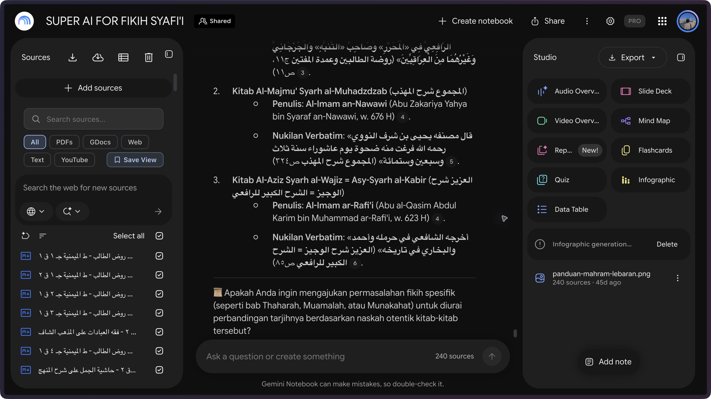
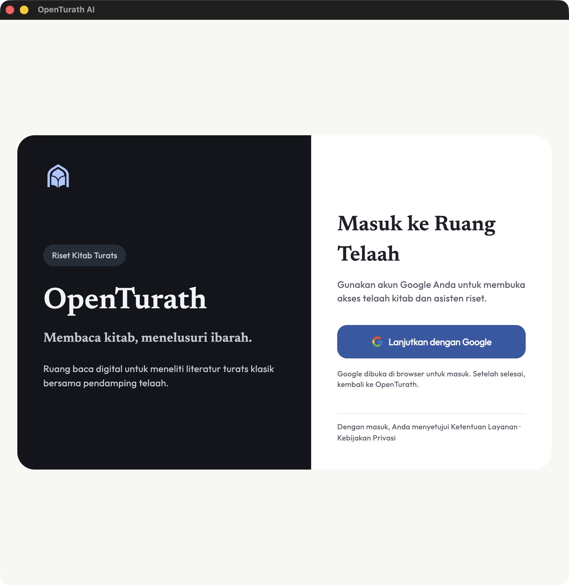

# Pemulihan aplikasi native dan uji autentikasi nyata

Tanggal pemeriksaan: 1 Oktober 2026. Repository: `openturath_ai` di workspace Ramadhan. Cabang: `codex/browser-session-login-2026-10-01`. Setiap perubahan disimpan langsung sebagai checkpoint Git.

Tujuan produk tetap antarmuka OpenTurath di dalam aplikasi, dengan NotebookLM sebagai mesin. Eksperimen browser sudah berhasil menghasilkan jawaban nyata pada akun berizin, tetapi belum memenuhi kebutuhan menyembunyikan UI NotebookLM di semua platform.

## Perubahan yang sudah diterapkan

1. Entry default kembali ke aplikasi Flutter native beserta login, beranda, pustaka, pembaca, catatan, dan langganan. Launcher browser hanya aktif melalui flag pengembangan `OPENTURATH_BROWSER_EXPERIMENT=true`.
2. Navigasi splash sekarang dijalankan setelah frame pertama, ketika Navigator tersedia. Sebelumnya navigasi dari `initState` dapat gagal dan meninggalkan aplikasi pada splash. Tiga tes widget memeriksa jalur login, pengguna aktif, dan kegagalan pembacaan status.
3. `AgentService.getAgentUrl` sekarang memakai tujuan notebook yang sudah diperiksa backend. Peta URL klien tidak lagi menimpa jawaban server. Respons kosong, tipe yang salah, host palsu, HTTP, userinfo, port lain, query/fragment, dan encoding ambigu ditolak. Sebanyak 26 tes memeriksa perilaku layanan yang sebenarnya.
4. Kedua wadah notebook tidak lagi membuka halaman autentikasi Google dalam WebView. Redirect autentikasi menghasilkan keadaan gagal yang jelas; membuka jendela baru atau readiness callback yang terlambat tidak boleh melewati batas tersebut. User-agent browser palsu telah dihapus.
5. Firebase macOS tetap memakai SDK resmi dengan penyimpanan sesi Keychain. Tidak ada pengalihan penyimpanan kredensial ke preferensi plaintext. Startup hanya menghapus tiga nama kunci preferensi lama yang sudah diketahui, tanpa membaca nilai kredensial atau menghapus Keychain/catatan riset.
6. Debug/Profile dan Release sekarang mendeklarasikan satu access group milik aplikasi: `$(AppIdentifierPrefix)$(PRODUCT_BUNDLE_IDENTIFIER)`. Target Runner mengaktifkan Keychain Sharing dan memakai identitas `Apple Development` untuk verifikasi lokal. Bundle ID Firebase yang ada tidak diubah.
7. Pesan kegagalan Keychain dalam bahasa Indonesia, Inggris, dan Arab menjelaskan bahwa build perlu diperiksa pengelola, bukan menyuruh pengguna mengulang login/restart tanpa dasar.

## Uji akun nyata yang diizinkan pengguna

Pengguna secara eksplisit mengizinkan akun `raflimaulan@gmail.com` untuk login OpenTurath dan satu pertanyaan NotebookLM. Pada profil Arc yang sama:

1. Login Google melalui helper resmi OpenTurath selesai dan halaman callback lokal diterima aplikasi.
2. Firebase native kemudian gagal menyimpan sesi ke Keychain. Aplikasi menampilkan kegagalan penyimpanan sesi; hasil browser tidak dipakai untuk memalsukan Firebase user atau kesiapan NotebookLM native.
3. Ruang `/workspace/` pada origin Firebase yang sama mengenali Firebase browser session tanpa permintaan login baru.
4. Callable produksi menyetujui akses Fikih Syafi'i dan mengembalikan URL notebook; hasil yang berizin ditampilkan sebagai tautan. NotebookLM kemudian mengalihkan host ke `notebook.google.com`, yang sudah termasuk host yang diizinkan.
5. Notebook dibuka dengan akun yang sama tanpa formulir login Google kedua. UI menampilkan notebook Fikih Syafi'i dan 240 sumber.
6. Satu pertanyaan baru dikirim: “Uji koneksi OpenTurath: sebutkan tiga judul kitab sumber yang tersedia dalam notebook ini beserta penulisnya. Jawab singkat dan sertakan sitasi sumber.”
7. Jawaban baru muncul dengan tiga judul kitab/penulis dan enam tombol sitasi. Reload pada tab uji masih menampilkan pertanyaan serta jawaban yang sama. Tidak ada sumber, hak berbagi, langganan, atau konfigurasi notebook diubah.

Ini memverifikasi autentikasi browser, hak akses backend, pembukaan notebook, pengiriman satu pertanyaan, dan munculnya jawaban. Ini bukan audit kebenaran ilmiah jawaban atau validasi isi semua sitasi. Profil browser sudah memiliki akun Google sebelumnya; login pertama dari browser yang benar-benar kosong, MFA, pergantian akun, pencabutan sesi, dan perangkat lain belum diuji. Error 403 “finance bot” pada akun/screenshot terdahulu tidak dinyatakan selesai secara umum oleh hasil pada akun ini.

## Hambatan macOS yang sudah dibuktikan

Pada uji native, callback OAuth bekerja, kemudian penyimpanan sesi gagal. Pemeriksaan lokal menemukan nol identitas code signing yang valid dan proyek sebelumnya tidak memiliki Keychain Sharing. Xcode kemudian menampilkan akun Apple yang terhubung beserta `Personal Team`; pengguna menyatakan akun tersebut terdaftar Apple Developer dan akan memberikan Team ID. Status keanggotaan berbayar tidak disimpulkan dari nama tim di UI.

Dokumentasi Firebase mewajibkan Keychain Sharing untuk macOS sejak SDK 9.6.0 karena penyimpanan menggunakan Data Protection Keychain. Konfigurasi yang telah ditambahkan mengikuti kebutuhan tersebut. [FAQ Firebase resmi](https://firebase.google.com/docs/ios/troubleshooting-faq#macos-keychain-sharing), [setup Flutter Firebase](https://firebase.google.com/docs/flutter/setup), [konfigurasi access group Apple](https://developer.apple.com/documentation/xcode/configuring-keychain-sharing).

Build lokal setelah penambahan Keychain gagal dengan exit 1 dan pesan Xcode: `Runner has entitlements that require signing with a development certificate`. Pemeriksaan build settings setelah perubahan identitas memastikan Runner memilih `Apple Development` dan `Runner/DebugProfile.entitlements`; Team ID belum ditetapkan. Ini merupakan hambatan signing yang konkret, bukan bukti perbaikan Keychain sudah berhasil pada runtime.

Langkah yang diperlukan berikutnya:

1. Tetapkan Team ID yang diberikan pengguna pada Runner. Jangan membuat Team ID atau mengganti bundle ID secara tebakan.
2. Pastikan sertifikat development milik tim tersebut tersedia secara lokal. Jika perlu membuat/mengimpor kredensial signing, pengguna melakukan langkah kredensial di Xcode; password dan private key tidak diminta melalui chat atau dibaca oleh agent.
3. Bangun kembali, periksa entitlements pada binary yang baru, kemudian ulangi login native dan restart aplikasi untuk membuktikan persistensi Firebase.

`Apple Development` adalah identitas untuk verifikasi lokal. Distribusi macOS publik masih memerlukan pilihan identitas/provisioning distribusi serta notarization yang sesuai. Belum ada build distribusi atau penerbitan baru pada tahap ini.

## Hasil pemeriksaan

| Pemeriksaan | Hasil dan batasnya |
| --- | --- |
| Suite Flutter penuh setelah pemulihan native dan guard notebook | Exit 0, 290 tes lulus; sebelum penambahan konfigurasi signing dan perubahan pesan Keychain |
| Flutter analyze pada perubahan alur native | Exit 0, `No issues found` |
| Build macOS debug sebelum penambahan Keychain entitlements | Exit 0; aplikasi benar-benar dijalankan dan mencapai login native |
| Uji bahasa/copy setelah perubahan pesan Keychain | Exit 0, 16 tes lulus |
| Kedua entitlements dan project Xcode setelah perubahan signing | `plutil -lint`: semua OK |
| Build settings Runner setelah perubahan signing | Exit 0, identitas `Apple Development`, entitlements Debug/Profile yang benar; belum ada `DEVELOPMENT_TEAM` |
| Build macOS dengan Keychain entitlements baru | Exit 1, sertifikat development diperlukan; belum ada binary baru yang dapat dinyatakan lolos |
| Login Google nyata → callback aplikasi | Berhasil pada akun yang diizinkan |
| Persistensi Firebase native macOS | Gagal pada build ad-hoc yang diuji; uji ulang build bertanda tangan masih menunggu |
| Sesi Firebase browser → akses server → pertanyaan NotebookLM → jawaban | Berhasil pada satu akun/profil Arc/perangkat; bukti gambar tersedia |
| Satu login dengan NotebookLM tersembunyi dalam aplikasi | Belum terbukti |
| Android, iOS, Windows, Linux pada perangkat nyata | Belum diuji |

## Batas integrasi yang tidak diselesaikan oleh sertifikat Apple

Keychain menangani sesi Firebase native. Sertifikat Apple tidak memindahkan cookie Google/NotebookLM dari browser ke WKWebView. Bukti keberhasilan browser juga tidak boleh diubah menjadi flag siap pada WebView.

Google melarang OAuth dalam embedded user-agent yang dikendalikan aplikasi. Menyalin cookie, mengganti user-agent agar menyerupai browser resmi, atau mengulang formulir Google tidak dipakai sebagai solusi. [Kebijakan OAuth Google](https://developers.google.com/identity/protocols/oauth2/policies), [OAuth untuk aplikasi native](https://developers.google.com/identity/protocols/oauth2/native-app).

Dokumentasi publik NotebookLM Enterprise yang diperiksa memuat pengelolaan notebook, sumber, dan audio; daftar endpoint yang diperiksa belum mendokumentasikan API chat untuk mengirim pertanyaan dan memperoleh jawaban/sitasi di UI pihak ketiga. Enterprise mendukung identitas Google Cloud atau federasi OIDC/SAML, tetapi SSO tersebut belum membuktikan antarmuka chat native dengan merek sendiri atau migrasi notebook personal. [API notebook](https://docs.cloud.google.com/gemini/enterprise/notebooklm-enterprise/docs/api-notebooks), [REST resources](https://docs.cloud.google.com/generative-ai-app-builder/docs/reference/rest), [identitas Enterprise](https://docs.cloud.google.com/gemini/enterprise/notebooklm-enterprise/docs/set-up-notebooklm).

Kebutuhan produk native, NotebookLM tetap asli, UI NotebookLM tersembunyi, dan satu login semua platform masih memerlukan integrasi resmi yang benar-benar dapat diuji. NotebookLM tidak diganti diam-diam dengan mesin lain. Belum ada dasar untuk menjanjikan “pasti berhasil” atau menyebut aplikasi siap rilis.

## Checkpoint dan publikasi

Checkpoint `e56ef8e` menyimpan pemulihan native beserta bukti login sebelum perubahan Keychain/signing. Perbaikan Keychain dimulai pada `5b7b0b3`, sedangkan `00a6f21` memastikan Runner meminta signing development. Riwayat Git menyimpan semua perubahan terpisah, termasuk bukti uji browser.

Eksperimen browser yang sebelumnya diizinkan tetap live; metadata publikasi sebelumnya disimpan dalam `publication.json`. Pada tahap pemulihan native ini tidak ada unggahan Hosting baru, APK, perubahan `app_config/version`, atau broadcast update. Build macOS baru yang gagal tidak disebut sebagai binary rilis.
