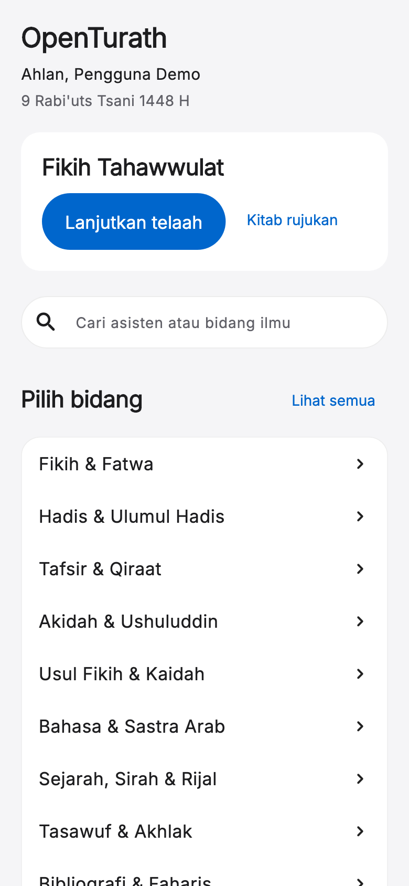
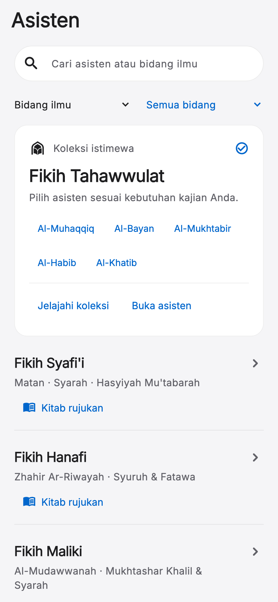
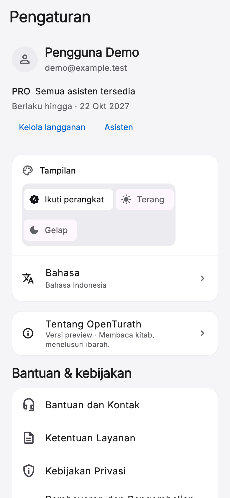
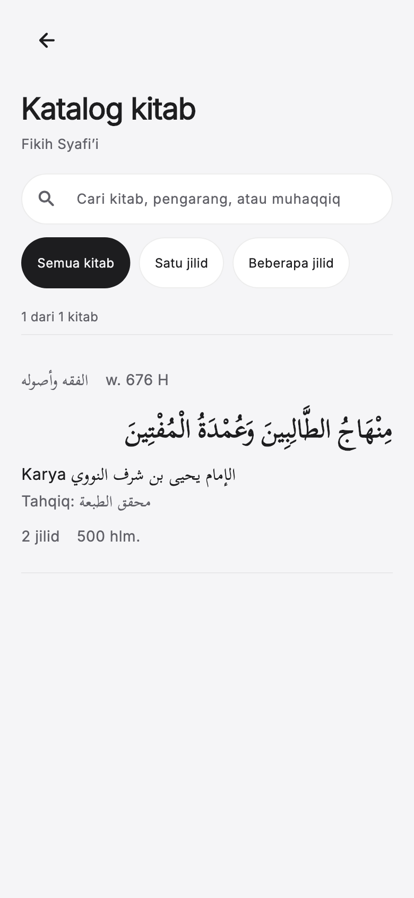
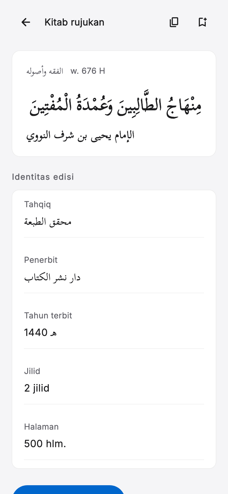
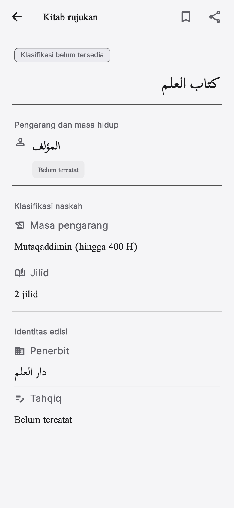
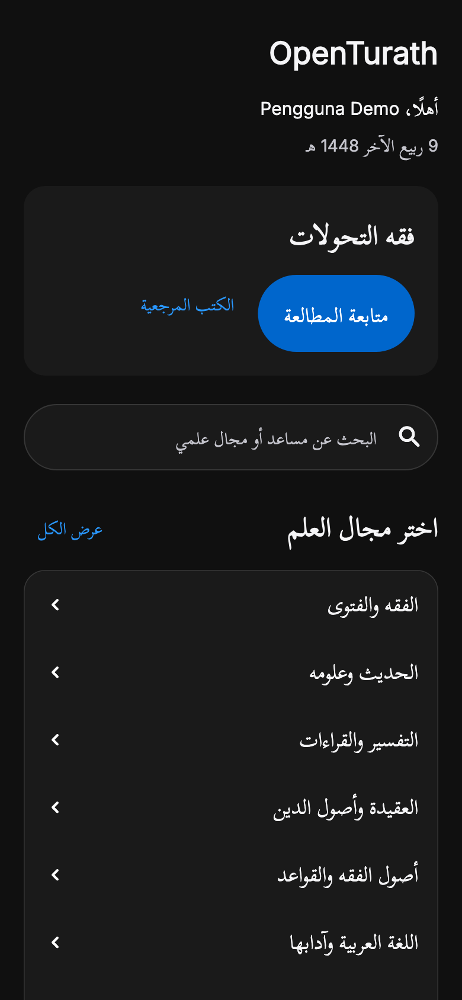
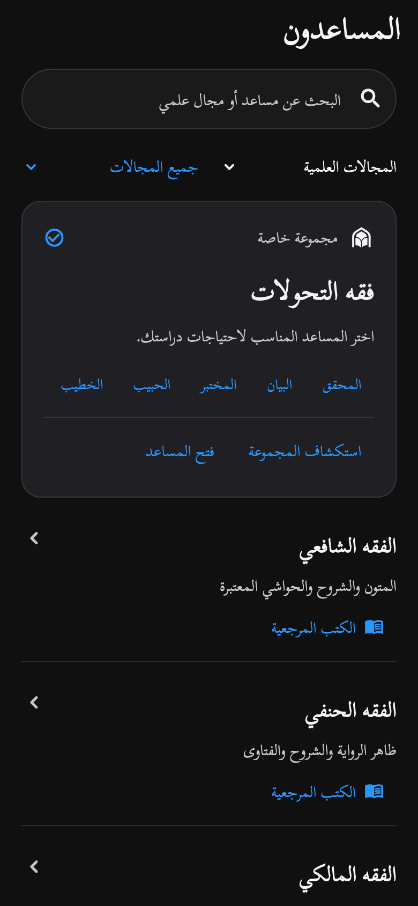

# Revisi komprehensif native — 22 September 2026

Dokumen ini menggantikan bukti visual dalam `docs/redesign-2026-09-22/IMPLEMENTASI.md` untuk halaman yang direvisi. Implementasi lama tidak digunakan sebagai bukti bahwa desain sudah sesuai.

## Perubahan

- Fondasi native: Inter berlisensi OFL dibundel offline, warna netral, aksi biru, kontras tombol gelap, hierarki sans-serif. Font Arab tetap mendukung harakat; teks Latin tidak lagi ikut menjadi serif ketika bahasa Arab aktif.
- Beranda: menghapus judul pembuka berulang, merangkum tanggal dan sapaan, memperkecil kartu lanjut belajar, mempercepat akses bidang.
- Pengaturan: identitas dan keanggotaan diringkas; tanggal berlaku mencakup tahun; pemilih tema membungkus pada layar sempit/teks besar; tanpa bayangan kontrol lama.
- Direktori: filter bidang/korpus dikonsolidasikan, kartu umum menjadi daftar yang lebih ringkas. Tahawwulat memiliki area khusus dengan akses langsung ke lima peran serta halaman penjelasan koleksi.
- Pustaka: subasisten Tahawwulat dipetakan ke korpus induknya, bukan fallback Syafi‘i. Rute native menolak katalog yang tidak dikenali; kesalahan pemuatan tidak disamarkan sebagai daftar kosong.
- Detail pustaka: metadata vertikal dengan gutter, judul Arab RTL, ID edisi/folder internal tidak dipamerkan, klasifikasi dan era dilokalkan. Data jilid hilang atau ambigu tidak dianggap multijilid.
- Copy bidang dan kontrol native diperiksa dalam Indonesia, Inggris, Arab. Nama kitab/pengarang Arab tetap dipertahankan sebagai data sumber.

Skill design-system digunakan untuk menyatukan token native; dart-flutter-patterns memandu pemisahan presentation dari autentikasi agar widget produksi dapat diuji langsung. Tema global AI tidak diubah.

## Verifikasi

- `flutter test --reporter expanded --dart-define=CAPTURE_REVISION=true`: **266 tes lulus**.
- `flutter analyze`: **No issues found**.
- 72 kasus layout: enam halaman produksi × tiga bahasa × dua tema × ukuran teks 100%/200%. Layar 390×844 untuk ukuran normal dan 320×844 untuk ukuran besar; render awal dan setelah scroll diperiksa dari exception layout.
- Tiga tes interaksi tambahan memeriksa kelima tombol peran dalam setiap bahasa dan identitas callback-nya.
- Tes korpus menggunakan aset katalog asli, mencocokkan lima persona dengan katalog Tahawwulat, serta memeriksa unknown-key dan klasifikasi jilid.
- Regresi sebelumnya untuk navigasi, auth, penyimpanan, koleksi lima peran, dan loading reduced-motion tetap dijalankan.
- Diff dibanding `e14e40c`: tidak ada perubahan file WebView, agent_multi_tab_room, agent_session, ot_colors, atau localization global. Opsi strict repository hanya dipakai jalur native; default pemanggil lama tetap sama.
- Semua perubahan dibuatkan checkpoint Git. Tidak membangun APK, mengunggah binary, atau menyiarkan pembaruan.

## Batas bukti

Gambar berikut adalah render widget presentation yang digunakan produksi, dengan data akun/kitab contoh. Ini **bukan screenshot perangkat** dan tidak menyertakan status bar, navigasi shell bawah, login nyata, pembayaran, atau sesi AI. Tes layout bukan sertifikasi seluruh kombinasi perangkat/data, dan bukan evaluasi kualitas jawaban AI. Validasi perangkat nyata tetap diperlukan sebelum rilis.

## Pratinjau

### Beranda

### Asisten dan lima peran

### Pengaturan

### Pustaka

### Arab dan mode gelap

