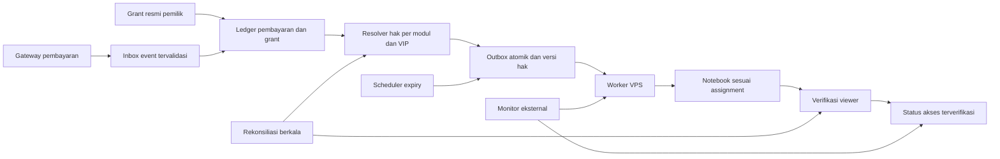
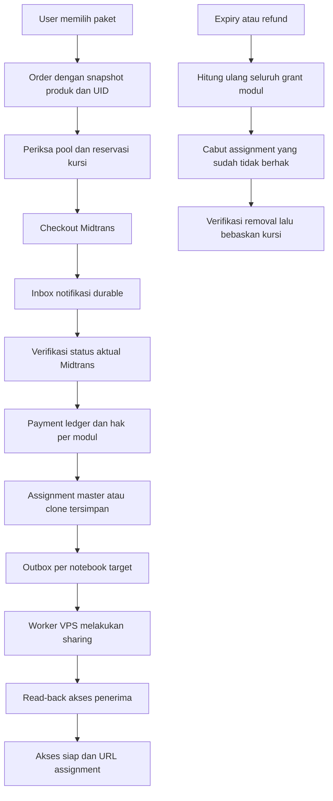

# Audit akses OpenTurath AI dan rancangan migrasi VPS

Tanggal: 9 Oktober 2026. Basis kode: `cd9e0aa`.

**Keputusan: belum siap untuk 10.000 pelanggan.** Cacat dapat direproduksi pada pembentukan masa aktif, isolasi modul, perlindungan VIP, dan penyelesaian pekerjaan akses. Memindahkan proses yang sama ke VPS hanya memindahkan cacat tersebut ke mesin yang lebih sering menyala.

Target yang layak adalah sistem dengan aturan yang dapat diuji, pekerjaan yang tidak hilang, pencabutan yang diverifikasi, pemulihan otomatis, dan peringatan jika jaminan waktu tidak terpenuhi. Tidak ada dasar untuk menjanjikan nol kegagalan ketika akses bergantung pada jaringan, sesi Google, dan layanan pihak ketiga.

## 1. Lingkup dan batas bukti

- Dibaca: dokumen kasus Nadia yang dilampirkan, aturan workspace, jalur Python subscription, Cloud Functions TypeScript, Firestore Rules, model akses Flutter, katalog notebook, daemon, Dockerfile, dan laporan stress test lokal.
- Dijalankan: 32 pengujian regresi backend yang sudah ada; simulasi Python terhadap fungsi asli yang diekstrak melalui AST; simulasi Cloud Functions melalui harness database dan HTTP tiruan.
- Pengujian ini tidak memakai database produksi, cookie Google, token pembayaran, atau Telegram nyata. Tidak menjalankan reaper atau skrip perbaikan produksi.
- Tidak mengubah kode operasional, data pelanggan, VIP, konfigurasi cloud, atau VPS. Dokumen ini adalah hasil kajian dan rancangan, bukan implementasi yang telah dirilis.
- Spesifikasi dan deployment VPS belum terverifikasi. Tidak ditemukan `/Users/apple/.ssh/config` pada pemeriksaan ini; hal tersebut tidak membuktikan VPS tidak ada. Pertanyaan spesifikasi telah disampaikan.
- Tidak mengonfirmasi ulang daftar viewer produksi atau riwayat transaksi Nadia. Tanggal dan riwayat pada lampiran tetap merupakan bukti yang diberikan pengguna, bukan hasil pembacaan produksi baru.
- Ada perubahan workspace lain sebelum audit; perubahan tersebut tidak dimasukkan ke checkpoint dokumen ini.

## 2. Sistem yang sebenarnya terlihat dalam kode

Sistem bukan sepenuhnya lokal. Ada beberapa jalur yang dapat menulis hak akses atau memerintah sharing:

| Jalur | Perilaku sekarang | Bukti kode |
|---|---|---|
| DOKU/Midtrans Cloud Functions | Aktivasi atomik invoice, entitlement, dan outbox | `openturath_ai/functions/src/index.ts:842–982` |
| Worker outbox cloud | Setiap 5 menit, paling banyak 25 kandidat; mengirim ke URL Cloud Run tetap | `index.ts:1963–2044`, `2105–2157` |
| Webhook Python | Memperbarui transaksi/profil lalu menambah atau menghapus viewer | `ecosystem/openturath_subscription/webhook_server.py:312–597` |
| Reaper Python | Membaca transaksi, users, Akal, kemudian melakukan pencabutan | `autonomous_reaper.py:360–562` |
| Daemon lokal | Siklus per jam ditambah durasi pekerjaan; heartbeat tengah malam | `run_reaper_daemon.py:28–70` |
| Revoke cloud | Jadwal per jam; memindai users dan transaksi | `index.ts:1772–1951` |
| Webhook/sync Akal cloud | Menulis entitlement/transaksi dan langsung memanggil sharing | `index.ts:2476–2981` |
| Sync Python lama | Ada penulis transaksi/profil flat dan ada sync yang mutasinya dinonaktifkan | `sync_akal_to_firestore.py:101–130`, `akal_sync.py:175–184` |

Keberadaan Cloud Run dan jadwal cloud di source tidak membuktikan versi tersebut sudah terdeploy atau sedang sehat. Namun ini cukup untuk menolak asumsi bahwa masalahnya hanya Mac yang berhenti menyala.

## 3. Temuan yang harus diselesaikan

### F01 — Perintah sharing diperlakukan sebagai pembayaran baru — KRITIS

`notifySubscriptionServer` mengirim `status`, `payer`, dan `service`, tanpa ID transaksi, nominal, price scheme, atau paidAt (`index.ts:2125–2137`). Server Python mem-parsenya menjadi nominal 0, ID kosong, dan durasi default 1 bulan; tetap membuat transaksi acak dan memperpanjang profil (`webhook_server.py:251–258`, `281–310`, `325–435`).

**Reproduksi:** tiga perintah semacam ini menghasilkan tiga transaksi dan expiry sekitar 90 hari. Pemeriksaan ID yang ditambahkan sebelumnya tidak melindungi jalur internal tanpa ID. Retry sharing atau sync dapat mengubah akuntansi langganan. Paket tahunan juga bisa diterjemahkan sebagai paket bulanan pada server penerima.

**Perbaikan:** pisahkan endpoint pembayaran dari endpoint rekonsiliasi sharing. Worker sharing tidak boleh membuat transaksi atau menghitung durasi. Wajib membawa `job_id`, UID/email terverifikasi, modul, notebook/assignment, dan versi entitlement.

### F02 — Isolasi modul bocor dari Akal — KRITIS

Reaper membaca pelanggan aktif setiap service lalu memasukkan setiap email ke semua modul (`autonomous_reaper.py:464–475`). Di revoke cloud, paket tahunan dianggap aktif di semua modul meskipun `entitlement_key` hanya Tahawwulat (`index.ts:1863–1874`).

**Reproduksi:** aktif Tahawwulat menyebabkan aktif Syafi'i di reaper; transaksi Tahawwulat tahunan meniadakan job cabut untuk transaksi Syafi'i expired pada fase transaksi cloud.

**Perbaikan:** service ID harus dipetakan secara eksplisit ke modul. Durasi tahunan tidak menentukan cakupan. Hanya produk all-access yang katalog resminya menyatakan demikian boleh mengaktifkan semua modul.

### F03 — Perlindungan VIP berbeda pada setiap jalur — KRITIS

Reaper Python membaca `role`, tetapi tidak membaca `users.is_vip` (`autonomous_reaper.py:432–439`). Daftar VIP webhook Python hanya tujuh email (`webhook_server.py:144–152`, `571–584`), sedangkan whitelist reaper jauh lebih lengkap. Helper `remove_viewer` tidak memiliki pagar VIP sendiri (`notebooklm_manager.py:131–181`).

Cloud memiliki pemeriksaan `is_vip`/role pada sebagian jalur, tetapi tidak satu resolver bersama untuk seluruh penanda VIP_PERMANENT. Daftar cloud juga belum memuat semua whitelist Python.

**Reproduksi:** `users.is_vip=true` saja tidak masuk global VIP reaper. Email yang secara eksplisit ada di whitelist permanen reaper tetapi tidak pada tujuh email webhook dapat mencapai pemanggilan removal tiruan.

**Perbaikan:** gabungkan seluruh bukti VIP yang sudah diakui pemilik, termasuk STATIC_WHITELIST, is_vip, role vip, dan VIP_PERMANENT. Pagar yang sama wajib berlaku ketika mengambil job dan tepat sebelum mutasi eksternal. Gagal membaca registri VIP berarti pencabutan berhenti dan dilaporkan. Jangan mengurangi daftar yang sudah ada atau menafsirkan VIP sebagai kesalahan data.

### F04 — Pemeriksaan hak lain tidak menghentikan removal — KRITIS

Helper Firestore dapat menemukan transaksi aktif lain dan memilih tidak mereset profil (`webhook_server.py:438–477`), tetapi caller tetap memanggil `remove_viewer` (`571–587`). Pemeriksaan ID yang sudah ada juga hanya menghentikan update database, bukan mutasi sharing.

**Reproduksi:** ketika helper kembali tanpa mengubah entitlement, route tetap mencapai removal tiruan.

**Perbaikan:** caller hanya menerapkan keputusan resolver hak akses terkini per modul. Status FAILED/EXPIRED sebuah order tidak dengan sendirinya berarti seluruh hak modul habis. Makna status gateway harus diverifikasi terhadap kontrak provider; dokumentasi GoAkal tidak berhasil diakses pada audit ini.

### F05 — Idempotensi tidak atomik dan retry tidak memperbaiki partial write — TINGGI

Python melakukan `get existing`, menulis transaksi, lalu mengubah user, tanpa transaksi database atomik (`webhook_server.py:325–435`). Jika berhenti setelah transaksi tersimpan, retry melihat dokumen sudah ada dan keluar. Event status berikutnya dengan ID sama juga keluar tanpa transisi yang jelas. Pada banyak proses, check-then-write dapat berlomba.

**Reproduksi:** crash tiruan setelah penulisan transaksi; retry tidak memperbaiki entitlement user.

**Perbaikan:** atomikkan event/payment activation, perubahan entitlement, dan outbox. ID pembayaran harus diberi namespace provider. Simpan ID event terpisah agar PAID→SETTLED tidak menambah durasi kedua kali dan transisi refund tidak diabaikan. Database mendukung transaksi atomik; panggilan eksternal harus dilakukan sesudah commit, di luar callback yang dapat diulang. [Dokumentasi Firestore](https://firebase.google.com/docs/firestore/manage-data/transactions).

### F06 — Profil lama dapat mengalahkan transaksi sah — TINGGI

Reaper menerima expiry user yang masih jauh di depan sebagai aktif. Sebaliknya, profil modul yang expired melakukan `active_by_module[k].discard(email)` setelah transaksi sah sebelumnya memasukkan email sebagai aktif (`autonomous_reaper.py:428–460`).

**Reproduksi:** transaksi modul masih aktif, tetapi expiry profil lama menyebabkan email menjadi kandidat expired tanpa perlindungan active.

**Perbaikan:** profil hanya proyeksi ledger. Ledger pembayaran/admin grant yang tervalidasi adalah asal keputusan. Rekonstruksi kronologis mempertahankan renewal sah dan tidak mempercayai expiry korup. Anomali diberi status rekonsiliasi dengan alasan, tidak dibenarkan diam-diam.

### F07 — Transaksi Rp0 tanpa verifikasi masih dipercaya — TINGGI

Python dan jalur Akal cloud belum mempersyaratkan pembayaran positif yang tervalidasi atau grant admin yang eksplisit (`autonomous_reaper.py:387–407`; `index.ts:2725–2737`, `2858`, `2923–2958`).

**Reproduksi:** transaksi success Rp0 dengan expiry masa depan dianggap hak aktif oleh reaper.

**Perbaikan:** grant gratis, voucher, beasiswa, dan VIP tetap sah melalui jenis event admin yang jelas. Rp0 dari sinkronisasi biasa masuk karantina; bukan perpanjangan otomatis. Pertahankan bukti asal dan admin penanggung jawab.

### F08 — Pencabutan eksplisit all-access bisa tidak menghasilkan target — TINGGI

Cabang expiry transaksi sukses Python menangani modul yang dikenal atau key None, tetapi melewatkan explicit `all_access`/`all_ai` expired (`autonomous_reaper.py:408–418`).

**Reproduksi:** transaksi all_access expired tanpa profil pendamping menghasilkan nol modul expired. Fallback profil tertentu mungkin menutup kasus ini, tetapi pelanggan yang hanya punya transaksi tidak terlindungi.

### F09 — Identitas notebook dan cakupan produk tidak tunggal — TINGGI

Master Syafi'i `c89d09ca-4b48-4000-a98d-59e532607fb6` **sudah ada** pada reaper saat audit ini (`autonomous_reaper.py:96–109`); temuan lama tentang ketiadaannya tidak lagi berlaku pada source tersebut. Namun mapping webhook masih bergantung pada satu variabel dengan default legacy, dan paket Semua AI menggunakan legacy yang di-hardcode (`webhook_server.py:87–97`, `106–141`). Hanafi/Maliki/Hanbali/Muqaran bahkan diarahkan ke notebook Syafi'i dalam mapping tersebut.

Katalog aplikasi mempunyai master tersendiri untuk modul-modul ini. Worker cloud hanya mendukung enam key (`index.ts:1957`), sementara katalog penjualan/bundle berisi jauh lebih banyak. Resolver URL saat ini selalu memilih master (`notebook_catalog.ts:638–662`), sehingga komentar 13 clone bukan bukti pembagian beban aktif.

**Perbaikan:** satu katalog versi untuk product ID→module keys→notebook assignment. Semua master, legacy yang masih bisa diakses, dan clone yang pernah diberikan harus masuk inventaris reconciliation. Pastikan routing aplikasi, grant, dan revoke merujuk assignment yang sama. Jangan mengganti mapping dengan partial text match.

### F10 — Pagination membuat pembacaan tidak lengkap — TINGGI

Python mengambil PAID/SETTLED halaman pertama saja dengan batas 100 dan services default 20 (`akal_client.py:86–88`, `139–147`). Sync cloud membatasi empat halaman dan memilih transaksi aktif pertama (`index.ts:2693–2745`), bukan menggabungkan seluruh riwayat renewal.

**Perbaikan:** selesaikan semua halaman memakai cursor/metadata provider, simpan watermark dan bukti kelengkapan; scan gagal/terpotong tidak boleh dipakai sebagai bukti pelanggan tidak berhak. Gunakan backfill terkontrol dan sinkronisasi inkremental setelahnya.

### F11 — Job add lama bisa menghidupkan kembali pelanggan expired — TINGGI

Worker menentukan add job sebagai `desired=true` tanpa mengecek entitlement aktif (`index.ts:2011`). Pengecekan revisi setelah delivery tidak membatalkan masalah jika entitlement sudah expired sebelum worker mulai. Pengguna dengan UID email juga melewatkan pembacaan dokumen UID biasa.

**Reproduksi:** job add tertunda untuk user expired tetap mengirim PAID.

**Perbaikan:** setiap job merupakan permintaan reconcile. Add dan remove sama-sama mengevaluasi kondisi terbaru, VIP, versi, cakupan bundle, dan assignment. UID canonical terikat pada email Google terverifikasi; email tidak dijadikan substitusi UID secara sembarang.

### F12 — Antrean dapat tertinggal, gagal permanen tanpa pemulihan jelas — TINGGI

Worker membaca paling banyak 25 kandidat per lima menit, menjalankan delivery berurutan, dan berhenti setelah budget sekitar 210 detik. Query juga memasukkan processing tanpa memilih pekerjaan due secara terurut. Setelah delapan attempt job menjadi failed (`index.ts:1968–1991`); tidak tampak jalur dashboard/replay otomatis yang lengkap dalam kode yang diaudit.

**Reproduksi:** 30 pekerjaan tiruan, satu siklus menyelesaikan paling banyak 25. Batas teoretis konfigurasi adalah 300 kandidat/jam sebelum timeout, retry, atau lease yang terpakai; 10.000 job memerlukan sedikitnya 33 jam 20 menit dengan satu cadence worker tersebut. Ini bukan benchmark throughput provider. Pelanggan dengan lima notebook membutuhkan beberapa operasi sharing per job.

**Perbaikan:** worker berkelanjutan di VPS dengan query due, lease, backoff+jitter, batas concurrency per akun/notebook, dead-letter beralasan, serta replay yang tetap idempoten. Ukur umur pekerjaan tertua dan backlog, bukan hanya jumlah worker hidup.

### F13 — Sebagian kegagalan dan sukses eksternal tidak dicerminkan dengan benar — TINGGI

Reaper menangkap kegagalan membaca transaksi/users/Akal lalu terus memakai hasil parsial (`autonomous_reaper.py:425–477`). Error per notebook hanya dilog; hasil akhir tidak mempunyai error count. Handler Telegram membaca `errors` default 0 (`webhook_server.py:690–691`). Reaper bulk mencatat sharing success langsung setelah RPC, tanpa membaca kembali status (`autonomous_reaper.py:521–537`).

Helper library remove_user pada wheel yang disertakan memang membaca `get_status` setelah RPC, tetapi manager hanya menggunakan jumlah viewer; tidak menegaskan email target benar-benar hilang. Jadi masalah pembuktian paling tegas ada di jalur bulk reaper. Jalur Akal cloud menelan error sharing dengan `catch (_) {}` dan tetap dapat membalas sukses (`index.ts:2787–2790`, `2964–2980`).

**Perbaikan:** bedakan accepted, entitlement_committed, access_pending, access_verified, blocked, retry, dan failed. Jika pembacaan VIP atau cakupan data tidak lengkap, blok removal. Baca ulang viewer dan cocokkan target+notebook sebelum menyebut pencabutan terverifikasi; tangani kegagalan ledger log sesudah mutasi melalui rekonsiliasi ulang.

### F14 — Belum ada batas waktu pencabutan yang dapat dijamin — TINGGI

Daemon tidur satu jam setelah siklus selesai, sehingga interval nyata melebihi satu jam. Cron cloud juga per jam ditambah antrean lima menit. `/health` hanya membuktikan handler HTTP hidup (`webhook_server.py:1009–1017`). Heartbeat yang dikirim dari proses sendiri tidak mendeteksi proses yang sudah mati, dan siklus yang gagal sebagian masih dapat terlihat selesai.

**Perbaikan:** scheduler expiry berbasis index waktu, pemeriksaan eksternal dari host berbeda, heartbeat terakhir yang berhasil, canary, metrik verification lag, serta alarm backlog/auth/provider. Reaper harus bisa memperbaiki grant yang hilang maupun revoke yang belum diterapkan; Python sekarang berfokus pada removal.

### F15 — Migrasi VPS belum cukup ditopang konfigurasi runtime — SEDANG/TINGGI

Path kredensial lokal dan pemilihan auth berbeda antarproses; reaper juga mengganti DNS NotebookLM dengan IP Google tetap (`autonomous_reaper.py:19–26`, `326–358`; `notebooklm_manager.py:32–66`). Docker hanya menjalankan webhook, bukan daemon (`Dockerfile`). `.dockerignore` secara eksplisit belum mengecualikan `.env`, storage state, dan master token dari image.

**Perbaikan:** konfigurasi tervalidasi saat startup, DNS standar yang diuji di VPS, secret dipasang saat runtime dengan izin minimal, image bebas secret/data pelanggan, auth refresh terserialisasi, readiness dependency, restart service, backup/restore. Jangan menjanjikan sesi Google tidak pernah memerlukan intervensi pemilik.

### F16 — Perhitungan durasi dan penulis lama saling berbeda — TINGGI

Python memakai 30×bulan; aktivasi invoice cloud memakai bulan kalender dengan clamp; sync Akal cloud memakai setMonth; webhook Akal cloud kembali 30×bulan. Ada fallback tanggal invalid menjadi waktu sekarang. Sync Python lama menimpa model flat dan tidak menyimpan key modul (`sync_akal_to_firestore.py:85–130`).

**Perbaikan:** katalog plan versi menyimpan unit durasi dan aturan stacking. Untuk kasus manual Syafi'i dalam SOP, satu bulan tetap 30 hari: 21 Agustus→20 September; jangan mengubah historinya menjadi 21 September. Paket lain mengikuti kontrak penjualan yang diverifikasi. PaidAt invalid dikarantina, bukan dianggap pembayaran baru hari ini. Penulis lama dinonaktifkan melalui cutover yang dapat diaudit.

## 4. Bukti pengujian

Suite existing:

```text
AUDIT_SOURCE_ROOT=/Users/apple/Downloads/ramadhan/openturath_ai \
node --experimental-transform-types --test \
openturath_ai/functions/test/audit_regression.test.ts
tests 32; pass 32; fail 0; exit 0
```

Percobaan pertama memakai strip-only gagal memuat parameter-property TypeScript. Mode transform menjalankan suite sampai selesai. Ini masalah pemanggilan runtime pengujian, bukan kegagalan test produk.

Simulasi tambahan menjalankan fungsi asli di lingkungan tiruan, tidak sekadar membuat ulang rumus. Python diekstrak melalui AST agar loader `.env`, kredensial, dan startup tidak berjalan. Cloud menggunakan `functions/test/audit_harness.ts` dengan HTTP/database memory.

```text
R1 aktif Akal Tahawwulat bocor ke Syafi'i: true
R2 users.is_vip=true dikenali reaper Python: false
R3 expiry profil stale mengalahkan transaksi aktif: true
R4 transaksi Rp0 belum diverifikasi dianggap aktif: true
R5 all_access explicit expired menghasilkan target: 0
W1 tiga perintah tanpa ID/nominal menghasilkan transaksi: 3
W1 masa aktif setelah tiga delivery: sekitar 90 hari
W2 retry memperbaiki profil setelah partial write: false
W3 VIP whitelist reaper dapat mencapai removal webhook: true
W4 helper tanpa perubahan entitlement tetap diikuti removal: true
C1 field billing yang diteruskan: hanya payer, service, status
C2 stale add pada user expired mengirim: PAID
C3 Tahawwulat tahunan meniadakan job cabut Syafi'i expired: true
C4 delivery satu siklus dari 30 kandidat: 25
```

R1–R5/W1–W4/C1–C4 adalah 13 skenario tambahan, dengan W1 mempunyai dua keluaran. Pengujian lama yang lulus tidak meliputi keseluruhan kontrak cloud→Python atau kegagalan ini. Reproduksi membuktikan jalur kegagalan source, bukan jumlah pelanggan yang saat ini terdampak.

## 5. Rancangan yang disarankan

### Satu pusat keputusan, satu ledger yang dapat ditelusuri

Pertahankan Firestore sebagai sumber kebenaran awal untuk mengurangi risiko migrasi database bersamaan. Letakkan eksekusi sharing dan rekonsiliasi pada service VPS. Pilihan ini adalah rekomendasi desain, bukan kebutuhan untuk memindahkan semua komponen ke VPS.



Pemisahan tanggung jawab:

1. **Inbox pembayaran:** validasi token/signature sesuai provider, invoice/product ID, jumlah/currency, identitas owner, dan event ID. Balas setelah event tersimpan durable; jangan menunggu sharing Google dalam request pembayaran.
2. **Ledger:** simpan bukti pembayaran sebagai riwayat yang tidak berubah menjadi status subscription expired. Refund/cancel/admin grant adalah event terpisah. Satu pembayaran memberikan durasi satu kali.
3. **Resolver:** hitung hak dari payment/grant valid per modul, termasuk overlap bundle dan renewal, dengan proyeksi entitlement versi. VIP mempunyai prioritas perlindungan permanen sesuai SOP pemilik.
4. **Outbox:** ditulis atomik dengan entitlement; menyimpan UID, modul, revision, target assignment, due_at, attempts, lease_until, dan alasan. Jangan simpan seluruh 10.000 pelanggan dalam satu dokumen.
5. **Worker:** tugasnya mendekatkan akses nyata ke kondisi yang seharusnya. Tidak mengubah ledger atau expiry. Request reconcile identik aman diulang. Efek eksternal memakai at-least-once delivery dengan dedup/reconciliation, bukan janji exactly-once lintas Google dan database.
6. **Verification:** catat email/notebook yang benar-benar diamati memiliki/tidak memiliki akses beserta timestamp. Jika provider tidak dapat diverifikasi, tetap pending/retry; jangan mengirim laporan seolah selesai.
7. **Reconciliation:** temukan hak aktif tetapi akses hilang, hak habis tetapi viewer masih ada, notebook tidak terinventarisasi, transaksi tanpa assignment, dan profil menyimpang. Pengguna tidak dikenal dilaporkan; tidak otomatis dicabut berdasarkan ketidakhadiran pada scan parsial.

### Aturan keputusan sebelum removal

Removal memerlukan semua hal berikut: bukan VIP dari sumber yang diakui; pemetaan notebook→modul jelas; bukti hak lengkap dan tervalidasi; tidak ada grant/pembayaran/bundle aktif lain untuk modul tersebut; expiry sudah tercapai; revision terbaru masih cocok; pembacaan data tidak gagal.

Gunakan lease per UID+modul serta fencing token/revision. Renewal saat removal sedang dikirim tetap merupakan race eksternal: baca ulang state sesudah mutasi dan lakukan perbaikan add segera bila revision berubah. Pastikan job lama tidak ditandai completed untuk revisi yang lebih baru. Pagar ini mengurangi dan memulihkan race, bukan menyatakan jaringan Google mempunyai transaksi atomik bersama Firestore.

### Ketahanan VPS

Service dijalankan di bawah supervisor dengan restart dan startup validation. Lease disimpan durable agar dua worker tidak berebut. Batasi concurrency dan beban per akun/notebook berdasarkan pengukuran provider. Backup data/konfigurasi, uji restore, pisahkan secret runtime, dan sediakan monitor dari mesin lain.

Satu VPS tetap titik kegagalan. Agar outage tidak membutuhkan pemantauan manual rutin, gunakan durable queue, monitor independen, dan jalur failover worker yang sudah diuji. Komponen cloud dan VPS tidak boleh menjadi dua penulis keputusan yang bersaing. Target CPU/RAM belum dipatok sebelum spesifikasi dan beban sharing nyata diketahui.

## 6. Kapasitas NotebookLM: koreksi berdasarkan pemeriksaan pemilik

Pemilik telah memeriksa bahwa notebook yang digunakan dapat menampung **2.000 pengguna**. Rancangan ini menggunakan kapasitas tersebut. Kesimpulan sebelumnya yang memakai batas umum 50 sebagai kendala akun ini dicabut; angka umum dokumentasi tidak boleh mengalahkan pemeriksaan langsung pemilik terhadap akun yang dipakai.

Untuk 10.000 pelanggan aktif pada satu entitas, kebutuhan mentah adalah lima notebook berkapasitas 2.000. Ini belum menyisakan ruang untuk VIP, akses manual, reservasi, dan perpindahan. Kapasitas penjualan harus menghitung kursi nyata dan reservasi, bukan hanya user paid. Contoh batas alokasi 1.900 adalah opsi cadangan operasional, bukan perubahan batas akun: dibutuhkan enam notebook untuk 10.000 kursi pada batas alokasi tersebut. Jika ingin kapasitas yang tetap cukup ketika satu dari enam notebook tidak tersedia, perlu notebook ketujuh atau strategi cadangan setara. Besarnya buffer ditetapkan dari kondisi nyata.

Lima spesialis Tahawwulat adalah lima entitas konten, masing-masing memerlukan pool notebook tersendiri. Jangan menyamakan cabang keilmuan Al-Muhaqqiq/Al-Bayan/dll. dengan clone penampung pengguna. Jika semua 10.000 user membeli akses ke kelima spesialis, kebutuhan mentahnya lima notebook per spesialis, total 25 notebook, sebelum buffer. Jumlah pelanggan total produk tidak otomatis sama dengan 10.000 user aktif pada setiap entitas.

Katalog source mempunyai 24 entitas dan 312 entri clone, tetapi keberadaan entri tidak membuktikan kesehatan atau keterisian notebook aktual. Evaluasi fungsi resolver membuktikan semua agent yang dipetakan tetap diarahkan ke master. Jadi masalahnya adalah penyambungan pool dan assignment, bukan kurangnya daftar clone dalam source.

Laporan stress test yang tersedia berisi 10 pertanyaan berurutan dan tiga worker chat. Itu tidak menguji alokasi 10.000 identitas, pembayaran bersamaan, atau lifecycle kursi dan pencabutan.

## 7. Target layanan dan pengujian penerimaan

Angka berikut adalah usulan awal, belum hasil pengukuran atau jaminan provider:

| Ukuran | Target saat dependency sehat | Bukti penerimaan |
|---|---|---|
| Pembayaran tersimpan | P95 ≤2 detik | Event inbox durable sebelum response |
| Akses terverifikasi | P95 ≤60 detik; P99 ≤5 menit | Read-back email pada notebook assignment |
| Pencabutan setelah expiry | P99 ≤5 menit; alarm >10 menit | Verifikasi viewer tidak lagi ada |
| Kehilangan pekerjaan | 0 pada restart/crash test | Semua job berakhir verified atau incident terbuka |
| VIP/cross-module | 0 pencabutan salah pada seluruh skenario uji | Matrix aturan + boundary test |
| Monitoring worker mati | ≤2 menit | Monitor eksternal benar-benar mendeteksi stop |

Uji penerimaan harus mencakup:

- Event pembayaran sama dikirim 100 kali dan secara paralel: satu durasi, satu effect ledger.
- PAID→SETTLED, event terlambat/terbalik, refund/cancel, dan order gagal lain pada user yang masih aktif.
- Semua penanda VIP melalui semua entrypoint, job lama, data read failure, dan registri unavailable.
- Kasus Nadia: Syafi'i habis setelah 30 hari; lima cabang Tahawwulat tetap aktif sampai expiry sahnya; simulasi terisolasi dahulu.
- Rp0 biasa ditolak untuk auto-renew; grant/voucher resmi dapat dilacak dan bekerja.
- Renewal dini, renewal setelah lapse, beberapa pembayaran sah, duplicate lintas sync/webhook, dan timestamp tidak valid.
- Crash sebelum/sesudah setiap commit dan sesudah sharing tetapi sebelum logging; job tetap dapat dipulihkan.
- Add lama ketika expired, remove lama ketika renewed, perubahan email/UID, dan pembelian sebelum signup.
- API pagination >100 transaksi, >400 transaksi, >20 services; hasil parsial tidak memicu removal.
- Semua modul/bundle/master/legacy/clone yang beredar menggunakan registry sama.
- Dataset sintetis 10.000 user dengan fanout realistis, expiry serentak, retry storm, quota provider, outage database, session expired, dan backlog recovery.
- Staging dengan akun uji yang terkendali: grant, login penerima, revoke, buka ulang link langsung dan cek penolakan nyata.
- Backup restore dan failover worker dari host lain tanpa pembayaran terhitung ulang.

## 8. Urutan implementasi dan cutover

1. **Tutup cacat kontrak dahulu:** pisahkan reconcile sharing dari pembayaran; pagar VIP bersama; resolver per modul; atomikkan payment/entitlement/outbox. Tambahkan regression test untuk skenario audit sebelum mengganti operasi.
2. **Inventaris dan shadow audit:** snapshot/backup ledger, users, daftar VIP, katalog, dan viewer. Rekonstruksi hak tanpa mutasi. Sajikan perbedaan dan alasan; karantina transaksi hantu tanpa menghapus bukti. Hak VIP tetap utuh.
3. **Worker VPS di staging:** due queue, lease, retry, verification, dashboard insiden, health dependency, monitor eksternal, backup/restore. Buktikan kapasitas dan akses nyata memakai akun uji.
4. **Shadow produksi:** jalankan evaluator baru sebagai pembanding read-only; ukur selisih dan kelengkapan sebelum membuatnya penulis tunggal.
5. **Cutover bertahap:** arahkan job ke worker baru; hentikan penulis/reaper lama yang bersaing; gunakan cohort kecil non-VIP dengan riwayat jelas; perluas setelah hasil akses terverifikasi. Semua perubahan memiliki checkpoint sesuai AGENTS.md.
6. **Rollback:** hentikan mutasi worker baru, pertahankan antrean/ledger untuk replay, pulihkan routing versi terdahulu yang sudah aman. Jangan mengaktifkan kembali penulis ghost billing saat rollback. Renewal dan pembayaran baru tetap ditampung durable selama pemulihan.

Pekerjaan operasional yang masih perlu bukti adalah deployment aktual Cloud Run/Functions/Scheduler, spesifikasi VPS, sesi akun NotebookLM yang dipakai, jumlah viewer per notebook, batas sharing aktual, dan rekonstruksi transaksi produksi. Audit source ini sudah cukup untuk menetapkan bahwa masalah tidak selesai dengan sekadar memindahkan daemon ke VPS.

## 9. Pendalaman: Midtrans, semua AI, dan overflow master ke cabang

**Status rancangan: arah dasarnya benar, tetapi belum layak disebut ideal atau lengkap sebelum bagian ini diimplementasikan dan diuji.** Midtrans adalah gateway utama yang diminta pemilik. Akal/DOKU lama hanya dipertahankan sebagai asal ledger historis atau jalur legacy yang memang masih diperlukan, bukan sebagai pengendali keputusan baru yang bersaing.

### 9.1 Apa yang sudah dan belum tersambung

`createCheckout` memang memanggil Midtrans Snap dan menyimpan `gateway: midtrans` (`index.ts:749–780`). `midtransWebhook` memeriksa signature dan meneruskan sukses ke aktivasi atomik (`1148–1225`). `checkPaymentStatus` mempunyai GET Status untuk inquiry oleh pengguna (`1298–1324`).

Namun resolver notebook tidak membaca kapasitas atau assignment; ia selalu memilih master (`notebook_catalog.ts:638–662`). Katalog Syafi'i masih memberi label master pada ID legacy `334e7b83...` (`416–419`), sedangkan master aktif menurut SOP pemilik adalah `c89d09ca...`. Registry baru harus menetapkan identitas canonical dan tetap melacak akses legacy untuk pencabutan. Jangan mengganti tautan produksi sebelum inventaris dan assignment jelas.

Worker outbox sekarang hanya mendukung enam key modul. Pembelian lain yang lolos whitelist checkout belum otomatis berarti semua notebook terkait dapat diprovision. Paket all-access juga masih dinonaktifkan oleh resolver harga (`index.ts:454–460`); rancangan wajib mampu menangani bundle, tetapi tidak berarti mengaktifkan penjualan paket itu tanpa keputusan pemilik.

### 9.2 Alur lengkap yang harus menjadi kontrak sistem



Pembayaran, entitlement, assignment, dan akses nyata merupakan empat status berbeda. `paid` tidak sama dengan seluruh AI siap dipakai. Tampilan pelanggan harus mengikuti status kesiapan yang terbukti, bukan mengklaim akses aktif ketika sharing masih pending.

### 9.3 Katalog produk harus menjangkau seluruh master dan spesialis

Tetapkan katalog versi dengan hubungan:

`product_id → daftar module_key → daftar entity_id → pool notebook_id`.

Satu modul dapat memberikan beberapa AI/spesialis. Contoh Tahawwulat memberikan Al-Muhaqqiq, Al-Bayan, Al-Mukhtabir, Al-Habib, dan Al-Khatib sesuai paketnya; masing-masing mempunyai master dan clone kapasitas sendiri. Untuk semua modul lain, dokumentasikan tepat AI mana yang termasuk. Jangan menganggap semua key yang mirip sama-sama berhak atau menggantungkan cakupan pada nama paket.

Order menyimpan snapshot katalog, harga, durasi, dan daftar entitas yang dibeli. Perubahan katalog berikutnya tidak diam-diam memperluas atau mengurangi pembelian lama. Keputusan apakah pembeli lama otomatis memperoleh AI baru harus menjadi kebijakan produk eksplisit. Registry pool mencatat notebook, pemilik, entitas, versi corpus/instruksi, kapasitas, dan status kelayakan.

### 9.4 Alokasi saat master penuh

Untuk user baru, pilih master jika sehat dan masih mempunyai kursi yang dapat dialokasikan. Jika penuh atau dihentikan untuk penempatan baru, pilih clone sehat dari entitas yang sama. Jangan mengarahkan ke AI/mazhab berbeda. Penempatan disimpan pada `assignment(uid, entity_id)`; user lama tetap memakai notebook yang sama ketika renew atau membuka aplikasi.

Menghitung `hash(uid) % jumlah_clone` tidak cukup: tidak menjamin batas kapasitas, dan perubahan jumlah clone dapat memindahkan banyak user. Simpan assignment permanen, lalu gunakan transaksi database untuk pemeriksaan dan reservasi kursi. Dua pembayaran yang berebut kursi terakhir harus menghasilkan hanya satu reservasi di master; yang lain dialokasikan ke clone.

Kursi terpakai mencakup penerima akses aktual, VIP/manual yang diakui, reservasi aktif, serta removal yang belum terverifikasi. Bedakan slot admin yang memang dihitung provider. Counter cache harus direkonsiliasi dengan daftar viewer; jangan menganggap counter database selalu sama dengan kenyataan. Jika jumlah nyata tidak lengkap/meragukan, hentikan alokasi ke notebook tersebut dan gunakan pool sehat lain.

Pembelian baru memesan kursi pada seluruh entitas paket sebelum checkout, dengan waktu reservasi mengikuti masa bayar order Midtrans. Pending order tidak boleh menahan kursi selamanya; pelepasan harus memperhatikan kemungkinan pembayaran terlambat. Jika pembayaran sah datang setelah reservasi lepas, pembayaran tetap dicatat; alokasikan ulang, atau tandai paid_waiting_capacity dengan pemulihan/kompensasi yang jelas. Jangan menolak webhook pembayaran sah hanya karena notebook penuh.

Renewal user yang masih aktif tidak mengonsumsi kursi kedua. Pembelian ulang setelah akses benar-benar dicabut perlu memperoleh kursi lagi. Bila semua pool penuh, hentikan checkout baru sebelum menarik pembayaran; mulai penyiapan clone cadangan sebelum kapasitas habis. Provision clone baru hanya ketika corpus, instruksi, ownership, private access, dan canary sudah lolos; bukan sekadar URL baru.

### 9.5 Status Midtrans, refund, dan notifikasi terlambat

Tambahkan worker inquiry terjadwal untuk order pending/processing yang belum final; jangan bergantung pada pelanggan menekan tombol cek. Status callback/browser finish tidak menjadi bukti pembayaran. Cocokkan environment, invoice, nominal, currency, UID, dan status transaksi aktual server-to-server. Simpan timestamp settlement yang riil terpisah dari waktu webhook diterima.

Midtrans mendokumentasikan kemungkinan notifikasi datang tidak berurutan serta GET Status untuk memastikan keadaan terkini. Signature memakai order_id, status_code, gross_amount, dan ServerKey; karena itu pemeriksaan signature tidak menggantikan evaluasi state machine seluruh isi event. [Notifikasi Midtrans](https://docs.midtrans.com/docs/https-notification-webhooks), [penanganan notifikasi](https://docs.midtrans.com/reference/handle-notifications).

State machine wajib mempertahankan fakta payment yang sudah sah ketika event pending/expire lama datang. Capture dengan fraud challenge tidak langsung memberi akses. Refund/full refund/partial refund memerlukan kebijakan yang berbeda; partial refund tidak otomatis menghabiskan seluruh modul. Jangan mencabut VIP atau hak lain yang masih berlaku. Kebijakan chargeback juga harus ditetapkan dan mempunyai asal bukti, bukan mengikuti string status sembarang.

**Simulasi lanjutan terhadap fungsi Midtrans asli dengan database dan HTTP tiruan:**

```text
M1 settlement identik dikirim ulang: expiry tidak bertambah lagi (baik)
M2 settlement kemudian expire terlambat: status transaksi paid menjadi expire (cacat)
M3 refund: response 200, tetapi entitlement tetap active; belum ada aturan rekonsiliasi refund
P1 entitas katalog: 24; entri clone: 312
P2 semua agent yang dipetakan resolver: tetap master, tanpa overflow
P3 route Syafi'i sampel: masih ID legacy 334e7b83...
```

M2 bukan bukti bahwa Midtrans selalu mengirim urutan tersebut; ia membuktikan sistem tidak menangani urutan terlambat yang harus diantisipasi. M3 membuktikan cabang refund tidak mengubah hak, bukan menetapkan bahwa seluruh refund wajib menghapus hak. Tidak ada transaksi uang atau sharing produksi dilakukan.

### 9.6 Fanout, kesiapan paket, dan awal masa aktif

Simpan job per notebook target. Jika empat dari lima AI berhasil dan satu gagal, retry hanya target yang belum verified. Invoice tidak dihitung ulang, assignment sukses tidak hilang, dan pelanggan dapat melihat AI mana yang siap. Definisikan kapan masa aktif pembelian baru dimulai agar antrean sharing tidak mengurangi durasi yang dijual: rekomendasi readiness bagi paket baru, sementara renewal aktif mengikuti expiry sebelumnya. Kebijakan ini perlu diputuskan bersama kontrak penjualan; historis 30 hari yang sudah diberikan tidak boleh diubah sepihak.

Jika durasi dimulai pada readiness, resolver harus tetap mengakui grant paid-awaiting-provision sebagai hak provisioning agar tidak terjadi deadlock, lalu menetapkan effective_from dan expiry secara idempoten setelah syarat readiness paket terpenuhi. Payment.paid_at tetap waktu pembayaran; jangan menggantinya dengan readiness. Sediakan tenggat pemulihan dan kompensasi untuk paket yang tak kunjung lengkap.

### 9.7 Pencabutan, kursi bebas, dan migrasi notebook

Expiry/refund menghitung ulang seluruh grant yang mencakup modul. Jika masih ada grant aktif atau VIP, akses dipertahankan. Jika hak habis, cabut semua assignment historis modul yang masih teramati ada, termasuk master, clone lama, dan notebook yang ditinggalkan saat migrasi. Cabut hanya target yang tidak lagi dibutuhkan grant lain. Jangan mengandalkan daftar master saja.

Kursi baru bebas setelah removal diverifikasi, bukan ketika profil berubah menjadi expired. Crash setelah sharing tetapi sebelum counter update harus dapat diperbaiki dari observed state dan job yang tersimpan. Pembayaran/renewal yang terjadi saat removal harus diuji bersama fencing/revision dan perbaikan akses.

Pemindahan terencana menggunakan grant target→verifikasi→perbarui assignment routing→cabut sumber→verifikasi. Selama perpindahan, kedua kursi dihitung. Pastikan source dan target mempunyai corpus/instruksi versi yang sesuai. Saat notebook tidak dapat diakses, jangan membebaskan kursinya berdasarkan asumsi. Catat removal tertunda untuk diselesaikan saat pulih.

Riwayat percakapan Google tidak boleh diasumsikan ikut berpindah clone. Simpan catatan/jawaban pengguna di penyimpanan aplikasi yang sudah ada, dan uji pengalaman migrasi. Jangan mengganti notebook pada setiap buka tab atau mengubah siklus hidup WebView yang dilindungi AGENTS.md.

### 9.8 Kegagalan bersama, keamanan penjualan, dan operasi

Tiga hal harus dipisahkan: jumlah kursi viewer, batas operasi sharing, dan beban chat bersamaan. Kapasitas 2.000 viewer bukan bukti 2.000 chat simultan tanpa antrean. Pool clone pada akun Google yang sama juga belum menjadi redundansi autentikasi: sesi pemilik gagal dapat menghentikan seluruh sharing.

Pantau usia job, readiness paket, kapasitas per entitas/pool, auth owner, mismatch viewer-counter, umur coroutine/lease, dan status pending Midtrans. Gunakan circuit breaker dan concurrency terbatas saat provider bermasalah; tidak menjalankan ribuan retry sekaligus. Dashboard admin menjelaskan invoice→grant→assignment→viewer beserta alasan keputusan, dengan aksi replay aman.

Perlu idempotency key checkout dari server untuk klik ganda, invoice unik yang dijamin database, konfigurasi sandbox/production eksplisit, dan pemulihan timeout Snap ketika order mungkin sudah dibuat. Satu Firebase UID terikat email Google yang terverifikasi; email kontak pembayaran tidak otomatis menjadi pemilik akses. Perubahan email, akun dihapus lalu dibuat ulang, serta pembelian website sebelum signup harus mempunyai aturan transfer/pemulihan yang jelas. Endpoint internal memakai job ID dan revision agar perintah lama tidak dapat menghidupkan akses lagi.

### 9.9 Tambahan syarat penerimaan rancangan

- Dua atau 100 pembayaran bersamaan ketika master hanya menyisakan satu kursi: tidak overbook dan semuanya memperoleh assignment sah pada pool yang tersedia.
- Dataset 10.000 user: tidak satu pun URL aplikasi berbeda dari notebook yang diberi akses; renewal tidak menggandakan kursi.
- Semua produk yang dapat dibeli mempunyai entity/pool/provisioning lengkap; tidak ada key unsupported yang tersembunyi di worker.
- Pool penuh, reservation timeout, settlement terlambat, dan Snap timeout mempunyai hasil pembayaran serta recovery yang jelas.
- Capture→settlement, pending terlambat, expire terlambat, duplicate, refund/partial refund, dan GET Status outage tidak membuat durasi/akses salah.
- Fanout lima atau 24 entitas gagal sebagian lalu worker restart: pekerjaan selesai tanpa pembayaran kedua, expiry compounding, atau klaim kesiapan palsu.
- Migration meninggalkan akses di notebook sumber: reconciliation menemukannya dan pencabutan modul menangani seluruh riwayat assignment.
- Clone baru belum sehat/versi corpus salah, owner auth gagal, notebook draining, dan counter tidak cocok: allocator tidak mengirim pelanggan ke target bermasalah.
- VIP permanen tetap utuh pada overflow, migrasi, refund, expiry, dan restore; kegagalan registri VIP menghentikan removal.

Sampai kontrak Midtrans→grant→pool→assignment→verified access ini terpenuhi, rancangan tetap berstatus proposal engineering yang perlu implementasi dan pembuktian, bukan sistem ideal yang sudah selesai.
