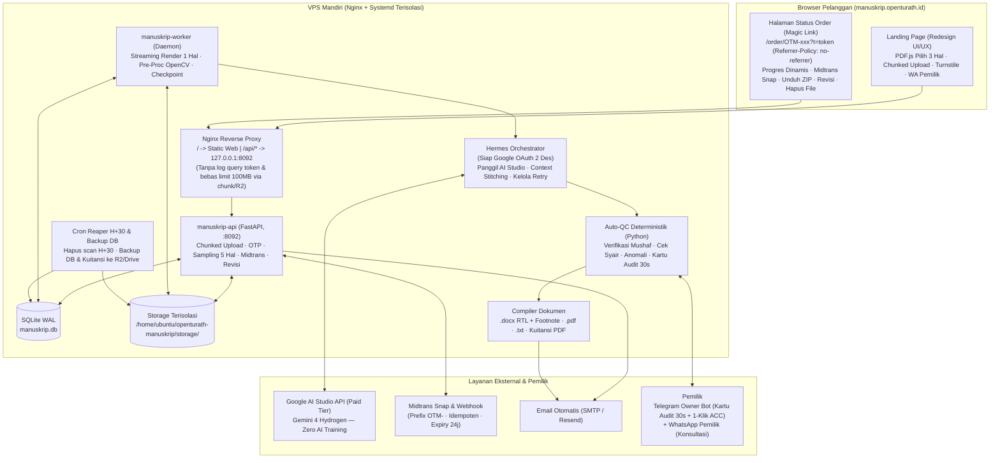
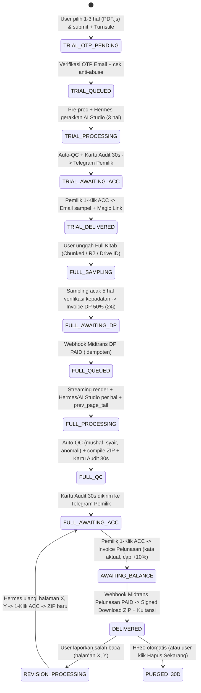

# PLAN v2.0 — OpenTurath Manuskrip (Redesign UI/UX + Otomasi VPS Hermes → AI Studio + Midtrans)

> **Versi:** 2.0 (Pembaruan setelah Audit Kritis 12 Blind Spot & Klarifikasi Mesin AI Studio)  
> **Tanggal Rencana:** 27 November 2026  
> **Target Momentum:** 2 Desember 2026 (Google OAuth resmi untuk Hermes Agent)  
> **Domain Produksi:** `https://manuskrip.openturath.id`  
> **Prinsip Utama:** Pelanggan mendapat alur serba mulus dari unggah hingga unduh; **Hermes** bertindak sebagai orkestrator di VPS yang menggerakkan **Google AI Studio (Gemini 4 Hydrogen — Paid Tier)**; pemilik cukup memantau lewat **Kartu Audit 30 Detik** dan menekan **1-Klik ACC** di Telegram.

---

## 1. Keputusan Arsitektur & Bisnis yang Dikunci

| Aspek | Keputusan Final (v2.0) |
|---|---|
| **Pemisahan Peran AI** | **Hermes Agent** = *Orchestrator / Operator* di VPS (kelola antrean, pre-processing, panggil API AI Studio, kelola *retry* & Auto-QC, susun Kartu Audit 30 Detik, kirim laporan & eksekusi 1-Klik ACC ke Telegram; siap aktifkan Google OAuth Hermes pada **2 Desember 2026**).<br>**Google AI Studio (Gemini 4 Hydrogen — WAJIB Paid Tier)** = *Mesin Vision & Transkripsi Naskah Arab* yang digerakkan oleh Hermes. |
| **Kepatuhan Privasi AI** | **WAJIB Google AI Studio Paid Tier** (billing aktif, dilarang memakai Free Tier untuk naskah pelanggan) agar janji *"tidak digunakan untuk melatih model AI"* sah secara kontraktual, sekaligus menjamin kuota RPM/RPD tinggi untuk kitab ratusan halaman. |
| **Kontrol Pemilik** | **Mode 1-Klik ACC + Kartu Audit Visual 30 Detik** di Telegram Owner Bot. Pemilik melihat 3 halaman acak (*side-by-side*) + halaman yang punya catatan QC di HP selama 30 detik, lalu tekan `[ACC & Kirim]`. |
| **Kanal Komunikasi** | **Email otomatis** (`manuskrip@openturath.id` via SMTP/Resend) untuk seluruh proses transaksional (OTP, Magic Link status, sampel 3 hal, invoice, pengingat, hasil ZIP & kuitansi) + **WhatsApp Pemilik** untuk konsultasi langsung. |
| **Skema Pembayaran (Anti-Refund Manual)** | **Midtrans Snap** (akun eksisting, prefix `order_id`: `OTM-`, header `X-Override-Notification`). **Skema seragam DP 50% di muka** (minimal Rp 50.000) untuk **semua** ukuran order, lalu **pelunasan sisa berdasarkan kata aktual** (plafon maksimal `estimasi + 10%`). Jika kata aktual lebih sedikit, tagihan pelunasan langsung berkurang — **nol refund manual QRIS/VA**. |
| **Tarif Resmi** | Naskah cetak `Rp 20/kata` (`Rp 5.000/250 kata`), Tulisan tangan `Rp 30/kata` (`Rp 7.500/250 kata`), Formatting Word standar **gratis**, Paket Lengkap `+ Rp 10/kata` (deskripsi naskah + catatan kaki). Uji coba 3 halaman pertama **gratis** (1×/pengguna). Retensi file **30 hari** lalu hapus otomatis (atau instan via tombol pengguna). |
| **Arsitektur VPS** | **Service terisolasi** di VPS yang sama (`/home/ubuntu/openturath-manuskrip/`, port lokal `127.0.0.1:8092`, SQLite WAL `manuskrip.db`, storage terpisah) di-proxy Nginx di bawah 1 domain `manuskrip.openturath.id` (tanpa CORS, tanpa mengganggu `maktabah.openturath.id` maupun `openturath-access.service`). |

---

## 2. Arsitektur Sistem Menyeluruh



### Struktur Direktori & Layanan di VPS
Mengikuti pola keamanan `openturath-access` (user `ubuntu`, `secrets/` mode `700`, hardened `systemd`):

```text
/home/ubuntu/openturath-manuskrip/
├── secrets/                          # chmod 700 (TIDAK masuk Git)
│   └── manuskrip.env                 # AI_STUDIO_PAID_API_KEY, MIDTRANS_*, SMTP/RESEND, TELEGRAM_*, TURNSTILE_*, R2_*
├── releases/
│   └── current/                      # symlink rilis aktif (bisa rollback instan)
│       ├── api/                      # FastAPI (upload chunk, OTP, sampling, Midtrans, revisi, signed download)
│       ├── worker/
│       │   ├── runner.py             # daemon antrean + estimasi antrean dinamis
│       │   ├── preprocess.py         # streaming PDF render, auto-rotate, double-page spread split, deteksi hasyiyah
│       │   ├── hermes_driver.py      # orkestrator Hermes -> Google AI Studio Paid API (Gemini 4 Hydrogen)
│       │   ├── auto_qc.py            # verifikasi mushaf lokal, cek 2 syatr, anomali tinta/kata, Kartu Audit 30s
│       │   └── compiler.py           # .docx RTL + native footnotes, .pdf, .txt UTF-8, kuitansi.pdf
│       ├── web/                      # salinan statis website/manuskrip/ (+ order.html)
│       ├── assets/                   # quran_mushaf.json, template_word_rtl.docx, template_kuitansi.html
│       └── cron/
│           ├── reaper_30d.py         # hapus berkas H+30 (sisakan metadata & kuitansi)
│           └── backup_ledger.py      # backup terenkripsi harian HANYA manuskrip.db + kuitansi.pdf ke R2/Drive
├── data/
│   └── manuskrip.db                  # SQLite (WAL mode)
└── storage/
    └── orders/
        └── OTM-20261202-001/
            ├── chunks/               # buffer sementara chunk upload (dihapus setelah digabung)
            ├── trial_in/             # 1–3 halaman contoh terpilih
            ├── trial_out/            # sampel .docx/.pdf/.txt + kartu_qc_trial.html
            ├── full_in/              # PDF/gambar penuh (dihapus otomatis H+30)
            ├── pages/                # p0001.json .. p0400.json (checkpoint per halaman)
            ├── revisions/            # halaman yang diminta revisi pasca-kirim
            └── final/                # OTM-20261202-001.zip + kartu_qc_full.html + kuitansi.pdf
```

### Layanan Systemd & Port
- `openturath-manuskrip-api.service` → `uvicorn` di `127.0.0.1:8092` (`NoNewPrivileges=true`, `ProtectSystem=strict`, `MemoryMax=512M`).
- `openturath-manuskrip-worker.service` → worker + Hermes driver (`MemoryMax=1G`, streaming 1 halaman per iterasi agar bebas OOM).
- `openturath-manuskrip-reaper.timer` → jalan harian pukul `02:00` WIB (hapus berkas H+30 + pengingat invoice belum lunas H+2/H+7 + backup terenkripsi `manuskrip.db` & kuitansi).

---

## 3. State Machine Pesanan (*End-to-End*, Termasuk Sampling, Expiry & Revisi)



---

## 4. Pengaman Kritis yang Menutup 12 Blind Spot

### 4.1 Mesin AI, Privasi & Kualitas Filologis
1. **Google AI Studio Paid Tier + OAuth Hermes (2 Des):**
   - Panggilan transkripsi gambar memakai **Google AI Studio Paid API Key** (`Gemini 4 Hydrogen`) yang diorkestrasi oleh Hermes — **zero training secara kontraktual** + kuota RPM/RPD tinggi + pencatatan biaya token aktual per order (omzet vs biaya token vs margin bersih dilaporkan ke Telegram).
   - Rate limiter & *exponential backoff* bawaan pada `hermes_driver.py` melindungi dari `429`, dan jika ada error beruntun 5× berturut-turut, worker otomatis *pause* & mengirim alert ke Telegram pemilik.
2. **Pre-Processing Gambar Lapangan (`preprocess.py`):**
   - **Streaming render 1 halaman per iterasi** (downscale maks `2000px` sisi terpanjang, hapus temp image setelah selesai) → bebas OOM pada PDF 300–500 MB.
   - **Auto-orientasi** (deteksi miring 90°/180°).
   - **Deteksi *Double-Page Spread*:** Jika rasio lebar/tinggi > `1.25` dan terdeteksi lipatan tengah kitab, sistem otomatis membelah **halaman kanan dulu, lalu halaman kiri** sesuai urutan baca Arab!
   - **Deteksi *Hasyiyah* Kompleks:** Jika terdeteksi bingkai *matn* + catatan pinggir 4 sisi miring, halaman ditandai `complex_hasyiyah` untuk perhatian khusus di Kartu Audit 30 Detik.
3. **Kontinuitas Lintas Halaman (*Cross-Page Stitching*) & Anti-Duplikasi *Ta'qibah*:**
   - Saat memproses halaman $N+1$, Hermes mengirimkan `prev_page_tail` (3 baris terakhir halaman $N$, *read-only*) ke AI Studio agar kalimat/ayat/bait syair yang terpotong pergantian halaman tersambung utuh, sekaligus mengabaikan *ta'qibah* (kata tangkap sudut kiri bawah manuskrip) agar tidak tertulis dua kali.
4. **Kaidah Prompt Ketat + Auto-QC Deterministik (`auto_qc.py`, Biaya Rp 0):**
   - Prompt ketat: dilarang mengubah kata asli (`لا تستسهلون` tetap `لا تستسهلون`), dilarang menghapus kata di syair, bagian buram wajib `[غير مقروء]`.
   - Auto-QC Python: verifikasi setiap ayat `﴿...﴾` terhadap `quran_mushaf.json` lokal; cek keutuhan pasangan `[sadr, ajuz]` pada setiap bait syair; cek anomali kepadatan tinta vs jumlah kata (< 25 kata pada halaman penuh → *auto-retry* maks 2×); hitung kata Arab murni tanpa harakat/penanda/header agar cocok 100% dengan *Word Count* Microsoft Word.
5. **Validasi Render PDF Arab di Fase 2:**
   - Instal font `Scheherazade New` (Regular & Bold) di `/usr/local/share/fonts/` VPS + `fc-cache -fv`.
   - Uji banding render `.pdf` Arab (**WeasyPrint / Chromium Headless vs LibreOffice headless**) untuk memastikan harakat, ligatur, tabel syair 2 *syatr*, dan catatan kaki tampil sempurna tanpa pergeseran.

### 4.2 Keuangan, Harga & Midtrans
6. **Sampling Acak 5 Halaman Sebelum Invoice DP (Anti-*Cherry-Picking*):**
   - Begitu Full Kitab diunggah, worker mengambil 5 halaman sampel acak (posisi 10%, 30%, 50%, 70%, 90%) untuk memverifikasi rata-rata kata & jenis tulisan (cetak/tangan, 1-hal/2-hal).
   - Jika deviasi > 20% dari 3 halaman trial, estimasi resmi & plafon +10% diperbarui secara transparan *sebelum* invoice DP dibuat—mencegah kerugian akibat sampel trial yang terlalu kosong.
7. **Skema Seragam DP 50% (Zero Refund Manual):**
   - Semua order berbayar memakai **DP 50%** di muka (minimal Rp 50.000) + **pelunasan sisa** berdasarkan jumlah kata aktual (otomatis *cap* di `estimasi × 1.10`). Jika kata aktual lebih sedikit, sisa tagihan langsung berkurang tanpa perlu refund manual QRIS/VA.
   - Prioritaskan QRIS pada tampilan Snap untuk nominal kecil guna menekan biaya admin (MDR).
   - *(FAQ di website ikut diselaraskan pada Fase 1 agar 100% konsisten dengan skema ini.)*
8. **Expiry Invoice 24 Jam & Penanganan Order Terbengkalai:**
   - Setiap invoice Midtrans berlaku **24 jam**; jika kedaluwarsa, tersedia tombol **"Buat ulang link pembayaran"** di halaman status.
   - Jika pelanggan sudah bayar DP tetapi belum melunasi setelah hasil siap: pengingat email otomatis pada **H+2** dan **H+7**; tetap tunduk pada kebijakan penghapusan berkas H+30.

### 4.3 Keamanan Upload, Anti-Abuse & Privasi
9. **Pemilih 3 Halaman di Browser (Bebas Jebakan Sampul) + Bypass Limit 100 MB Cloudflare:**
   - Pada form trial, jika user memilih PDF > 3 halaman, **PDF.js** di browser menampilkan thumbnail dan meminta user memilih **3 nomor halaman isi** (mis. hal. 12, 13, 14) lalu memotong 3 halaman itu di browser sebelum diunggah.
   - Pada upload Full Kitab (sering 150–500 MB), gunakan **chunked upload per 15 MB** (atau presigned direct upload ke **Cloudflare R2** — gratis 10 GB, egress Rp 0) agar tidak pernah terbentur limit 100 MB Cloudflare (`HTTP 413`).
10. **Anti-SSRF, Magic Link Aman & Anti-Spam Trial:**
    - **Google Drive:** Hanya terima ekstraksi `file_id` resmi Google Drive (dilarang fetch URL sembarang → anti-SSRF), cek `Content-Length ≤ 500 MB`, dan validasi *magic bytes* PDF/JPG/PNG sebelum diproses.
    - **Magic Link (`/order/OTM-...?t=...`):** Header `Referrer-Policy: no-referrer`, matikan pencatatan query string di log Nginx untuk `/order` & `/api/order`, dan gunakan *signed download URL* berumur **5 menit** untuk mengunduh ZIP.
    - **Anti-Abuse Trial:** OTP email 6 digit + normalisasi Gmail (hapus titik & `+alias`) + blokir domain *disposable email* + **Cloudflare Turnstile** (gratis) + *circuit breaker* harian (maks 15 trial gratis/hari).

### 4.4 Pengalaman Pemilik (Benar-Benar Santai)
11. **Kartu Audit Visual 30 Detik + 1-Klik ACC (Telegram Owner Bot):**
    - Worker otomatis menyusun 1 berkas ringkas (`kartu_qc_*.html` / PDF) berisi: 3 halaman acak (*side-by-side* scan vs hasil) + seluruh halaman yang memiliki `qc_flags` atau `[غير مقروء]`.
    - Telegram Owner Bot mengirim ringkasan (jumlah hal, kata aktual, estimasi vs biaya token vs margin, link Kartu Audit 30 Detik) beserta tombol inline: **`[ACC & Kirim]` · `[Ulangi Halaman Flag]` · `[Tahan / Hubungi WA]`**.
12. **Alur Revisi Pasca-Pengiriman, Antrean Dinamis & Backup Offsite:**
    - **Revisi Mandiri:** Di halaman status (`DELIVERED`), pelanggan bisa klik **"Laporkan Salah Baca"** (masukkan nomor halaman + catatan) → otomatis masuk antrean revisi → Hermes ulangi *hanya halaman tersebut* di AI Studio → Kartu Audit masuk Telegram Anda → 1-Klik ACC → ZIP & email pembaruan terkirim otomatis.
    - **Estimasi Antrean Dinamis:** Halaman status menghitung estimasi waktu selesai real-time dari total `order_pages` berstatus `pending`/`running` (tidak menjanjikan *"±2 jam"* saat 4 kitab antre bersamaan).
    - **Backup Offsite Aman:** Cron harian mengirim backup terenkripsi **hanya `manuskrip.db` dan `kuitansi.pdf`** (tidak pernah file naskah pelanggan) ke Cloudflare R2 / Drive pribadi Anda.

---

## 5. Skema Database SQLite (`manuskrip.db`, WAL Mode)

| Tabel | Kolom Kunci | Peran |
|---|---|---|
| `orders` | `id` (`OTM-YYYYMMDD-NNN`), `magic_token_hash`, `customer_name`, `customer_email`, `customer_email_norm`, `customer_wa`, `script_type`, `include_complete`, `estimated_pages`, `trial_avg_words`, `full_sample_avg_words`, `actual_word_count`, `estimated_amount_idr`, `cap_amount_idr`, `final_amount_idr`, `ai_token_cost_idr`, `status`, `owner_acc_at`, `created_at`, `completed_at`, `purged_at` | Ledger tunggal setiap order (termasuk verifikasi sampling & biaya token). |
| `order_pages` | `order_id`, `stage` (`trial`/`sample`/`full`/`revision`), `page_no`, `spread_side` (`single`/`right`/`left`), `status`, `word_count`, `unreadable_marks`, `has_hasyiyah`, `qc_flags_json`, `retry_count`, `updated_at` | Checkpoint per halaman & dasar hitung estimasi antrean dinamis. |
| `payments` | `id`, `order_id`, `phase` (`dp_50`/`balance_50`), `midtrans_order_id`, `midtrans_tx_id` (**UNIQUE**), `amount_idr`, `payment_type`, `status`, `snap_token`, `expires_at`, `paid_at`, `raw_webhook_json` | Idempotensi Midtrans mutlak (`UNIQUE midtrans_tx_id`, tolak `amount <= 0`). |
| `revisions` | `id`, `order_id`, `page_numbers_json`, `customer_note`, `status`, `created_at`, `resolved_at` | Pelacakan garansi perbaikan salah ketik pasca-kirim. |
| `trial_guards` | `email_norm_hash`, `ip_hash`, `otp_hash`, `otp_expires_at`, `trial_count`, `last_trial_at` | Anti-abuse trial (normalisasi Gmail, blokir disposable, batas harian). |
| `owner_actions` | `id`, `order_id`, `telegram_msg_id`, `action`, `note`, `acted_at` | Audit trail setiap keputusan 1-Klik ACC pemilik. |

---

## 6. Rombakan UI/UX Website (`website/manuskrip/`)

Tetap berpegang pada DNA **Monochrome Editorial OpenTurath** (palet kertas netral `#FAFAFA / #F4F4F5 / #111113`, tanpa warna norak, tanpa *AI slop*):

1. **Header Seimbang:** Logo mark OpenTurath + `Manuskrip` (kiri), 4 link navigasi terpusat (tengah), tombol CTA + tautan *"Lacak pesanan"* (kanan).
2. **Hero Editorial Bernyawa:** Logo mark, judul tajam 2 baris, subjudul ringkas (≤ 22 kata), 2 CTA + 3 penanda bukti singkat, **animasi masuk bertahap cepat & mulus** (koreografi per elemen, bukan mengetik paragraf 300 huruf), latar kisi/lembaran kitab monokrom super tenang (tanpa coretan gelombang & tanpa tombol `"Jeda latar"` yang mengganggu).
3. **Demo Slider Split 2-Kolom (Muat 1 Viewport + Interaktif):** Kiri berisi konteks + **tombol sorot fitur interaktif** (*Ayat berharakat*, *Syair 2 syatr*, *Catatan kaki*) yang langsung menyorot bagian terkait di teks Arab; kanan panggung slider yang presisi & sejajar baris.
4. **Isi Hasil Berbasis Spesimen Nyata:** 4 kartu grid variatif yang masing-masing menampilkan **cuplikan mikro nyata** (ayat berharakat RTL, bait 2 syatr sejajar, catatan kaki, laporan halaman duplikat/hilang).
5. **Bukti Terukur Ringkas:** Dipadatkan dari 1 layar penuh 4 kartu kosong menjadi 1 panel metodologi jujur yang elegan.
6. **Harga & Kalkulator 2-Kolom Modern:** Tabel pasar bersih; matriks dipadatkan jadi **7 pembeda kunci**; kartu paket menonjolkan *Tulisan tangan* sebagai layanan inti + *Paket Lengkap* sebagai add-on jelas; **Kalkulator 2-kolom** (kiri: preset `50 / 200 / 400 hal` + input ringkas + toggle paket; kanan: panel gelap *inverse* menampilkan total real-time + DP 50% + plafon +10% + tombol aksi).
7. **Lembaga, Batas Layanan & Privasi Terpadu + FAQ 2-Kolom:** Menyatukan batas layanan & komitmen privasi (*Zero AI Training* via AI Studio Paid Tier + hapus 30 hari); FAQ 2-kolom (*sticky* judul kiri, akordeon kanan) dengan skema pembayaran **DP 50% seragam**.
8. **Form Unggah 1–3 Halaman + Konsultasi WA Pemilik:** Dropzone JPG/PNG/PDF + pemilih 3 halaman PDF.js di browser + Cloudflare Turnstile + verifikasi OTP email + tombol konsultasi langsung ke **WhatsApp Pemilik**.
9. **Halaman Status Order (`order.html`):** *Magic Link* tanpa login untuk melihat progres real-time & estimasi antrean, pratinjau hasil 3 hal, unggah Full Kitab (chunked/Drive), bayar Midtrans Snap (DP & pelunasan), unduh ZIP + Kuitansi, lapor revisi, dan tombol hapus berkas mandiri.

---

## 7. Roadmap Eksekusi (Menyambut 2 Desember 2026)

### Fase 1 — Rombakan UI/UX Frontend + Halaman Status (28–29 Nov 2026)
- [ ] Rombak total `website/manuskrip/` (Hero, Demo Split 2-Kolom interaktif, Spesimen Isi Hasil, Bukti ringkas, Harga & Kalkulator 2-Kolom dengan preset, FAQ 2-Kolom selaras DP 50%, Dropzone upload + PDF.js pemilih 3 halaman + tombol WA Pemilik).
- [ ] Bangun halaman status pesanan (`order.html`) dengan *state* lengkap (trial, sampling, DP, progress halaman dinamis, pelunasan, unduh ZIP, revisi, hapus berkas).
- [ ] Uji Playwright lintas viewport (`320px–1440px`), WCAG 2.2, kontras, dan kelancaran animasi bertahap.

### Fase 2 — Backend API + Pre-Processing + Midtrans + Compiler (30 Nov–1 Des 2026)
- [ ] Bangun `ecosystem/openturath_manuskrip/`: FastAPI (`:8092`), SQLite WAL, chunked upload + Google Drive `file_id` downloader anti-SSRF, OTP email + normalisasi Gmail + Turnstile + circuit breaker harian.
- [ ] Bangun `preprocess.py` (streaming render, auto-rotate, *double-page spread split*, deteksi *hasyiyah*), `auto_qc.py` (verifikasi `quran_mushaf.json`, cek 2 syatr, anomali tinta/kata, Kartu Audit 30 Detik), dan `compiler.py` (`.docx` RTL + native footnotes, uji banding renderer `.pdf` Arab, `.txt`, Kuitansi PDF).
- [ ] Integrasi Midtrans Snap (DP 50% + pelunasan kata aktual + cap +10% + expiry 24j + webhook SHA-512 idempoten) & callback Telegram Owner Bot (1-Klik ACC + alur revisi).
- [ ] Unit test: kalkulasi tarif/plafon +10%, sampling deviasi >20%, idempotensi Midtrans, split spread, dan state machine order.

### Fase 3 — Integrasi Hermes → AI Studio & Deploy VPS (2–3 Des 2026)
- [ ] Hubungkan `hermes_driver.py` ke **Google AI Studio Paid Tier (Gemini 4 Hydrogen)** dengan konteks lintas halaman (`prev_page_tail`) + aktifkan **Google OAuth pada Hermes** di VPS pada 2 Desember 2026.
- [ ] Pasang hardened systemd services (`api`, `worker`, `reaper.timer`), Nginx (`Referrer-Policy: no-referrer`, tanpa log `?t=`), dan SSL Cloudflare untuk `manuskrip.openturath.id` (menyelesaikan HTTP 525).
- [ ] Uji *end-to-end* 1 kitab uji penuh: trial PDF.js → OTP → Hermes/AI Studio → Kartu Audit 30s → 1-Klik ACC → unggah full (chunked) → sampling 5 hal → DP Midtrans → batch ber-checkpoint → Auto-QC → 1-Klik ACC → pelunasan → unduh ZIP & Kuitansi → uji tombol revisi 1 halaman.

### Fase 4 — Hardening & Soft Launch (4 Des 2026+)
- [ ] Verifikasi `reaper_30d.py` (dry-run + tombol hapus mandiri) dan `backup_ledger.py` (backup terenkripsi DB + kuitansi).
- [ ] Selesaikan uji akurasi formal 45 halaman oleh 2 pemeriksa mandiri dan perbarui angka di seksi Bukti Terukur.
- [ ] Arahkan / selaraskan tautan dari `openturath.id/*/ai-manuskrip` ke `https://manuskrip.openturath.id/`.

---

## 8. Kredensial & Input Pemilik Sebelum Fase 2–3
1. **Nomor WhatsApp resmi** pemilik untuk tombol konsultasi di website.
2. **Google AI Studio API Key (Paid Tier / Billing Aktif)** — wajib Paid Tier demi jaminan privasi *zero-training* & kuota tinggi.
3. **Kredensial Email pengirim** (`manuskrip@openturath.id` atau `support@openturath.id`, via SMTP/Resend).
4. **Kredensial Midtrans produksi** (pakai akun eksisting) & **Cloudflare Turnstile site/secret key** (gratis).
5. **Pilihan Bot Telegram:** Gabung ke `openturath-owner-bot` eksisting atau buat 1 bot Telegram khusus Manuskrip agar notifikasi order tidak bercampur dengan langganan aplikasi.
