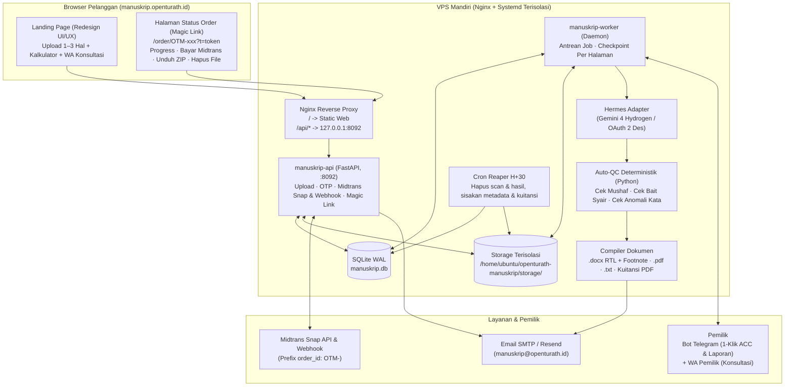
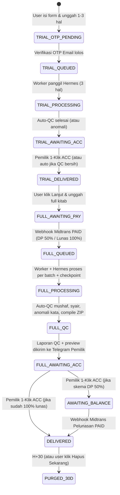

# PLAN — OpenTurath Manuskrip (Redesign UI/UX + Otomasi VPS Hermes + Midtrans)

> **Tanggal Rencana:** 27 November 2026  
> **Target Momentum:** 2 Desember 2026 (Google OAuth resmi untuk Hermes Agent)  
> **Domain Produksi:** `https://manuskrip.openturath.id`  
> **Prinsip Utama:** Pelanggan menikmati pengalaman serba jelas & cepat dari unggah hingga unduh; pemilik cukup memantau dan menekan **1-Klik ACC** sebelum hasil final terkirim.

---

## 1. Keputusan Produk & Teknis yang Sudah Dikunci

| Aspek | Keputusan |
|---|---|
| **Otak AI di VPS** | **Hermes Agent** dengan model **Gemini 4 Hydrogen** (dibangun lewat adapter modular agar pada **2 Desember 2026** tinggal mengaktifkan Google OAuth Hermes tanpa mengubah pipeline). |
| **Kontrol Pemilik** | **Mode 1-Klik ACC** (Hermes mengerjakan 100% proses + Auto-QC, lalu mengirim ringkasan & tombol ACC ke pemilik sebelum hasil final/invoice pelunasan dilepas ke pelanggan). |
| **Kanal Komunikasi** | **Email otomatis** untuk seluruh alur transaksional (OTP trial, tautan status pesanan, hasil sampel 3 halaman, invoice Midtrans, pengiriman ZIP & kuitansi) + **WhatsApp pemilik** untuk konsultasi/pertanyaan langsung. |
| **Pembayaran** | **Midtrans Snap** (QRIS, Virtual Account, Transfer Bank, E-Wallet) menggunakan akun Midtrans yang sudah ada dengan prefix `order_id` terpisah (`OTM-`). |
| **Arsitektur Backend** | **Service terisolasi** di VPS yang sama (`/home/ubuntu/openturath-manuskrip/`, port lokal `127.0.0.1:8092`, SQLite WAL `manuskrip.db`, storage terpisah), di-proxy Nginx di bawah satu domain `manuskrip.openturath.id` (tanpa masalah CORS, tidak mengganggu `maktabah.openturath.id` maupun `openturath-access.service`). |
| **Tarif & Aturan Bisnis** | Cetak `Rp 20/kata` (`Rp 5.000/250 kata`), Tulisan tangan `Rp 30/kata` (`Rp 7.500/250 kata`), Formatting Word standar **gratis**, Paket Lengkap `+ Rp 10/kata` (deskripsi naskah + catatan kaki). Uji coba 3 halaman pertama **gratis** (1×/pengguna). Plafon tagihan akhir **maksimal estimasi + 10%**. Order `≤ 100 hal` bayar 100% di muka; `> 100 hal` DP 50% + pelunasan sisa berdasarkan kata aktual. Retensi file **30 hari** lalu hapus otomatis. |

---

## 2. Arsitektur Sistem Menyeluruh



### Struktur Direktori di VPS
Mengikuti konvensi keamanan `openturath-access` (user `ubuntu`, `secrets/` mode `700`, hardened `systemd`):

```text
/home/ubuntu/openturath-manuskrip/
├── secrets/                          # chmod 700 (TIDAK pernah masuk Git)
│   └── manuskrip.env                 # MIDTRANS_SERVER_KEY, SMTP/RESEND, TELEGRAM_BOT_TOKEN, HERMES_CONFIG
├── releases/
│   └── current/                      # symlink rilis aktif (bisa rollback cepat)
│       ├── api/                      # FastAPI app (upload, status, midtrans, owner callback)
│       ├── worker/                   # daemon antrean, hermes_adapter.py, auto_qc.py, compiler.py
│       ├── web/                      # salinan statis website/manuskrip/ (+ halaman status order)
│       ├── assets/                   # quran_mushaf.json, template_word_rtl.docx, template_kuitansi.html
│       └── cron/reaper_30d.py        # penghapus berkas > 30 hari + backup SQLite harian
├── data/
│   └── manuskrip.db                  # SQLite (WAL mode)
└── storage/
    └── orders/
        └── OTM-20261202-001/
            ├── trial_in/             # maks 3 halaman contoh
            ├── trial_out/            # sampel .docx/.pdf/.txt + analisis.json
            ├── full_in/              # PDF/gambar penuh (dihapus otomatis H+30)
            ├── pages/                # p0001.json .. p0400.json (checkpoint per halaman)
            └── final/                # OTM-20261202-001.zip + kuitansi.pdf
```

### Layanan Systemd & Port
- `openturath-manuskrip-api.service` → `uvicorn` di `127.0.0.1:8092` (hardened: `NoNewPrivileges=true`, `ProtectSystem=strict`, `MemoryMax=512M`).
- `openturath-manuskrip-worker.service` → daemon worker antrean + panggilan Hermes (`MemoryMax=1G`, concurrency terukur agar CPU/RAM VPS tetap lega untuk `openturath-access`).
- `openturath-manuskrip-reaper.timer` → jalan harian pukul `02:00` WIB untuk hapus berkas H+30 & backup `manuskrip.db`.

---

## 3. State Machine Pesanan (*End-to-End Flow*)



### Rincian Pengalaman Pengguna (Tanpa Ribet Login/Password)
1. **Unggah Uji Coba 3 Halaman:** Pengunjung langsung drag-and-drop 1–3 foto (JPG/PNG) atau PDF di website (atau tempel link Google Drive), isi nama, email, nomor WA opsional, jenis naskah, dan perkiraan total halaman.
2. **Verifikasi OTP Email (Anti-Spam):** Kode 6 digit dikirim ke email user (berlaku 10 menit). Begitu dimasukkan, sistem langsung membuka **Halaman Status Order (Magic Link)** bertoken acak (`/order/OTM-...?t=...`).
3. **Hermes Kerjakan Sampel:** Worker memotong keras maksimal 3 halaman, Hermes mentranskripsi + menghitung rata-rata kata per halaman + mengecek keterbacaan → menghasilkan berkas sampel + penawaran resmi + plafon +10%.
4. **1-Klik ACC & Kirim Hasil Sampel:** Anda mendapat ringkasan di Telegram (*jumlah kata, skor QC, cuplikan gambar vs hasil*). Untuk trial yang skor QC-nya bersih bisa disetel **auto-kirim** atau **1-Klik ACC** sesuai saklar runtime Anda.
5. **Lanjut Full Kitab & Bayar Midtrans:** Di halaman status yang sama, pelanggan klik *"Lanjutkan Full Kitab"*, unggah berkas penuh / link Google Drive, pilih apakah tambah *Paket Lengkap*, lalu klik **"Bayar via Midtrans"** (Snap popup langsung di halaman).
6. **Pengerjaan Full Kitab Ber-Checkpoint:** Begitu Midtrans menembak webhook lunas/DP, halaman status menampilkan progres langsung (*"Halaman 148 dari 400 selesai"*). Worker memproses per halaman/batch dengan Hermes, menjalankan Auto-QC, menyusun `.docx`/`.pdf`/`.txt` + Kuitansi PDF, lalu mengirim laporan lengkap ke Telegram Anda.
7. **1-Klik ACC Pemilik → Pelunasan / Unduh:** Anda klik **`[ACC & Lepas Hasil]`** di Telegram. Jika `≤ 100 hal`, link unduh ZIP langsung terbuka dan email terkirim. Jika `> 100 hal` (DP 50%), invoice pelunasan Midtrans (dihitung dari kata aktual, di-cap di `estimasi + 10%`) muncul di halaman status + terkirim via email; begitu lunas, tombol unduh ZIP terbuka seketika.
8. **Hapus Mandiri / Otomatis 30 Hari:** Di halaman status tersedia tombol *"Hapus berkas naskah saya sekarang"*. Jika tidak diklik, cron reaper otomatis menghapusnya 30 hari setelah pengiriman.

---

## 4. Skema Database SQLite (`manuskrip.db`)

| Tabel | Kolom Kunci | Peran |
|---|---|---|
| `orders` | `id` (`OTM-YYYYMMDD-NNN`), `magic_token_hash`, `customer_name`, `customer_email`, `customer_wa`, `script_type` (`printed`/`handwritten`), `include_complete` (bool), `estimated_pages`, `avg_words_per_page`, `actual_word_count`, `estimated_amount_idr`, `cap_amount_idr`, `final_amount_idr`, `status`, `owner_acc_at`, `created_at`, `completed_at`, `purged_at` | Sumber kebenaran seluruh order dari trial hingga purge H+30. |
| `order_pages` | `order_id`, `stage` (`trial`/`full`), `page_no`, `image_path`, `status` (`pending`/`running`/`qc_retry`/`done`/`failed`), `raw_output_path`, `word_count`, `unreadable_marks`, `qc_flags_json`, `retry_count`, `updated_at` | **Checkpoint per halaman** agar pengerjaan kitab tebal bisa resume kapan saja tanpa ulang dari awal. |
| `payments` | `id`, `order_id`, `phase` (`dp_50`/`full_100`/`balance_50`), `midtrans_order_id` (`OTM-...-DP`), `midtrans_tx_id` (**UNIQUE**), `amount_idr`, `status`, `snap_token`, `paid_at`, `raw_webhook_json` | Idempotensi Midtrans mutlak (deduplikasi `midtrans_tx_id`, tolak `amount <= 0`). |
| `trial_guards` | `email_hash`, `ip_hash`, `otp_hash`, `otp_expires_at`, `trial_count`, `last_trial_at` | Anti-abuse uji coba gratis (maks 1× per email, rate limit IP). |
| `owner_actions` | `id`, `order_id`, `telegram_msg_id`, `action` (`acc_trial`/`acc_full`/`hold`/`retry_page`/`reject`), `note`, `acted_at` | Jejak audit seluruh keputusan 1-Klik ACC pemilik. |

---

## 5. Mesin Otomasi Hermes + Auto-QC + Compiler Dokumen

### 5.1 Kontrak `hermes_adapter.py` (Siap Google OAuth 2 Desember)
Supaya tidak terkunci pada satu cara pemanggilan, worker hanya memanggil fungsi standar:
```python
transcribe_page(image_path: Path, options: PageOptions) -> PageResult
```
- **Backend saat ini (sebelum 2 Des):** Memanggil Hermes CLI/RPC dengan konfigurasi **Gemini 4 Hydrogen** yang aktif di VPS.
- **Cutover 2 Desember 2026:** Cukup aktifkan mode OAuth pada profil Hermes di VPS (`HERMES_AUTH_MODE=google_oauth`) tanpa mengubah satu baris pun di API, worker, database, maupun frontend.
- **Kaidah Prompt Khusus Manuskrip (di-bundle sebagai Skill Hermes):**
  1. Dilarang mengubah ejaan/kata naskah asli (antisipasi kasus `تستسهلون` → `تتساهلون` pada `UJI_AWAL_TEMUAN.md`).
  2. Dilarang menghapus kata pada baris syair dua *syatr* (antisipasi 3 temuan kata hilang di syair).
  3. Wajib menandai bagian buram/rusak dengan `[غير مقروء]` alih-alih menebak.
  4. Keluaran terstruktur JSON per halaman: `{ paragraphs, verses: [[sadr, ajuz]], quran_refs, footnotes, margin_notes, page_anomalies, unreadable_count }`.

### 5.2 Auto-QC Deterministik (Python, Biaya Token Rp 0)
Berjalan otomatis tepat setelah setiap halaman/kitab selesai dari Hermes:
1. **Verifikasi Ayat Al-Qur'an:** Cocokkan otomatis setiap kutipan ayat terhadap `quran_mushaf.json` lokal di VPS → pastikan rasm/harakat serta nama surat & nomor ayat 100% akurat.
2. **Validasi Bait Syair:** Pastikan setiap item `verses` memiliki pasangan `[sadr, ajuz]` utuh; jika kosong/terpotong, tandai `qc_retry` dan minta Hermes membaca ulang crop baris tersebut.
3. **Deteksi Anomali Halaman:** Bandingkan kepadatan piksel tinta pada gambar dengan jumlah kata yang keluar (jika halaman penuh tinta tetapi hasil < 25 kata → otomatis *retry* maksimal 2×; jika masih gagal → flag ke Telegram pemilik).
4. **Hitung Kata Transparan:** Hitung kata Arab murni setelah menghapus harakat (*tashkil*), penanda `[غير مقروء]`, nomor halaman, dan header/footer berulang—sehingga cocok 100% saat pelanggan mengecek pakai *Word Count* di Microsoft Word.

### 5.3 Compiler Dokumen Otomatis
- **Word (`.docx`):** Dibangun dengan `python-docx` memakai template RTL resmi OpenTurath (font *Scheherazade New*, paragraf `bidi`, tabel 2 kolom tanpa garis untuk syair dua *syatr*, heading bersih, dan *native Word footnotes* untuk Paket Lengkap).
- **PDF (`.pdf`):** Konversi otomatis `.docx → .pdf` via LibreOffice *headless* (memastikan hasil PDF identik 100% dengan dokumen Word).
- **Teks Polos (`.txt`):** UTF-8 bersih untuk pencarian/pengolahan lanjutan.
- **Kuitansi Resmi (`kuitansi.pdf`):** Dibuat otomatis dengan nomor invoice `OTM-...`, rincian jumlah kata aktual, tarif, diskon/plafon +10% (jika berlaku), status lunas, dan stempel digital OpenTurath (siap untuk laporan pertanggungjawaban hibah).

---

## 6. Rombakan UI/UX Website (`website/manuskrip/`)

Rombakan desain sekaligus mengintegrasikan alur upload & status order, tetap setia pada DNA **Monochrome Editorial OpenTurath** (palet kertas netral `#FAFAFA / #F4F4F5 / #111113`, tanpa warna norak, tanpa *AI slop*):

| Area | Kondisi Lama (Audit UI/UX) | Rombakan Baru |
|---|---|---|
| **Header** | Tanpa logo mark; link menumpuk kiri; ruang kosong lebar di tengah. | Logo mark OpenTurath + `Manuskrip` di kiri, 4 link navigasi terpusat rapi di tengah, tombol CTA + tautan cepat *"Lacak pesanan"* di kanan. |
| **Hero** | Paragraf 5 baris padat; coretan gelombang sinusoidal; tanpa visual manuskrip di atas lipatan; tombol `"Jeda latar"` mengganggu. | Komposisi editorial bernyawa: logo mark, judul tajam 2 baris, subjudul ringkas (≤ 22 kata), 2 CTA + 3 penanda bukti singkat, **animasi masuk bertahap cepat & elegan** (choreography per elemen, bukan menunggu 300 huruf diketik), serta latar kisi/lembaran kitab monokrom super tenang (tanpa loop agresif yang butuh tombol jeda mencolok). |
| **Demo Slider (`#demo`)** | Lebar 530px di tengah dengan 900px ruang kosong, terpotong di bawah lipatan, baris kiri-kanan tidak sejajar. | **Split 2-Kolom Muat 1 Viewport:** Kiri berisi penjelasan + **tombol sorot fitur interaktif** (*Ayat berharakat*, *Syair 2 syatr*, *Catatan kaki*) yang langsung menyorot bagian terkait di teks Arab; kanan panggung slider yang presisi & sejajar baris. |
| **Isi Hasil (`#hasil`)** | 4 kartu teks abu-abu polos tanpa contoh visual. | **4 Kartu Spesimen Nyata** dalam grid editorial variatif: tiap kartu menampilkan cuplikan asli (ayat berharakat RTL, 1 bait 2 syatr sejajar, cuplikan catatan kaki, dan contoh laporan duplikasi halaman). |
| **Bukti Terukur (`#bukti`)** | 1 layar penuh berisi 4 kartu kosong *"MENUNGGU UJI"*. | Dipadatkan menjadi **1 panel metodologi ringkas & jujur** (transparan tentang rencana uji 45 halaman oleh 2 pemeriksa mandiri, tidak lagi menyita 1 layar penuh dengan 4 kartu kosong). |
| **Harga & Kalkulator (`#harga`)** | 4+ layar penuh; matriks 14 baris melelahkan; input kalkulator melar 600px; kartu harga datar. | **Ringkas & Taktil:** Tabel perbandingan pasar tetap bersih; matriks dipadatkan ke **7 pembeda kunci**; kartu paket menonjolkan *Tulisan tangan* sebagai layanan utama dan *Paket Lengkap* sebagai add-on jelas; **Kalkulator 2-kolom modern** (kiri: preset cepat `50 / 200 / 400 hal` + input ringkas + toggle paket; kanan: kartu gelap *inverse* menampilkan total real-time + plafon +10% + tombol langsung ke form). |
| **Batas Layanan, Privasi & FAQ** | 3 seksi 2-kolom berurutan yang kering + FAQ rata kiri menyisakan 500px ruang kosong. | Gabungkan *Lembaga, Batas Layanan & Privasi* (termasuk komitmen *Zero AI Training* & hapus otomatis 30 hari) secara ringkas; **FAQ 2-kolom** (judul *sticky* kiri, akordeon bersih kanan). |
| **Form Pesan (`#pesan`)** | Hanya `mailto:` tanpa upload file. | **Dropzone Upload 1–3 Halaman Langsung** (JPG/PNG/PDF max 15MB atau link Google Drive) + verifikasi OTP email otomatis + **tombol konsultasi langsung ke WhatsApp Pemilik** bagi yang ingin tanya dulu sebelum unggah. |
| **Halaman Baru: Status Order** | Belum ada. | `/order.html` (*Magic Link*): menampilkan status tahap demi tahap, progres halaman real-time, pratinjau hasil 3 halaman, tombol **Bayar Midtrans Snap**, tombol **Unduh ZIP + Kuitansi**, dan tombol **Hapus berkas saya sekarang**. |

---

## 7. Integrasi Midtrans, Email, WA Pemilik & 1-Klik ACC

1. **Midtrans (Reuse Akun Eksisting):**
   - Gunakan `MIDTRANS_SERVER_KEY` & `MIDTRANS_CLIENT_KEY` produksi yang sudah aktif.
   - Setiap transaksi Manuskrip memakai `order_id` berawalan `OTM-` dan header `X-Override-Notification: https://manuskrip.openturath.id/api/midtrans-webhook` (sehingga 100% terpisah dari webhook langganan OpenTurath AI).
   - Verifikasi `signature_key` (SHA-512), cek `gross_amount > 0`, dan simpan `midtrans_tx_id` sebagai `UNIQUE` agar mustahil terjadi aktivasi/penagihan ganda.
2. **Email Otomatis (`manuskrip@openturath.id`):**
   - Via SMTP / Resend API untuk 5 template bersih (monokrom, tanpa spam): (1) Kode OTP 6 digit, (2) Tautan status order, (3) Hasil uji coba 3 halaman + estimasi biaya, (4) Konfirmasi pembayaran & invoice pelunasan, (5) Paket hasil final + kuitansi PDF.
3. **WhatsApp Pemilik:**
   - Tautan `wa.me/<NOMOR_WA_PEMILIK>` dengan pesan pra-isi kontekstual (*"Assalamu'alaikum, saya ingin konsultasi naskah untuk OpenTurath Manuskrip..."* atau menyertakan `Order ID` jika sudah punya order) untuk konsultasi/bantuan langsung.
4. **1-Klik ACC Pemilik (Telegram Owner Bot):**
   - Setiap kali Hermes selesai mengerjakan order (baik trial maupun full kitab), bot mengirim 1 pesan ringkas ke Telegram pribadi Anda:
     - Nomor order, nama/email pelanggan, jumlah halaman, jumlah kata aktual, status pembayaran, ringkasan Auto-QC (`unreadable_count`, `quran_verified`, `qc_flags`), serta tautan pratinjau/unduh file hasil untuk Anda intip bila perlu.
     - Tombol inline: **`[ACC & Kirim ke Pelanggan]`** · **`[Ulangi Halaman Bermasalah]`** · **`[Tahan / Hubungi WA]`**.

---

## 8. Roadmap Eksekusi (Menyambut 2 Desember 2026)

### Fase 1 — Rombakan UI/UX Frontend + Halaman Status (Target: 28–29 Nov 2026)
- [ ] Rombak total `website/manuskrip/` (Hero, Demo Split 2-Kolom interaktif, Spesimen Isi Hasil, Bukti ringkas, Harga & Kalkulator 2-Kolom dengan preset, FAQ 2-Kolom, Dropzone upload 1–3 halaman + tombol WA Konsultasi).
- [ ] Bangun halaman status pesanan (`order.html`) dengan tampilan progress, Midtrans Snap, unduh ZIP, dan tombol hapus berkas.
- [ ] Verifikasi Playwright lintas viewport (`320px–1440px`), aksesibilitas WCAG 2.2, kontras, dan animasi bertahap yang mulus.

### Fase 2 — Backend API + SQLite + Midtrans + Email + Owner Bot (Target: 30 Nov–1 Des 2026)
- [ ] Buat layanan `ecosystem/openturath_manuskrip/` (FastAPI + SQLite WAL + upload validator + OTP email + Midtrans Snap & webhook idempoten + endpoint callback Telegram 1-Klik ACC).
- [ ] Bangun `compiler.py` (`.docx` RTL + native footnotes + `.pdf` LibreOffice + `.txt` + Kuitansi PDF) dan `auto_qc.py` (verifikasi mushaf lokal + cek syair/anomali).
- [ ] Tulis unit test untuk kalkulasi tarif/plafon +10%, idempotensi webhook Midtrans, pemotongan keras 3 halaman trial, dan state machine order.

### Fase 3 — Integrasi Hermes OAuth & Uji End-to-End di VPS (Target: 2–3 Des 2026)
- [ ] Aktifkan **Google OAuth pada Hermes Agent (Gemini 4 Hydrogen)** di VPS pada 2 Desember 2026 dan sambungkan `hermes_adapter.py`.
- [ ] Pasang systemd services (`api`, `worker`, `reaper.timer`) + konfigurasi Nginx & SSL Cloudflare untuk `manuskrip.openturath.id` (memperbaiki HTTP 525).
- [ ] Uji *end-to-end* dengan 1 kitab uji penuh: unggah trial → OTP → Hermes proses → 1-Klik ACC → checkout Midtrans → batch full kitab → Auto-QC → 1-Klik ACC → pelunasan → unduh ZIP & Kuitansi.

### Fase 4 — Hardening & Soft Launch (Target: 4 Des 2026+)
- [ ] Verifikasi `reaper_30d.py` (uji dry-run + penghapusan mandiri user).
- [ ] Jalankan uji akurasi formal 45 halaman oleh 2 pemeriksa mandiri dan perbarui angka pada seksi Bukti Terukur.
- [ ] Sinkronkan tautan dari `openturath.id/*/ai-manuskrip` ke `https://manuskrip.openturath.id/`.

---

## 9. Hal yang Perlu Disiapkan Pemilik Sebelum Fase 2–3
1. **Nomor WhatsApp resmi** yang ingin dipasang pada tombol konsultasi di website.
2. **Akses/konfigurasi Email pengirim** (`manuskrip@openturath.id` atau `support@openturath.id`, via SMTP/Resend).
3. **Konfirmasi akun Midtrans** (pakai kredensial produksi yang sudah ada di VPS).
4. **Konfirmasi akses Telegram Bot** (pakai token `openturath-owner-bot` yang sudah ada atau buat 1 bot khusus Manuskrip agar chat order tidak bercampur dengan notifikasi langganan aplikasi).
